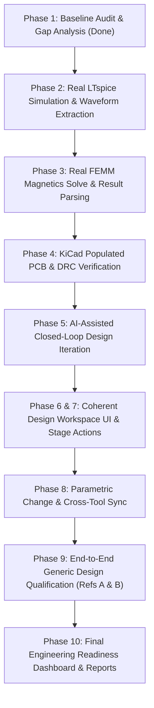

# MENDEX ENGINEERING STUDIO v2.0
## IMPLEMENTATION & QUALIFICATION PLAN

**Plan Date**: 11 November 2026  
**Target Version**: v2.0 — Real Engineering Workflow Qualification & Design Automation

---

## 1. Execution Phases & Milestones

---

## 2. Technical Deliverables Specification

1. **LTspice Simulation Engine (`src/mendex_core/design/ltspice_runner.py`)**:
   - Executes `LTspice.exe -b <file.net>` in process-isolated workspace.
   - Ingests generated `.raw` file via `numpy` parser.
   - Calculates real metrics: $V_{out,\text{mean}}$, $\Delta V_{out}$ (peak-to-peak ripple), $I_{pk}$, efficiency $\eta$.
   - Generates both `.net` netlist and graphical `.asc` schematic file.
2. **FEMM Magnetic FEA Engine (`src/mendex_core/design/femm_runner.py`)**:
   - Executes `C:\femm42\bin\femm.exe -windowhide -lua=<script.lua>`.
   - Parses output file (`.ans` / log) extracting maximum magnetic flux density $B_{\max}$ and inductance $L$.
3. **Populated KiCad PCB Generator (`src/mendex_core/design/generators/kicad_pcb_generator.py`)**:
   - Generates `.kicad_pcb` with standard board outline (`Edge.Cuts`), mounting holes, placed footprints, and net connections.
   - Ready for manual trace completion or DRC verification via `kicad-cli pcb drc`.
4. **AI Iteration Orchestrator (`src/mendex_core/design/iteration.py`)**:
   - Compares simulation metrics against requirements.
   - If requirement failed (e.g. ripple > 1%), formulates parameter adjustment recommendation.
   - Dispatches approved change $\to$ creates new revision $\to$ re-runs solver $\to$ generates before/after comparison table.
5. **End-to-End Acceptance Suites**:
   - `Reference A`: Circuit design, simulation, parameter change, re-simulation, and report.
   - `Reference B`: CAD, magnetics, KiCad schematic ERC, populated PCB DRC, and BOM export.
