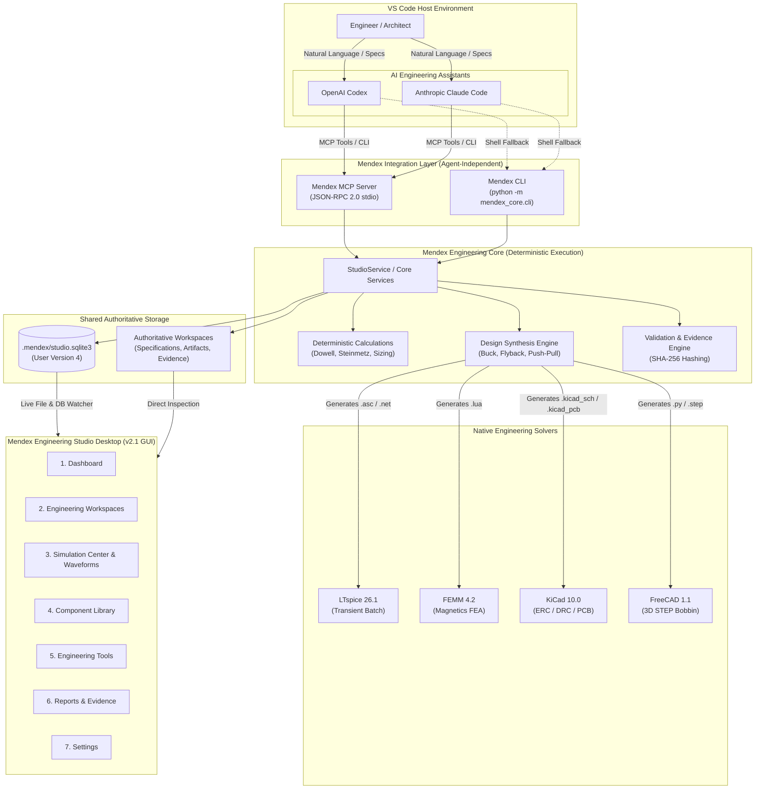

# Mendex Engineering Studio v2.1 — Comprehensive System Audit & Module Removal Matrix

**Audit Date:** 2026-11-11  
**Lead Auditor:** Google Antigravity (Implementation Agent)  
**Target Release:** Mendex Engineering Studio v2.1  
**Architecture Transition:** Hybrid Engineering Workspace (VS Code + Codex / Claude Code $\to$ Mendex CLI / MCP $\to$ Mendex Engineering Core $\to$ Specialized EDA/CAD Tools $\to$ Mendex Studio Command Center)  
**Baseline Test Verification:** **206 passed, 2 skipped in 224.50s** (100% green, 0 failures).

---

## 1. Executive Summary & Strategic Pivot

Mendex Engineering Studio has accumulated significant capabilities across engineering design synthesis, numerical multiphysics solvers (LTspice, FEMM, FreeCAD, KiCad), lifecycle stage qualification, visual node graph workflows, and in-app conversational AI assistants.

However, housing full AI chat interfaces, drag-and-drop workflow canvases, and custom circuit editors directly inside the desktop GUI has created:
1. **Architectural Duplication:** Duplicate design wizards, overlapping workspace selectors, and multiple parallel panels displaying the same engineering data.
2. **Cognitive Overload:** 16 separate navigation sidebar tabs competing for developer attention.
3. **Misaligned Modality:** Interactive code generation, natural language orchestration, and rapid design prompts are vastly superior when hosted in dedicated developer environments (**VS Code with OpenAI Codex and Anthropic Claude Code**), while the desktop GUI is best suited as a **specialized engineering management, visualization, monitoring, and validation command center**.

### The v2.1 Architectural Contract
- **VS Code + Codex / Claude Code:** Primary environment for natural language instructions, specification authoring, automated design requests, and orchestration.
- **Mendex Integration Layer (CLI & MCP Server):** Standardized, agent-independent Model Context Protocol (MCP) server (JSON-RPC 2.0 stdio) and robust CLI interface exposing all core capabilities.
- **Mendex Engineering Core:** Authoritative layer for deterministic calculations, component databases, design synthesis, artifact generation, simulation dispatch, and verification.
- **External Engineering Applications (LTspice, FEMM, KiCad, FreeCAD):** Specialized execution engines for circuit simulation, magnetics FEA, 3D solids, and PCB layout/DRC.
- **Mendex Engineering Studio:** Lean, professional 7-item navigation dashboard for workspace management, simulation monitoring, waveform inspection, design rule verification, and formal reporting.

---

## 2. In-Depth Audit of the 23 Subsystems

### 1. PySide6 Desktop Application (`src/mendex_ui/`)
- **Status:** **REFACTOR & SIMPLIFY**
- **Current State:** `StudioWindow` hosts 16 navigation tabs, legacy dashboard widgets, multiple overlapping dialogs (`ProductDialog`, `NewEngineeringDesignDialog`), AI chat sidebars, and workflow canvases.
- **Target v2.1 State:** Streamlined into 7 primary navigation destinations:
  1. `Dashboard` (High-level operational health, tool readiness, active workspaces)
  2. `Engineering Workspaces` (Unified workspace & product browser with Overview, Specs, Designs, Calculations, Simulations, Files, Validation, Revisions, Reports)
  3. `Simulation Center` (Unified monitoring, queue, raw logs, interactive waveform viewer)
  4. `Component Library` (Semiconductor ratings, core geometries, SwitchLossDB, MagNet)
  5. `Engineering Tools` (Host tool discovery, versioning, diagnostics, and launch controls)
  6. `Reports & Evidence` (Immutable engineering dossiers, validation audit trails, manifests)
  7. `Settings` (Tool executable paths, workspace locations, CLI/MCP status, theme)

### 2. Engineering Workspace Management (`src/mendex_core/service.py`, `integration_service.py`)
- **Status:** **REUSE & UNIFY**
- **Current State:** Two workspace concepts existed: Revision-relative folders (`.mendex/workspaces/<prod_id>/<rev_id>/`) and Generic Integration Workspaces (`workspaces/<ws_id>/`).
- **Target v2.1 State:** Unify workspace resolution under `StudioService` so both CLI/MCP and Studio access identical directories, design revisions, and evidence stores.

### 3. StudioService & Core Services (`src/mendex_core/`)
- **Status:** **KEEP & REUSE (AUTHORITATIVE)**
- **Current State:** `StudioService` provides clean transactional SQLite access, product/revision baselines, append-only validations, and report generation. `EngineeringDesignService` coordinates IR, parametric models, and native CAD generators.
- **Target v2.1 State:** Expose all `StudioService` and `EngineeringDesignService` capabilities directly through the CLI and MCP server without duplicating logic.

### 4. SQLite Database & Persistence (`.mendex/studio.sqlite3`)
- **Status:** **KEEP (NO DESTRUCTIVE SCHEMA CHANGES)**
- **Current State:** User version 4 with 17 tables (`products`, `revisions`, `tool_settings`, `validations`, `reports`, `runs`, `integration_settings`, `integration_health`, `integration_workspaces`, `integration_jobs`, `integration_datasets`, `activities`, `workflows`, `workflow_runs`, `lifecycle_approvals`, `engineering_change_requests`, `measurements`).
- **Target v2.1 State:** Maintain existing schema integrity. Workflows table remains dormant; no existing data is deleted. Local offline persistence is fully preserved.

### 5. Engineering Specification Management (`src/mendex_core/models.py`)
- **Status:** **KEEP & REUSE**
- **Current State:** Strongly-typed Pydantic SI model `Specification` ($V_{\text{in}}$, $V_{\text{out}}$, $I_{\text{out}}$, $f_{\text{sw}}$, isolation, standards profile, assumptions) with cryptographic SHA-256 frozen hashing.
- **Target v2.1 State:** Unchanged. CLI and MCP tools expose JSON schema validation against this canonical model.

### 6. Engineering Calculations (`src/integrations/calculations/`, `src/mendex_core/intelligence/calculations.py`)
- **Status:** **KEEP & REUSE**
- **Current State:** Pure deterministic analytical calculations:
  - Dowell AC winding loss ratio ($F_R = R_{\text{ac}}/R_{\text{dc}}$)
  - Area-product ($A_p$) transformer core sizing and turns calculations
  - Semiconductor conduction & switching loss models
  - Steinmetz core loss ($P_v = k \cdot f^\alpha \cdot B^\beta$)
- **Target v2.1 State:** Kept completely intact and exposed via `mendex calculation run` and MCP tool `run_engineering_calculations`.

### 7. Design Synthesis (`src/mendex_core/design/synthesis.py`, `parametric.py`)
- **Status:** **KEEP & REUSE**
- **Current State:** `CandidateSynthesisEngine` generates valid candidates (Buck, Flyback, Push-Pull) with component sizing and IR snapshots.
- **Target v2.1 State:** Fully exposed to Codex/Claude via CLI and MCP (`mendex design generate`).

### 8. Component Libraries (`src/mendex_core/components/`, `SwitchLossDB`, `MagNet`)
- **Status:** **KEEP & REUSE**
- **Current State:** Component database service with discrete models, plus research datasets (SwitchLossDB CSV fixture and MagNet loss curve fixtures).
- **Target v2.1 State:** Retained in Core and rendered in the consolidated **Component Library** Studio tab.

### 9. Circuit Generation (`src/mendex_core/design/generators/`)
- **Status:** **KEEP & REUSE**
- **Current State:** Native generators for LTspice (`.net`, `.asc`), KiCad (`.kicad_sch`, `.kicad_pro`, `.kicad_pcb`), FEMM (`.lua`), and FreeCAD (`.step`). Fully sanitized against Windows filesystem Errno 22.
- **Target v2.1 State:** Core artifact generator engine unchanged.

### 10. LTspice Integration (`src/integrations/adapters/ltspice.py`, `src/mendex_core/design/ltspice_runner.py`)
- **Status:** **KEEP & REUSE (VERIFIED OPERATIONAL)**
- **Current State:** Verified installation (LTspice 26.1.1.0 at `C:\Program Files\ADI\LTspice\LTspice.exe`). Batch CLI execution (`-b -ascii`), log parsing, and raw waveform parsing working with exit code 0.
- **Target v2.1 State:** Primary simulation engine invoked via CLI/MCP and Studio.

### 11. FEMM Integration (`src/integrations/adapters/femm.py`, `src/mendex_core/design/femm_runner.py`)
- **Status:** **KEEP & REUSE (VERIFIED OPERATIONAL)**
- **Current State:** Installed at `C:\Program Files\femm42\bin\femm.exe`. Filelink IPC protocol `create(0)` executes automated finite-element mesh and solve.
- **Target v2.1 State:** Expose via CLI/MCP `mendex simulation run --tool femm`.

### 12. KiCad Integration (`src/mendex_core/lifecycle/kicad_service.py`, `src/mendex_core/pcb.py`)
- **Status:** **KEEP & REUSE (VERIFIED OPERATIONAL)**
- **Current State:** Installed KiCad 10.0 CLI at `C:\Program Files\KiCad\10.0\bin\kicad-cli.exe`. Real ERC and DRC checks execute and parse violations into structured JSON reports.
- **Target v2.1 State:** Retained in Core and accessible via Studio PCB/Validation views.

### 13. Simulation Execution Engine (`src/integrations/runners/safe_runner.py`)
- **Status:** **KEEP & REUSE**
- **Current State:** Sandboxed process runner with `shell=False`, argument list validation, process-tree termination, isolated directories, and timeout enforcement.
- **Target v2.1 State:** Kept as authoritative runner for all external tool executions.

### 14. Simulation Result Extraction (`src/integrations/parsers/`)
- **Status:** **KEEP & REUSE**
- **Current State:** Robust parsers for LTspice ASCII/binary `.raw` files, solver logs, FEMM magnetic outputs, and KiCad rule reports.
- **Target v2.1 State:** Retained in Core.

### 15. Waveform Visualization (`src/mendex_ui/waveform_viewer.py`)
- **Status:** **KEEP & REUSE IN SIMULATION CENTER**
- **Current State:** Native PySide6 `WaveformViewerWidget` with zooming, panning, multi-trace overlays, and cursor measurements.
- **Target v2.1 State:** Embedded into the unified **Simulation Center** in Studio.

### 16. Engineering Validation & Evidence (`src/mendex_core/evidence.py`, `rules.py`)
- **Status:** **KEEP & REUSE**
- **Current State:** Append-only validation records, criteria verification, cryptographic evidence hashing, and strict `NOT_EVALUATED` states for unverified checks.
- **Target v2.1 State:** Unchanged.

### 17. Revision Management (`src/mendex_core/service.py`, `src/mendex_core/design/iteration.py`)
- **Status:** **KEEP & REUSE**
- **Current State:** Immutable baseline freezing, revision branching, parametric delta tracking, and `DesignIterationEngine` analytical tuning.
- **Target v2.1 State:** Expose via `mendex revision list/create/compare` and MCP tools.

### 18. Engineering Workflow Builder (`src/mendex_core/workflows/`, `src/mendex_ui/workflow_canvas/`)
- **Status:** **REMOVE FROM PRIMARY UI & DEPRECATE**
- **Current State:** 25+ files implementing a visual node graph canvas, connection ports, palette, and DAG runner.
- **Reason for Removal:** Drag-and-drop workflow graphs duplicate natural-language pipeline orchestration in VS Code + Codex/Claude. They introduce massive GUI complexity while power engineers prefer scripted/agentic flows.
- **Action:** Remove from primary sidebar navigation and window initialization. Preserve underlying calculation nodes for reuse by Core services.

### 19. Built-in AI Copilot & Conversational UI (`src/mendex_ui/ai_interactive.py`, `ai_config_dialog.py`, `src/mendex_core/ai/`)
- **Status:** **REMOVE FROM PRIMARY UI & ARCHIVE**
- **Current State:** In-app chat browser, formula formatting, sandbox widgets, API key dialogs, and AI gateway calls.
- **Reason for Removal:** VS Code with Codex / Claude Code is the designated interactive AI environment. Having an embedded chat window inside the desktop Studio duplicates VS Code and clutters the UI.
- **Action:** Remove AI chat panel and key setup dialog from Studio navigation. The desktop app becomes a pure, high-performance engineering command center.

### 20. Existing AI Provider Integrations (`src/mendex_core/intelligence/models.py`)
- **Status:** **REFACTOR & ISOLATE**
- **Current State:** `OpenAIBackend` and `GeminiBackend` classes calling external REST APIs.
- **Action:** Ensure Mendex Core has **zero runtime dependencies on OpenAI, Anthropic, or Gemini SDKs**. All AI intelligence operates externally via the standardized MCP protocol and CLI.

### 21. Engineering Reporting (`src/mendex_core/service.py`, `integration_service.py`)
- **Status:** **KEEP & REUSE**
- **Current State:** Generates draft HTML + JSON engineering dossiers with rule assessments, tool versions, and evidence hashes.
- **Target v2.1 State:** Consolidated into the **Reports & Evidence** tab and exposed via CLI (`mendex report generate`).

### 22. Engineering Lifecycle Engine (`src/mendex_core/lifecycle/engine.py`, `product_lifecycle_panel.py`)
- **Status:** **KEEP & REFACTOR**
- **Current State:** 12-stage lifecycle qualification engine with readiness gates.
- **Target v2.1 State:** Embedded cleanly into the `Engineering Workspaces` hub.

### 23. Existing Automated Tests (`tests/`)
- **Status:** **KEEP & EXPAND**
- **Current State:** 208 automated tests across core, adapters, UI, and integration.
- **Target v2.1 State:** Update UI tests to validate the simplified 7-item navigation; add comprehensive CLI and MCP protocol tests for both Codex and Claude Code.

---

## 3. Detailed Module Removal & Action Matrix

| Module / Component | Existing Purpose | Dependencies | Classification | Risk Level | Mitigation & Migration Strategy |
| :--- | :--- | :--- | :--- | :--- | :--- |
| `src/mendex_ui/workflow_canvas/` | Drag-and-drop node graph canvas & graphics items | `PySide6.QtWidgets`, `mendex_core.workflows` | **REMOVE FROM PRIMARY UI** | Low | Remove from Studio pages; preserve calculation node logic in Core. |
| `src/mendex_ui/workflow_studio_panel.py` | Visual workflow studio panel | `workflow_canvas`, `mendex_core.workflows` | **REMOVE FROM PRIMARY UI** | Low | Remove navigation entry; user orchestrates via Codex/Claude or CLI. |
| `src/mendex_core/workflows/` | Visual node execution engine & storage | `SQLite`, `pydantic` | **DEFER / REFACTOR** | Very Low | Keep pure calculation nodes; decouple from GUI canvas. |
| `src/mendex_ui/ai_interactive.py` | In-app conversational AI formatting & chat widgets | `PySide6`, `openai` | **REMOVE FROM PRIMARY UI** | Low | Discontinue in-app chat UI; engineers interact via VS Code + Codex/Claude. |
| `src/mendex_ui/ai_config_dialog.py` | Dialog for OpenAI/Gemini API keys | `PySide6`, `.mendex/ai_config.json` | **REMOVE FROM PRIMARY UI** | Low | Keys are configured in VS Code environment, not in Studio. |
| `src/mendex_core/ai/` | AICopilotGateway & in-app chat models | `requests`, `openai` | **REFACTOR / DEFER** | Low | Decouple from core services; Core does not require LLM APIs to function. |
| `src/mendex_ui/v17_panels.py::AIAssistantPanel` | Conversational AI sidebar panel | `ai_interactive`, `v17_panels` | **REMOVE FROM PRIMARY UI** | Low | Remove tab from Studio; free up navigation and CPU resources. |
| `src/mendex_ui/workspace_panels.py` | 3 separate panels for Transformer, DCDC, Semiconductor | `PySide6`, `StudioService` | **REFACTOR & CONSOLIDATE** | Low | Consolidate domain calculations into **Component Library** & **Workspaces**. |
| `src/mendex_ui/pcb_panel.py` | Dedicated PCB Workspace panel | `PySide6`, `pcb.py` | **CONSOLIDATE** | Low | Merge native KiCad launching and ERC/DRC into **Engineering Workspaces**. |
| `src/mendex_ui/design_studio_panel.py` | Duplicate Design Studio page with duplicate candidate synthesis | `WaveformViewer`, `service.design` | **CONSOLIDATE** | Medium | Retain deterministic synthesis in Core; embed design viewing in Workspaces. |
| `src/mendex_core/design/synthesis.py` | Topologies & analytical sizing engine | `numpy`, `pydantic` | **KEEP (CORE)** | High | Authoritative design engine; exposed to CLI/MCP. |
| `src/mendex_core/design/ltspice_runner.py` | Real headless LTspice runner | `LTspice.exe`, `subprocess` | **KEEP (CORE)** | High | Authoritative circuit simulator; verified operational. |
| `src/mendex_core/design/femm_runner.py` | Real headless FEMM runner | `femm.exe`, filelink IPC | **KEEP (CORE)** | High | Authoritative magnetics FEA solver; verified operational. |
| `src/mendex_core/lifecycle/kicad_service.py` | Real KiCad ERC/DRC CLI runner | `kicad-cli.exe` | **KEEP (CORE)** | High | Authoritative PCB design rule engine; verified operational. |
| `src/mendex_ui/waveform_viewer.py` | Interactive graphical waveform viewer | `PySide6.QtGui.QPainter` | **KEEP (REUSE)** | Medium | Integrated directly into the **Simulation Center**. |
| `src/mendex_core/service.py` | Core SQLite products, revisions, evidence | `sqlite3`, `pydantic` | **KEEP (CORE)** | Critical | Authoritative database and lifecycle service. |
| `src/mendex_core/cli.py` | Command line interface | `sys`, `argparse` | **REFACTOR & EXPAND** | Low | Upgrade to comprehensive, agent-friendly CLI (`json` output, error handling). |
| `src/mendex_core/mcp/` | Model Context Protocol server (v2.1) | MCP SDK / JSON-RPC 2.0 | **NEW IMPLEMENTATION** | Medium | Expose typed tools for both OpenAI Codex and Anthropic Claude Code. |

---

## 4. Target Clean Navigation Structure (7 Primary Items)

```
MENDEX ENGINEERING STUDIO v2.1
│
├── 📊 Dashboard                  (High-level ecosystem health, tool status, active workspaces)
│
├── 📁 Engineering Workspaces     (Central hub for all product designs and revisions)
│     ├── Overview                (Status, progress, engineering objectives, team)
│     ├── Specifications          (SI limits, operating corners, standards profile)
│     ├── Designs                 (Synthesized topologies, candidates, sizing formulas)
│     ├── Calculations            (Dowell factor, Steinmetz loss, power dissipation)
│     ├── Simulations             (Batch runs, raw data, logs, convergence)
│     ├── Engineering Files       (Browse native .kicad_sch, .kicad_pcb, .asc, .step)
│     ├── Validation              (Append-only verification records, rule assessments)
│     ├── Revisions               (Baseline comparison, ECR, parametric deltas)
│     └── Reports                 (Immutable HTML/JSON dossiers with SHA-256 evidence)
│
├── ⚡ Simulation Center           (Dedicated simulation queue, runner status & waveform viewer)
│
├── 📚 Component Library          (Semiconductors, magnetics, SwitchLossDB, MagNet datasets)
│
├── 🛠️ Engineering Tools          (Host tool discovery: LTspice, FEMM, KiCad, FreeCAD, health)
│
├── 📄 Reports & Evidence         (Central audit register, validation summary, dossiers)
│
└── ⚙️ Settings                   (Tool binary paths, workspace directory, CLI/MCP status, theme)
```

---

## 5. Architectural Integration Contract: VS Code + Codex & Claude Code



---

## 6. Migration & Safe Rollback Plan

1. **Zero Data Destruction:** No database tables will be dropped. Workspaces, products, revisions, and simulation evidence remain 100% intact.
2. **Git Baseline Checkpoint:** We will create a clean checkpoint commit (`v2.0-pre-v21-cleanup`) on the current branch so any modification can be reverted instantly with `git restore` or `git checkout`.
3. **Core Independence:** `mendex_core` will be decoupled from GUI and external AI provider packages.
4. **Step-by-Step Verification:** Tests will be run at each phase milestone to guarantee 100% test pass rate throughout migration.
