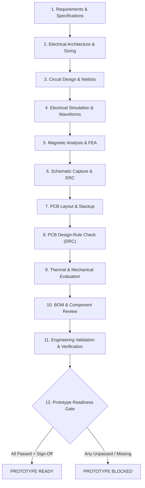

# Mendex Engineering Studio — Product Engineering Lifecycle Architecture

**Document Version:** 1.0  
**Date:** 2026-11-11  
**Author:** Principal Engineering Platform Architect & Enterprise Systems Lead  
**Scope:** Architecture and specification of the unified Product Engineering Lifecycle & Verification Framework.

---

## 1. Architectural Philosophy & Core Principles

1. **Strict Evidence Traceability:** No engineering stage is marked `PASSED` solely because a file exists or an application was launched. Every claim of completion requires an explicit, verified artifact, SHA-256 hash, and formal reviewer sign-off.
2. **Separation of Concerns:** 
   - A solver exit code 0 (`SUCCEEDED`) indicates process execution success.
   - Engineering validation (`PASSED`) requires evaluation against quantitative acceptance thresholds (e.g., ripple $< 1.10\,\text{mV}$, $B_{\text{peak}} \le 0.28\,\text{T}$, $0$ ERC/DRC violations).
3. **Product-Independent Foundation Preserved:** Engineering workspaces, standalone Simulation Lab, and Visual Workflow Studio v1.9 operate independently. Products remain optional associations, not mandatory prerequisites for engineering work.
4. **Deterministic Gate Evaluation:** Prototype fabrication authorization is governed by 12 configurable readiness gates. If any mandatory gate is missing, failed, or unverified, prototype readiness is strictly `BLOCKED`.

---

## 2. The 12 Product Lifecycle Stages

The lifecycle engine models the complete development progression of a power electronics product:



### Stage Definitions & Acceptance Criteria

| Stage # | Stage Name | Mandatory | Required Evidence | Verification Criteria |
|---|---|---|---|---|
| **1** | **Requirements & Specifications** | Yes | Reviewed SI requirements specification, standards profile, and isolation requirements | Complete SI parameter fields, standards profile, explicit reviewer approval |
| **2** | **Electrical Architecture & Sizing** | Yes | Analytical sizing calculations for resonant tank, transformer turns, and semiconductor losses | Analytical sizing equations evaluated with explicit units and verified thermal headroom |
| **3** | **Circuit Design & Netlists** | Yes | Verified schematic netlist, component selections, and operating topology definition | Valid SPICE netlist (`.cir`) or Modelica model (`.mos`) committed to workspace |
| **4** | **Electrical Simulation & Waveforms** | Yes | Batch simulation runs with parsed output waveforms showing ripple and switching transients | Native solver run (LTspice / ngspice) with ASCII `.raw` parsed and ripple $< 1.10\,\text{mV}$ |
| **5** | **Magnetic Analysis & FEA** | Category-dependent | 2D/3D magnetic FEA simulation solve verifying flux density and leakage inductance | FEMM 4.2 solve with $B_{\text{peak}} \le B_{\text{max}}$ ($0.28\,\text{T}$) and $L_{\text{leak}} < 1.5\,\mu\text{H}$ |
| **6** | **Schematic Capture & ERC** | Yes | KiCad schematic file (`.kicad_sch`) with 0 electrical rule check violations | `kicad-cli sch erc` execution with parsed violation count $= 0$ across all sheets |
| **7** | **PCB Layout & Stackup** | Yes | KiCad PCB layout (`.kicad_pcb`) with defined isolation air slots and creepage distances | 3-Zone architecture, $\ge 4.0\,\text{mm}$ HV creepage, $5.0\,\text{mm}$ routed air-slot barrier |
| **8** | **PCB Design-Rule Check (DRC)** | Yes | KiCad DRC report with 0 clearance and net violations | `kicad-cli pcb drc` execution with parsed violation count $= 0$ |
| **9** | **Thermal & Mechanical Evaluation** | Category-dependent | 3D solid model export (STEP) and thermal dissipation loss budget | FreeCAD 3D STEP bobbin export and thermal dissipation budget $< 85\,^\circ\text{C}$ in sealed can |
| **10** | **BOM & Component Review** | Yes | Structured Bill of Materials (BOM) with manufacturer part numbers and dielectric ratings | Component ratings verified ($\ge 1.5\,\text{kV}$ diodes/caps) and single-source risks reviewed |
| **11** | **Engineering Validation & Verification** | Yes | Append-only validation records with numerical thresholds and evidence SHA-256 hashes | Manual/automated validation checks logged in SQLite with evidence hash integrity verified |
| **12** | **Prototype Readiness Review** | Yes | All mandatory engineering gates PASSED and formal engineering sign-off recorded | Zero unresolved blockers and explicit sign-off from Lead Systems Engineer |

---

## 3. Data Architecture & Unified Evidence Register

Every file, simulation run, ERC/DRC report, and calculation is indexed in the `UnifiedEvidenceRecord` schema:

```python
class UnifiedEvidenceRecord(Model):
    evidence_id: UUID
    product_id: Optional[UUID]
    revision_id: Optional[UUID]
    workspace_id: Optional[str]
    activity_id: Optional[str]
    stage_id: LifecycleStage
    artifact_type: ArtifactType
    source_tool: str
    tool_version: Optional[str]
    source_file: str
    output_file: Optional[str]
    sha256: str
    file_size_bytes: int
    execution_timestamp: datetime
    validation_result: str
    engineering_revision: str
    reviewer_approval: Optional[str]
    notes: str
```

### Traceability Benefits:
- **Tamper Evidence:** Any modification to a netlist, schematic, or output file alters its SHA-256 hash, immediately invalidating historical stage passes and triggering `PENDING_VERIFICATION`.
- **Chain of Custody:** Auditors can trace from the final prototype release back through the exact Gerber files, DRC report, simulation raw waveform, and requirements document.
