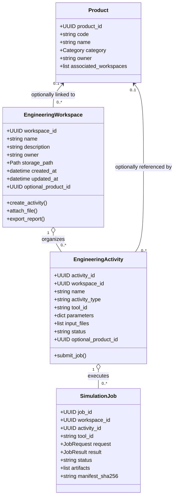

# MENDEX ENGINEERING STUDIO v1.7 ARCHITECTURE
## Enterprise UI Modernization & Product-Independent Engineering Architecture

### 1. Executive Summary & Paradigm Shift

Historically, Mendex Engineering Studio v0.1–v1.6 was anchored to a product-first paradigm:
```
[Legacy] Create Product -> Configure Product -> Access Engineering Tools -> Run Simulation
```
In real-world engineering organizations, engineering precedes product formulation. Engineers conduct magnetic modeling, semiconductor loss trade-offs, circuit simulations, and physical thermal feasibility checks before any product taxonomy, stock keeping unit (SKU), or formal specification revision is created.

**Mendex Engineering Studio v1.7 pivots to a Product-Independent Engineering Workspace Architecture:**
```
[v1.7] Studio -> Workspace -> Engineering Activity -> Engineering Tools -> Results -> (Optional Product Link)
```

Engineers are empowered to:
1. Open the Studio and immediately work inside a general-purpose, persistent **Engineering Workspace**.
2. Perform **Engineering Activities** (SPICE simulation, 2D FEA magnetics, mechanical 3D CAD modeling, equation-based Modelica validation) without selecting or creating a product.
3. Access all native tools (**LTspice, KiCad, FEMM, FreeCAD, Qucs-S, ngspice, OpenModelica**) and datasets (**SwitchLossDB, MagNet**).
4. Inspect tamper-proof SHA-256 evidence, waveforms, and analysis reports.
5. Optionally associate any workspace or activity to a formal Product downstream.

---

### 2. Core Entity Hierarchy



---

### 3. Database Schema v5 (Additive & Zero-Loss Migration)

To maintain 100% backward compatibility with existing v1.0–v1.6 databases (`user_version=4`), schema v5 executes non-destructive migrations:

```sql
BEGIN IMMEDIATE;

-- 1. Enhance integration_workspaces with full enterprise metadata
ALTER TABLE integration_workspaces ADD COLUMN description TEXT DEFAULT '';
ALTER TABLE integration_workspaces ADD COLUMN owner TEXT DEFAULT 'Engineer';
ALTER TABLE integration_workspaces ADD COLUMN product_id TEXT REFERENCES products(id);
ALTER TABLE integration_workspaces ADD COLUMN created_at TEXT;
ALTER TABLE integration_workspaces ADD COLUMN updated_at TEXT;

-- 2. Create activities table for product-independent engineering tracking
CREATE TABLE IF NOT EXISTS activities (
    id TEXT PRIMARY KEY,
    workspace_id TEXT NOT NULL REFERENCES integration_workspaces(id),
    name TEXT NOT NULL,
    activity_type TEXT NOT NULL,
    tool_id TEXT,
    payload TEXT NOT NULL,
    product_id TEXT REFERENCES products(id),
    created_at TEXT NOT NULL,
    updated_at TEXT NOT NULL
);

-- 3. Link jobs to optional activities
ALTER TABLE integration_jobs ADD COLUMN activity_id TEXT REFERENCES activities(id);

-- 4. Fast lookup indexes
CREATE INDEX IF NOT EXISTS idx_activity_workspace ON activities(workspace_id);
CREATE INDEX IF NOT EXISTS idx_activity_product ON activities(product_id);
CREATE INDEX IF NOT EXISTS idx_job_activity ON integration_jobs(activity_id);

PRAGMA user_version = 5;
COMMIT;
```

---

### 4. Primary Navigation Architecture

The Studio UI is restructured into 10 dedicated top-level destinations:

1. **Dashboard:** Live engineering metrics, active workspaces, tool health overview, recent activities, and quick actions.
2. **Workspaces:** Multi-tab engineering workbench with file explorer, activity tree, active editors, and layout persistence.
3. **Engineering Tools:** Rich visual management center for all 18 engineering tools, detection diagnostics, configuration, and direct execution.
4. **Simulation Lab:** Dedicated multi-tool simulation execution and comparison center (LTspice, ngspice, FEMM, OpenModelica, FreeCAD).
5. **AI Engineering Assistant:** Workspace-aware conversational AI for calculation assistance, simulation configuration, error diagnosis, and report drafting.
6. **Research Center:** Standalone browser for SwitchLossDB, MagNet datasets, and Princeton research resources.
7. **Results & Reports:** Centralized artifact manifest, waveform inspector, calculation summaries, and report generation.
8. **Engineering Knowledge:** Standards profiles, magnetic design guidelines, and semiconductor rules.
9. **Product Management (Optional):** Optional product lifecycle, baseline revisions, and formal specifications.
10. **Settings & Integrations:** Tool executable paths, environment diagnostics, UI theme customization, and plugin management.

---

### 5. Multi-Agent Responsibilities (Codex & Antigravity)

- **Agent 1 (Codex):** Application architecture, navigation shell, dashboard, workspace panels, AI UI, database migrations, and UI regression tests.
- **Agent 2 (Antigravity):** Tool adapters, product-independent execution orchestration, parsers, simulation engine integration, and end-to-end tool validation tests.
