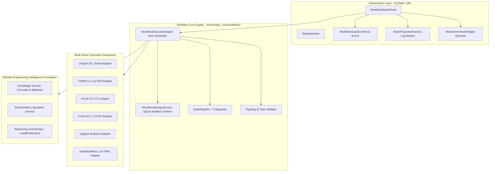
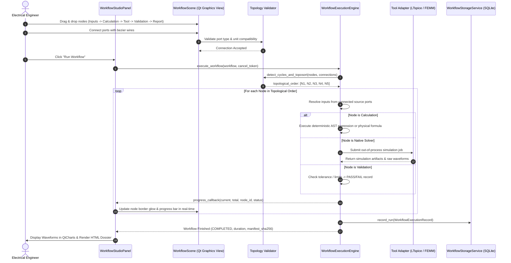

# Mendex Engineering Studio v1.9 — Visual Workflow Architecture

## 1. Executive Overview

Mendex Engineering Studio v1.9 introduces a native, node-based **Visual Engineering Workflow Studio**. This system enables electrical, magnetic, and systems engineers to construct, configure, execute, monitor, and persist multi-stage engineering calculation and simulation pipelines without writing code.

The workflow system operates strictly **independent of product definitions**, allowing general-purpose engineering pipelines (`Workflow -> Node Graph -> Execution -> Results & Evidence -> Optional Product Link`).

---

## 2. Architectural Principles

1. **Strict DAG Execution**: Workflows are directed acyclic graphs. Directed cycles are detected and rejected prior to execution via Kahn's algorithm.
2. **Explicit Port Contracts**: Nodes communicate exclusively through typed, unit-aware ports. Direct memory sharing or uncontrolled global mutation is forbidden.
3. **Deterministic & Unit-Aware**: Unit conversions and algebraic calculations are performed deterministically. All mathematical expressions use safe AST traversal without Python `eval()`.
4. **Process Tree & Adapter Safety**: Native solver execution is orchestrated out-of-process via verified adapters with timeout protection and process-tree cleanup.
5. **Non-Blocking Asynchronous UI**: Canvas rendering and user interaction remain responsive at 60 FPS while background execution workers process long-running solver jobs.

---

## 3. High-Level System Architecture

---

## 4. Workflow Lifecycle & Execution Sequence

---

## 5. Persistence & Schema Model

Workflows are persisted in the central SQLite database via additive tables without altering `PRAGMA user_version`:

- **`workflows` table**:
  - `id`: UUID primary key.
  - `workspace_id`: Foreign key to `integration_workspaces` (optional).
  - `product_id`: Foreign key to `products` (optional, product-independent).
  - `name`, `description`, `version`: Metadata.
  - `payload`: Full JSON-serialized `WorkflowDefinition` (nodes, connections, canvas viewport).
  - `created_at`, `updated_at`: ISO-8601 timestamps.
- **`workflow_runs` table**:
  - `id`: Execution run UUID.
  - `workflow_id`: Parent workflow reference.
  - `status`: `COMPLETED`, `FAILED`, or `CANCELLED`.
  - `duration_s`: Execution duration in seconds.
  - `manifest_sha256`: Cryptographic digest of run summary.
  - `payload`: Serialized `WorkflowExecutionRecord` containing per-node execution records.
