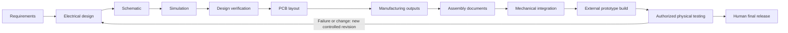

# Report 2 — End-to-End Engineering Workflow

**Assessment date:** 15 November 2026, Asia/Calcutta. **Revision:** AUDIT-1. **Scope:** generic framework, evaluation only. No product development or manufacturing authorization.

Read this with [method and evidence](README.md). “Verified” means the explicitly described software behavior was inspected or executed; it never means an entire hardware design is qualified. Missing engineering acceptance stays **NOT_EVALUATED / Not Verified**. Synthetic audit files and mocked test files are not hardware evidence.

**Verification:** the initial selected regression run was 153 passed / 4 failed (157 total). Two contextual failures passed targeted retests; the live-product-dependent test was not rerun against live data, and a waveform expectation/window mismatch remains unresolved. See E06 for precise results and the final supplementary regression. Native buck ERC had zero violations; routed DRC had zero errors/unconnected items and 16 warnings. This is a narrow idealized reference, not a qualified product envelope.

**Changing-workspace limit:** source and live artifacts changed concurrently outside this audit. Findings are tied to captured source hashes and execution times; [closing-source addendum](09_CLOSING_SOURCE_ADDENDUM.md) documents new enclosure/TIM code and integrity-banner findings. Those additions are not silently treated as fully verified.

These are recommended execution and acceptance steps. They do not assert that all lifecycle gates currently enforce them. All safety thresholds, standards applicability and prototype test instructions must be supplied/reviewed for the actual design.

## 1. Requirements

| Field | Required workflow |
| --- | --- |
| Objective | Define traceable acceptance |
| Inputs | Sourced input/output/load/environment/safety/cost requirements |
| Software/integration | Core Specification + engineering_records/lifecycle; human requirements author |
| Execution | Enter explicit limits and assumptions; link requirement IDs to verification methods; resolve missing inputs |
| Calculations/validation | Units, finite values, voltage order; completeness human-reviewed |
| Files generated | requirements/specification.json, product-requirements.md, requirements-traceability.csv |
| Quality acceptance | Every critical requirement has a source, numeric/qualitative acceptance and verification owner |
| Responsible team | Systems + electrical + PM |
| Proceed condition | Reviewed requirements and applicable product context; missing criteria block engineering acceptance |
| Location of work | In studio + human |

## 2. Electrical design

| Field | Required workflow |
| --- | --- |
| Objective | Choose architecture and size circuits |
| Inputs | Reviewed requirements, exact topology and part/model/material information |
| Software/integration | Design synthesis + seven shared calculators + engineer |
| Execution | Generate candidates/IR; select topology; supply parts; calculate stress, ripple, loss, magnetics and thermal budget; record assumptions |
| Calculations/validation | Equation applicability, units/conventions, component ratings/SOA and fault paths |
| Files generated | electrical-architecture.md, design-ir.json, sizing.json, loss-budget.csv |
| Quality acceptance | Reviewer accepts architecture, assumptions and complete ratings across operating envelope |
| Responsible team | Electrical + magnetics |
| Proceed condition | No unknown critical parts/models/insulation constraints |
| Location of work | Mixed |

## 3. Schematic

| Field | Required workflow |
| --- | --- |
| Objective | Produce electrically complete editable drawings |
| Inputs | Approved design intent, symbols/pin maps, parts and footprint assignments |
| Software/integration | KiCad/Copper, LTspice generator |
| Execution | Generate native candidates; inspect all pages; add auxiliaries/control/protection/connectors; netlist; compare graphs |
| Calculations/validation | Native opens, ERC, pin mapping, netlist equivalence and BOM linkage |
| Files generated | *.kicad_sch, *.kicad_pro, *.asc, *.net, ERC JSON |
| Quality acceptance | No unexplained errors, no omitted power/control/protection circuitry; documented warning dispositions |
| Responsible team | Electrical + PCB |
| Proceed condition | Reviewed complete schematic and matched simulation graph |
| Location of work | Mixed |

## 4. Simulation

| Field | Required workflow |
| --- | --- |
| Objective | Evaluate modeled behavior against requirements |
| Inputs | Exact model versions, native graph, parameter ranges, stimuli and solver settings |
| Software/integration | LTspice; optional implemented solvers |
| Execution | Run nominal then line/load/temp/tolerance/transient/AC/fault matrix; retain decks/models/raw/logs/version/hashes |
| Calculations/validation | Convergence separate from requirement acceptance; compute time-domain metrics with correct windows; quantify model limits |
| Files generated | *.net/.asc/.raw/.log, model libraries, simulation-config.json, plots and validation summary |
| Quality acceptance | All modeled requirements evaluated; missing/invalid results NOT_EVALUATED; unexplained failures resolved |
| Responsible team | Simulation + electrical |
| Proceed condition | Model adequacy reviewed and non-simulation requirements assigned external verification |
| Location of work | In studio + human |

## 5. Design verification

| Field | Required workflow |
| --- | --- |
| Objective | Reconcile evidence and design intent |
| Inputs | Requirement matrix and complete calculation/simulation/native outputs |
| Software/integration | Core evidence/lifecycle/manual engineering review |
| Execution | Link evidence; verify context and hashes; perform independent review; record local declared decisions and unresolved risks |
| Calculations/validation | No stale evidence; simulated/calculated/measured separated; reviewer attribution is not identity authentication |
| Files generated | verification-report.json/html/pdf, traceability.csv, decision history |
| Quality acceptance | No false PASS; critical requirements have attributable evidence and signed external decisions where required |
| Responsible team | Independent electrical + QA |
| Proceed condition | Review authorizes layout work; no manufacturing release inferred |
| Location of work | Mixed |

## 6. PCB layout

| Field | Required workflow |
| --- | --- |
| Objective | Translate reviewed design into manufacturable geometry |
| Inputs | Reviewed schematic/netlist, footprints, stackup, dimensions, isolation and current constraints |
| Software/integration | KiCad PCB + Copper |
| Execution | Forward annotate; place for power loops and return paths; route/pour; inspect constraints; review thermal and mechanical interfaces |
| Calculations/validation | Native DRC/unconnected count; footprint library checks; creepage engineering review; stackup/material approvals |
| Files generated | *.kicad_pcb, constraints, stackup and layout-review report |
| Quality acceptance | Zero unintended opens/shorts; accepted DRC dispositions; adequate copper and interfaces demonstrated |
| Responsible team | PCB + electrical + mechanical |
| Proceed condition | Controlled layout baseline and independent review |
| Location of work | Mixed |

## 7. Manufacturing outputs

| Field | Required workflow |
| --- | --- |
| Objective | Generate consistent fabrication data |
| Inputs | Reviewed PCB and fabricator-approved material/stackup/finish/tolerance notes |
| Software/integration | KiCad CLI + desktop export/inspection |
| Execution | Export Gerber/drill/CPL/D356/stats; inspect every layer/outline/drill; reconcile files and source revision; do not suppress failures |
| Calculations/validation | Independent CAM load, units/origin/layer mapping, drill/plating/slots, dimensions, netlist comparison |
| Files generated | Gerbers, *.drl, *.d356, fabrication.pdf, fab-notes.md |
| Quality acceptance | Complete required layer/drill set; manufacturer DFM review; same approved board hash |
| Responsible team | PCB + fabrication engineer |
| Proceed condition | Fabricator can interpret complete package and acknowledges constraints |
| Location of work | In studio exports + external CAM/fabricator |

## 8. Assembly documentation

| Field | Required workflow |
| --- | --- |
| Objective | Enable unambiguous population |
| Inputs | Same-revision PCB, exact BOM/CPL, paste data and process choices |
| Software/integration | KiCad exports + human assembly documents |
| Execution | Reconcile refdes/quantity/DNP/MPN; confirm bottom-side rotation/origin; create assembly/polarity/solder/special-process instructions |
| Calculations/validation | BOM-CPL-board equality and DNP policy; orientation and footprint/part compatibility |
| Files generated | bom.csv/json, cpl.csv, assembly.pdf, soldering.md, inspection.md |
| Quality acceptance | Assembler acknowledges no missing parts/orientation/process information |
| Responsible team | Electrical + SMT manufacturing |
| Proceed condition | Approved procurement and assembly instructions plus resolved substitutions |
| Location of work | Partial studio + external/human |

## 9. Mechanical integration

| Field | Required workflow |
| --- | --- |
| Objective | Establish enclosure/mounting/cooling fit |
| Inputs | PCB STEP, exact components/connectors, enclosure and hardware/tolerance requirements |
| Software/integration | KiCad STEP + FreeCAD/native mechanical work |
| Execution | Import board solid; design enclosure/mounting/heat sink; run collision/tolerance review; create drawings and pinouts |
| Calculations/validation | Complete 3D model coverage, connector access, keepouts, insulation, torque and interface tolerances |
| Files generated | *.step, *.FCStd, mounting.pdf, fasteners.csv, installation.md |
| Quality acceptance | Reviewed fit/tolerances and cooling interfaces; visual preview alone insufficient |
| Responsible team | Mechanical + hardware integration |
| Proceed condition | Complete reviewed mechanical/mounting package |
| Location of work | External/manual with studio exchange |

## 10. Prototype manufacturing

| Field | Required workflow |
| --- | --- |
| Objective | Build a controlled engineering prototype |
| Inputs | Reviewed fab and assembly package, authorized prototype order |
| Software/integration | External fabricator/SMT team |
| Execution | Submit controlled package and hashes; answer DFM/assembly queries; record accepted revisions, build deviations and serials |
| Calculations/validation | Incoming inspection, bare-board electrical test, assembly/AOI/X-ray as applicable |
| Files generated | DFM response, fabrication/assembly travelers, inspection and deviation records |
| Quality acceptance | Accepted prototype build with traceability; no unrecorded substitutions |
| Responsible team | Fabricator + SMT + quality |
| Proceed condition | Safe review authorizes separately controlled laboratory testing |
| Location of work | External; no orders placed by audit |

## 11. Physical testing

| Field | Required workflow |
| --- | --- |
| Objective | Validate actual hardware |
| Inputs | Qualified test plan, risks, calibrated instruments, prototype identity and separate authorization |
| Software/integration | External lab; studio measurement/evidence intake |
| Execution | Qualified team revises generic plan for actual topology; execute bring-up/function/line-load/thermal/fault/isolation/EMC tests as applicable; preserve raw captures |
| Calculations/validation | Requirement-specific limits, uncertainty/calibration, setup/photos, DUT/firmware identity; independent results review |
| Files generated | Raw scope CSV, power/thermal/insulation/EMC reports, test scorecards |
| Quality acceptance | All required physical requirements have accepted evidence; simulations never substitute |
| Responsible team | Laboratory + electrical + safety/compliance + QA |
| Proceed condition | Critical failures closed, deviations reviewed; external qualification/certification complete where required |
| Location of work | External execution + studio intake |

## 12. Final release

| Field | Required workflow |
| --- | --- |
| Objective | Deliver controlled final engineering records |
| Inputs | All discipline packages, physical/quality evidence and accountable release decisions |
| Software/integration | Studio candidate packager + manual controlled release process |
| Execution | Assemble proposed 14-folder package; validate manifest/hashes/revision/completeness; obtain actual approvals; deliver read-only team bundles and acknowledgments |
| Calculations/validation | Independent package audit and recipient acceptance; no READY-to-approval inference |
| Files generated | Release manifest, archive, approvals, revision history and team handover records |
| Quality acceptance | Complete consistent package, physical verification and authorized human release outside unavailable automatic manufacturing approval |
| Responsible team | Engineering leads + manufacturing + QA + PM/document control |
| Proceed condition | Only authorized organization can issue final release; this audit does not |
| Location of work | Partial studio packaging + human/external |

**Final cutoff correction (14:40:18 Asia/Calcutta):** concurrent source now includes standalone STEP/SVG/mechanical files in packaging and adds enclosure RPC/client routes. The initial STEP omission is historical. The final probe still excludes simulations/requirements and reports READY for incomplete/corrupt archives. See [closing addendum](09_CLOSING_SOURCE_ADDENDUM.md) and [cutoff evidence](evidence/final-cutoff-probe.json). Changes after this cutoff are outside this audit.
