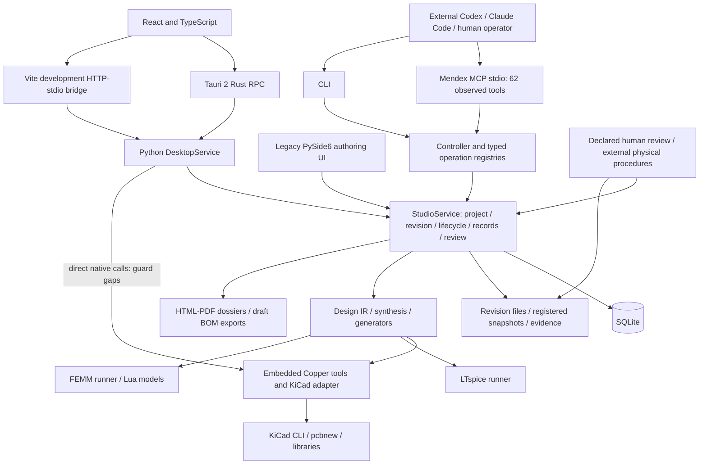

# Mendex Power Electronics End-to-End Readiness Audit

**Date:** 14 November 2026 (Asia/Calcutta). **Mode:** independent audit only. **Overall:** substantial engineering support and real native integrations exist, but a complete engineering-ready product-development and release workflow is **not demonstrated**.

Evidence: [20261114-readiness](evidence/20261114-readiness/). The exact commit, dirty working tree and inspected source hashes are recorded there. See the [24-gap register and roadmap](MENDEX_ENGINEERING_GAPS_AND_NEXT_STEPS.md) for root causes, modules, impacts, recommended fixes, effort, dependencies and acceptance tests.

## 1. Executive summary

This is more than a UI prototype. A disposable 12 V to 5 V / 1 A buck fixture generated native KiCad/ASC/netlist files, real LTspice raw/log data, routed copper, a raytraced PNG, STEP, Gerbers, drill output, placement CSV, draft BOM documents and a report. Existing core/controller, Copper, native CLI and actual MCP/CLI/desktop process paths were exercised.

However, successful execution did not establish engineering correctness:

- The independently generated SPICE netlist ran: the runner reported **4.8448 V mean and 0.0937 V peak-to-peak ripple**. Independent time-weighted analysis gave **4.85705 V** over the final 30 percent of time. Both meet the explicitly supplied illustrative 4.75-5.25 V band and 0.1 V ripple limit. This is not a commercial specification or safety approval.
- **KiCad ERC found 20 errors and 18 warnings.** The delivered editable LTspice ASC opened but netlisted with disconnected NC_01 through NC_08 nodes and without the PWM sources in the separately simulated netlist. Simulation does not validate that delivered schematic.
- Copper generated **21 tracks and zero unrouted connections**, but post-route native DRC still found **2 errors and 16 warnings**, including six footprint-library mismatches. Command exit zero did not mean a clean PCB.
- Real PNG/STEP generation works. The inspected PNG includes an unjustified isolation slot in a nonisolated buck because the generator treats a VOUT net name as an HV indicator. Visualization is not mechanical verification.
- Empty FEMM JSON generated **PASS (99.3% Margin)** in the dossier. The real nested ERC report generated **Pin drive integrity: Clean**, despite 20 errors. These are confirmed false-positive reporting defects.
- A non-mutating spy showed routing reaches its adapter for an **archived revision**. The method can return success=true with seven unrouted connections and three DRC errors. No frozen bytes were edited by this probe.
- Desktop Gerber export passes **force=True** through the lower-level DRC/routing gate. A downloadable ZIP is not necessarily a checked fabrication candidate.

Recent fail-closed safety-helper work, thermal calculators, waveform parsing and Copper features are present. They are assessed as implemented portions with limitations, not carried forward as wholly missing features from older audits.

**No production code was edited during this audit.** Prior priority-1 work and the other agent's changes were preserved. No dependencies were installed, commercial product developed, hardware energized, manufacturing approval issued or deployment performed. Engineering fixtures use a separate audit data root. A harness field-name mistake was preserved and corrected only in a continuation audit script.

## 2. Current architecture

`StudioService` is the metadata authority, with SQLite records and filesystem-native artifacts. CLI/MCP generally share its services. Tauri RPC is wired; Vite provides the development HTTP bridge. The frontend asset build passed with 1,589 modules. That does not demonstrate an installed Tauri application. Offline Cargo validation is BLOCKED by the configured MSVC toolchain's unavailable/inapplicable cargo component. Packaged Python/backend/dependency installation was not demonstrated.

Qt authoring and React/desktop paths coexist. Some desktop Copper calls bypass common core revision guards, retry receipts and snapshot transactions: a concrete missing connection, not grounds for a broad rewrite.

Copper is embedded under `src/copper_kicad`, with an internal tool registry and native adapter. Actual routing/rendering/checks executed. Its internal registry is **not canonical Mendex MCP exposure**: the observed 62-tool inventory has no Copper-specific routing/render/export tool. Some features are reached through desktop methods or the Python SDK instead. Vendor agent/provider modules do not establish an enabled autonomous Mendex planner or AI account; no account or secret was inspected or used.

Exercised paths include core/controller/MCP/CLI, native tools and a separate desktop Python observer. Interactive React, installed Tauri and visible KiCad editing were not observed. A private hidden LTspice instance opened/netlisted the ASC without commandeering the user's GUI.

Snapshots, append-only events and hashes provide useful integrity controls. They do not prove formula correctness, measurement origin or reviewer identity. Unique native generation paths do not establish that every subsequent edit/export preserves baselines.

## 3. End-to-end engineering workflow assessment

`SDK` means an existing direct Python core/adapter call, not a claimed MCP operation. The table addresses implementation, connection, agent/human access, artifacts, traceability, actual testing and manual dependencies. The gap register supplies readiness conditions.

| Step | Implemented / connected | Agent access | Engineer action/review | Artifact and traceability | Executed here / missing condition |
|---|---|---|---|---|---|
| Requirements | Structured snapshots/review context; partial completeness | MCP/CLI/core | Supply sources/limits/conflict decisions | Records + specification hash | Two explicit requirements saved; full test coverage missing |
| Electrical specifications | Typed V/I/frequency/ambient fields; generic remainder | MCP/CLI | Authoritative envelope and assumptions | Revision JSON | Fixture persisted; broad domain validation partial |
| Feasibility | Candidate constraints/heuristics/documents | Controller/MCP candidates | Review applicability and decision | IR/metrics/documents | Buck inspected; scores/efficiency not validation |
| Topology selection | Six builder families, uneven qualification | Generate/list MCP; broader controls uneven | Select/review architecture | Candidate/design revisions | Buck selected; per-topology benchmarks needed |
| Calculations | Real functions and record framework | MCP/CLI; narrower persisted registry | Supply units/models/applicability | Result/provenance records | Sizing/raw analysis; unit/window issues remain |
| Component selection | Sourced reference catalog | Core/desktop; partial agent coverage | Exact MPN/model/package review | References/draft BOM | Lookup executed; no complete qualified physical BOM |
| Magnetics | Turns/flux/L/loss/winding helpers and geometry | Core/native runners | Material/core/construction expertise | IR/Lua/native files | Not required by nonisolated fixture; complete transformer not qualified |
| Circuit schematic | Real KiCad/ASC generation | MCP design/Copper SDK | Native edit/review | Native files and hashes | FAIL electrical equivalence/ERC |
| Electrical simulation | Real LTspice run/parser | MCP run_simulation and SDK | Models/windows/failure review | Raw/log/job evidence | PASS idealized execution; delivered schematic differs |
| Thermal/loss | Closed-form thermal/loss/trace helpers | Calculator MCP/controller/desktop | Supply thermal paths/airflow/stackup | Outputs, uneven recording | Source assessed; no complete independent qualification |
| PCB design | Populated file/pads/nets/model references | Generator/desktop/SDK | Placement/loops/returns/domain review | PCB/STEP/PNG | Footprint/slot/DRC issues prevent readiness |
| PCB verification | Native ERC/DRC | SDK/desktop; partial agent parity | Inspect raw issues and layout | Native JSON | Real failures detected; dossier/export can misrepresent |
| Mechanical verification | Actual visualization/STEP; verification partial | SDK/desktop | Models/collisions/heights/enclosure | PNG/STEP | Render/export work; actual fit acceptance missing |
| Design review | Context-bound declared decisions | Package/request/history tools | Actual human judgment | Append-only declaration | No fixture approval invented; name is not authenticated authority |
| Prototype planning | Templates/procedures/measurement schema | Agents can prepare/register files | Define instruments/calibration/limits | Plans and procedures | Audit-authored unexecuted plan; qualified generator not demonstrated |
| Physical testing | Recording/linkage, not performed | Ingestion, not instrument operation | External physical work/review | Genuine originals if supplied | NOT_EVALUATED; simulation cannot replace testing |
| Iteration | Revisions/ECR/parametric/resimulation | MCP/core subset; CAD mostly desktop | Impact review and repeat checks | Revisions/events/snapshots | Draft routing and archived permission probe; inconsistent guards |
| Manufacturing docs | Native exports and draft documents | Native CLI/SDK; incomplete parity | Coherence/fab constraint review | Gerber/drill/positions/BOM/STEP/report | Formats generated; input design fails acceptance |
| Engineering release | Final physical/release chain not demonstrated | Must not be agent self-approval | Accountable external release | Draft package/process history | NOT READY; no release issued |

Typed Specification supports input min/nom/max, output voltage/current, switching frequency, ambient temperature, topology, isolation description and standards profile. Power can be derived from explicit V/I. Efficiency, ripple/noise, regulation, environment, dimensions, cooling, protection, EMI/EMC, reliability, cost and manufacturing constraints can be stored as generic requirements/documents, but are not all first-class validated/calculator-linked fields.

Coverage checks can flag missing mapped fields, inconsistent targets/units and duplicate requirement IDs. Voltage ordering and unknown fields are checked. Snapshots/revisions retain history; reviews can declare conflicts/missing information. This is not a general engineering contradiction detector. A written criterion becomes a working acceptance rule only when linked to appropriate result/evidence evaluation.

The default lifecycle has nine stages: initialization, requirements, feasibility, calculations, design, simulation, verification, prototype and documentation. Initialization uses project context; each later stage requires its named validation record and review. Dependencies are requirements after initialization; feasibility/calculations/design after requirements; simulation after design; verification after calculations and simulation; prototype and documentation after verification. Documentation does not depend on prototype. Starting calculations while requirements remain IN_PROGRESS was permitted; this is an execution dependency observation, not proof that a completion approval was bypassed. A completed documentation stage must not be represented as physical product release.

## 4. Tools, service architecture and interfaces

The MCP inventory contains 62 tools covering projects, revisions, requirements, calculations, lifecycle, reviews, generation, simulation, artifacts, reports and tool diagnostics. The audit executed both an in-process JSON-RPC dispatch and a real MCP stdio subprocess. A separate desktop observer subprocess and CLI project read also succeeded against the disposable root. These are substantive working interfaces.

Copper routing/render/export capabilities are available through internal adapters and desktop methods, but lack equivalent named MCP tools. Thermal helper aliases exist in the calculation controller while the persisted calculation request permits only four calculation kinds. UI/CLI/MCP parity and provenance therefore remain incomplete. Native processes and PDF creation can block requests; cancellation, timeout recovery, retry and idempotence need acceptance tests.

The frontend TypeScript/Vite build passed. Interactive browser testing was BLOCKED: the supported browser runtime reported no available browsers. Native desktop packaging was NOT VERIFIED: offline Cargo check failed because the installed Rust toolchain did not provide an applicable cargo binary. No dependencies were installed.

## 5. Engineering calculations and qualification

The application contains real closed-form converter sizing, switching/conduction loss, Dowell winding loss, Steinmetz core loss and thermal helpers. Their existence is useful preliminary engineering support, not validation of every topology or operating range. Synthesis includes buck, boost, flyback, push-pull, LLC and phase-shift full bridge builders. Forward, general buck-boost and general half-bridge workflows are not demonstrated as complete methodologies. Fixed efficiency assumptions and candidate scores must be labeled estimates.

Two Steinmetz paths use incompatible coefficient conventions: one computes cm*f_Hz^alpha*B^beta; another computes k*(f_Hz/1000)^alpha*B^beta*1000. The numerical counterexample in engineering-counterexamples.json demonstrates disagreement for identical bare inputs. Coefficient units, waveform convention, material, temperature and frequency validity must accompany coefficients; this audit did not establish either example as a physical material benchmark.

Thermal sizing provides resistance-chain and empirical convection estimates. Junction-temperature derating multiplies the Celsius limit, magnetic convection uses an empirical correlation, and default areas/resistances can materially determine results. These need explicit assumptions and benchmarks. The trace helper labels the k*DeltaT^0.44*A^0.725 expression IPC-2152; TI identifies that familiar expression with IPC-2221. Correct the attribution and qualify the model before treating its output as a standards result. [TI trace sizing reference](https://www.ti.com/lit/pdf/snva766).

Control-loop compensation, stability margins, startup/shutdown, current limit, short circuit, overvoltage, undervoltage and fault recovery lack a demonstrated complete requirements-to-analysis-to-test chain. This audit did not run or approve those checks. See G05–G13 in the gap register.

## 6. Schematic and PCB readiness

Native KiCad CLI opened the generated files and exported SVG, STEP, Gerbers, drills and component positions. These are genuine outputs. However, nested schematic ERC contained 20 errors and 18 warnings: 17 dangling labels, three disconnected pins and additional geometry/naming warnings. Process exit zero alone did not establish acceptance; KiCad offers an explicit violations exit-code option. [KiCad CLI manual](https://docs.kicad.org/10.0/en/cli/cli.pdf).

Copper actually routed the board: 21 tracks, zero vias, and zero remaining unconnected items in the independent post-route report. DRC still contained two errors and 16 warnings, including copper-edge clearance and footprint/library discrepancies. The pre-route report had two errors, 15 warnings and four unconnected items. The adapter's own warning count differed from the separately captured native report; neither should be silently discarded.

The board generator inserts a 5 mm slot when a VOUT net exists, even for this non-isolated 12 V buck. A net name cannot establish an insulation barrier. Footprint geometry, library identity, pad numbering, actual component package and schematic pin connectivity need authoritative mapping. Routing completion is not DRC acceptance.

The native LTspice schematic opened, but its extracted circuit contained floating NC_* connections and lacked the gate-drive sources used by the separately simulated netlist. Therefore, successful netlist simulation does not validate the generated editable schematic. Graph equivalence between IR, ASC, KiCad schematic, PCB and BOM is a release-blocking requirement.

## 7. Simulation, waveforms and magnetics

LTspice executed the idealized nominal buck netlist successfully. The full RAW contained 25,774 points through 5 ms. Independent evaluation of the final 30% of elapsed time yielded approximately 4.85705 V time-weighted mean and 93.707 mV peak-to-peak ripple. The runner reported 4.8448 V using a sample-average approach. Both fall inside the illustrative fixture voltage band; their discrepancy still requires a declared averaging policy. The runner's embedded trace contains only its first 200 points, ending around 30 microseconds, and is not the steady-state waveform.

The waveform RPC reads real RAW data, but the requested start=100 and limit=5 were ignored: it returned 1,031 samples starting at zero. Explicit zero tolerance is also replaced by a fallback in the requirement evaluation expression. Full-time coverage, windowing, adaptive-step integration, paging and tolerances require correction. No efficiency, loop stability, switching-stress envelope, temperature sweep or protection pass is inferred from this nominal run.

FEMM integration and model generation exist, including excitation when positive current is supplied. Geometry defaults, including zero peak current, can still produce an unqualified model. A nonzero-excitation benchmark with known flux, energy/inductance and losses is required. FEMM supports planar/axisymmetric static and time-harmonic formulations; that does not demonstrate a full 3D switching-transient magnetic solution. [Official FEMM manual](https://www.femm.info/Archives/doc/manual.pdf).

## 8. Safety, verification and evidence integrity

The main safety service now keeps unqualified assessments NOT_EVALUATED. A separate Copper helper still returns the same reinforced creepage for all four material groups and accepts negative voltage through absolute value. This duplicate path must be retired or qualified; numerical output is not verified IEC compliance. Working voltage, overvoltage category, pollution, material group, altitude, insulation function and applicable product standard require a controlled applicability decision. [IEC 60664-1 scope](https://webstore.iec.ch/en/publication/59671), [TI insulation overview](https://www.ti.com/video/6146024211001).

Two report counterexamples are decisive. An empty FEMM JSON produced a PASS badge claiming 99.3% margin. A real KiCad ERC report with 20 nested errors produced a clean pin-integrity card because the renderer inspected the wrong level. Captured HTML is retained. Unknown, missing, malformed or stale evidence must remain NOT_EVALUATED or explicitly failed; default values cannot manufacture a pass.

A non-mutating adapter spy proved archived-revision routing reached the native adapter. A failed route result containing seven unrouted items and three DRC errors was wrapped as success=True. No archived production board was changed. Desktop manufacturing export also supplies force=True, bypassing lower-level route/DRC guards. Central revision guards and truthful result propagation are required before further write capabilities are trusted.

Manual reviewer identity is declared rather than authenticated. Measurement records carry operator, procedure, instrument/calibration information, values and raw hashes, but ingestion does not prove physical origin. Keep software evidence, engineering review, laboratory evidence and accountable release distinct. No hardware, safety certification, manufacturing approval or commercial authorization was performed.

## 9. Prototype, mechanical and manufacturing documentation

Draft BOM CSV/JSON and DOCX/PDF were generated. The fixture also produced fabrication geometry, drills, placement CSV, STEP and a rendered board image. The 480x320 image was inspected: a real board and traces are present, but component-body coverage is incomplete and the inappropriate slot is visible. File existence is therefore a format/integration success, not a mechanical-fit or fabrication acceptance result.

Enclosure fit, mounting, connector access, tolerances, thermal interfaces, creepage around hardware, assembly clearances and complete 3D models remain unverified. Prototype planning and measurement intake exist, but no board was purchased, assembled, energized or measured. EMI/EMC, environmental, fault, reliability and production test evidence remains NOT_EVALUATED. Supplier qualification, approved alternates, lot/serial traceability, incoming inspection, assembly work instructions and yield controls are not established by these exports.

## 10. Actual isolated end-to-end exercise and regression results

All new fixture work used docs/audit/evidence/20261114-readiness/disposable-project, never SV1000. Inputs were auditor-selected illustrative assumptions: 12 V fixed input, 5 V output, 1 A, 100 kHz, 100 mV ripple limit and 4.75–5.25 V voltage band. They are not user product specifications. No efficiency target was invented.

Project ID: 49f8e26c-b8ed-415d-8d0b-b104320f490c. Revision ID: c56d1a5a-4ad3-46e0-a13a-3426a6779017. Final fixture lifecycle: initialization COMPLETED; requirements and calculations IN_PROGRESS; remaining stages NOT_STARTED. No review approval or release was fabricated.

| Step | Actual result | Interpretation |
|---|---|---|
| 1. Inventory source and dirty tree | Captured commit, source and live-data hashes | Reproducible baseline, not a clean checkout |
| 2. Inspect tool registry | 62 MCP tools | Real inventory; not all desktop functions exposed |
| 3. Create isolated project | Core service succeeded | PASS |
| 4. Create initial revision | Core service succeeded | PASS |
| 5. Enroll default lifecycle | Nine stages recorded | PASS |
| 6. Record requirements | Two sourced fixture acceptance requirements | PASS for intake |
| 7. Start calculations | Allowed with requirements IN_PROGRESS | Execution observed; no completion approval inferred |
| 8. Generate buck IR | Real service/MCP dispatcher | PASS as candidate generation |
| 9. Export four native files | NET, ASC, KiCad schematic and PCB | Format generation PASS |
| 10. Simulate netlist | Native LTspice completed | Nominal idealized run PASS |
| 11. Independently inspect RAW | 25,774 points; mean/ripple recomputed | Restricted nominal acceptance only |
| 12. Open ASC and extract native netlist | Opens, but NC_* nodes and missing gate drives | Electrical equivalence FAIL |
| 13. Run KiCad ERC | 20 errors, 18 warnings | FAIL |
| 14. Run initial PCB DRC | Two errors, four unconnected items | FAIL |
| 15. Route and pour | 21 tracks; no remaining unconnected items | Routing ran; quality still fails |
| 16. Run post-route DRC | Two errors, 16 warnings | FAIL |
| 17. Export fabrication geometry | Gerbers, drills, positions, STEP | Format PASS; release NOT_EVALUATED |
| 18. Render PCB | Genuine PNG inspected | Partial mechanical visualization |
| 19. Export draft BOM/report | CSV/JSON/DOCX/PDF and draft record | Generated; engineering truth requires review |
| 20. Register revision artifacts | Four artifact records | Provenance mechanism exercised |
| 21. Test actual subprocess interfaces | MCP stdio simulation, CLI read, desktop observer | PASS in disposable context |
| 22. Probe negative boundaries | Archived route, false success, false report PASS | Confirmed failures; no live mutation |

The initial audit script stopped at BOM construction because it used component_type rather than the IR's type field. This was an audit-harness error, not an application failure. The continuation script corrected only that harness field and retained the same generated artifacts. Both transcripts are preserved.

The isolated selected regression run finished: **383 passed, one failed, exit 1**, in 1,092 seconds. The failure was tests/core/test_desktop_revision_isolation.py::test_desktop_designs_require_explicit_project_and_revision_link: an extra design appeared in the project view despite the test requiring explicit project/revision linkage. This is a project/revision isolation defect. The collection inventory listed 387 tests; the actual run summary is authoritative for executed outcomes.

The broad preliminary run was stopped after discovering a test module hardcoding the live repository root and a real product UUID. Its partial results are not a pass. The accepted run excluded that module and the native dossier-PDF module and used a temporary MENDEX_DATA_ROOT. A prior pre-audit Qt regression ended in a Windows native access violation; it is not a successful full-suite result. This audit does not claim exhaustive regression coverage.

Evidence is under [20261114-readiness](evidence/20261114-readiness/): e2e-transcript.json, e2e-continuation-transcript.json, native-asc-netlisting.json, native-raw-info.json, independent-waveform-check.json, waveform-rpc-summary.json, boundary-results.json, engineering-counterexamples.json, mcp-native-stdio.json, desktop-observer.json, safe-pytest.xml/log, cargo.log and build logs. Native ERC/DRC, exports and RAW/log files reside in the disposable fixture. Empty-FEMM and real-ERC report counterexamples are retained as HTML. These files are observations, not physical qualification certificates.

## 11. Capability scorecard

Statuses describe demonstrated scope. BLOCKED means an external/tooling condition prevented the check. NOT TESTED is not a pass. Every unavailable engineering check remains NOT_EVALUATED.

| # | Capability | Status | Evidence / limit |
|---|---|---|---|
| 1 | Project identity and revisions | PASS | Disposable creation and retrieval |
| 2 | Requirements and acceptance intake | PARTIAL | Structured records; incomplete engineering-domain coverage |
| 3 | Lifecycle and review | PARTIAL | Nine stages; declared identities and weak discipline-specific gates |
| 4 | Shared core UI/CLI/MCP | PARTIAL | Subprocess reads/simulation pass; CAD/thermal parity incomplete |
| 5 | Component/material library | PARTIAL | Seed data; authoritative ratings/models/footprints not fully qualified |
| 6 | Topology selection | PARTIAL | Six builders; no general qualified topology envelope |
| 7 | Electrical sizing | PARTIAL | Real equations; limited benchmarks/assumptions |
| 8 | Loss and efficiency analysis | PARTIAL | Real helpers; coefficient units and fixed estimates need qualification |
| 9 | Thermal and trace sizing | PARTIAL | Preliminary models and attribution issues |
| 10 | Control and protection design | NOT IMPLEMENTED | Complete requirements-linked workflow not demonstrated |
| 11 | Magnetic design/FEMM | PARTIAL | Integration exists; excited physical benchmark outstanding |
| 12 | Native schematic correctness | FAIL | KiCad ERC and ASC graph mismatch |
| 13 | Native simulation execution | PASS | Real LTspice nominal fixture and full RAW |
| 14 | Waveform/requirement evaluation | PARTIAL | Averaging, preview and paging defects |
| 15 | PCB placement/routing | PARTIAL | Actual routing, but DRC errors and footprint issues |
| 16 | Mechanical visualization/fit | PARTIAL | STEP/PNG generated; complete fit not verified |
| 17 | ERC/DRC acceptance reporting | FAIL | Raw violations coexist with false clean card |
| 18 | Safety/insulation qualification | FAIL | Duplicate unqualified Copper helper; engineering NOT_EVALUATED |
| 19 | Prototype measurements | NOT TESTED | No physical prototype or measurements |
| 20 | EMI/environment/reliability validation | NOT TESTED | External evidence absent |
| 21 | Manufacturing document generation | PARTIAL | Real formats; no accepted coherent release package |
| 22 | Immutable revisions/evidence boundaries | FAIL | Archived routing reaches adapter; project view isolation fails |
| 23 | Desktop delivery and interactive acceptance | BLOCKED | Frontend build passes; browser unavailable, Cargo toolchain failure |

The requested engineering-domain view is below. Implemented describes available functionality; tested describes this audit's execution; ready describes acceptance within the named domain, not code presence.

| Engineering capability | Implemented | Tested | Ready | Gap |
|---|---|---|---|---|
| Requirements management | PARTIAL | PASS | PARTIAL | G06: domain coverage and acceptance mappings |
| Topology selection | PARTIAL | PARTIAL | PARTIAL | G13: qualified operating envelopes |
| Engineering calculations | PARTIAL | PARTIAL | PARTIAL | G08/G09: units and independent benchmarks |
| Component selection | PARTIAL | PARTIAL | PARTIAL | G05: sourced ratings, models and pad maps |
| Magnetics design | PARTIAL | PARTIAL | PARTIAL | G11: excited reference benchmark |
| FEMM simulation | PARTIAL | NOT TESTED | NOT TESTED | G11: qualified nonzero-excitation execution |
| KiCad schematic | PARTIAL | PASS | FAIL | G02: native electrical graph |
| Electrical ERC | PARTIAL | FAIL | FAIL | G02/G04: 20 errors; report interpretation |
| LTspice simulation | PASS | PASS | PARTIAL | G02/G13: editable schematic equivalence and scenario coverage |
| Waveform analysis | PARTIAL | PARTIAL | PARTIAL | G07: time windows, mean, tolerance and paging |
| PCB design | PARTIAL | PASS | FAIL | G14: footprints and physical constraints |
| PCB routing | PARTIAL | PASS | PARTIAL | G01/G14: guards and residual violations |
| PCB DRC | PARTIAL | FAIL | FAIL | G03/G14: two errors, forced export |
| PCB 3D | PARTIAL | PASS | PARTIAL | G15: incomplete bodies and fit validation |
| Thermal assessment | PARTIAL | PARTIAL | PARTIAL | G09: empirical assumptions and qualification |
| Safety verification workflow | PARTIAL | FAIL | FAIL | G10/G18: duplicate unqualified calculation and trust boundary |
| EMI/EMC workflow | PARTIAL | NOT TESTED | NOT TESTED | G16: genuine external test evidence |
| Engineering verification | PARTIAL | FAIL | FAIL | G04/G23: false PASS and discipline gates |
| Prototype test planning | PARTIAL | PASS | PARTIAL | G17: plan generated; no execution/physical evidence |
| Manufacturing exports | PARTIAL | PASS | FAIL | G03/G14: formats exist, design fails gates |
| Engineering documentation | PARTIAL | PASS | FAIL | G04: generated documents can misstate evidence |
| AI agent automation | PARTIAL | PASS | PARTIAL | G19/G24: parity, recovery and context |
| Complete end-to-end workflow | PARTIAL | FAIL | FAIL | G01–G24: no accepted coherent reference/release |

## 12. Release blockers and gap register

The companion [Engineering gaps and next steps](MENDEX_ENGINEERING_GAPS_AND_NEXT_STEPS.md) contains 24 actionable gaps with root causes, affected modules, evidence, impacts, acceptance tests, dependencies and effort estimates. Highest priority is central revision/write guarding, coherent native graphs, removal of hidden force-export bypasses, truthful evidence rendering, isolated clean regression and a verified installable desktop bundle. The newly observed project-view regression belongs with G01/G20 and must be fixed and retested before claiming isolation.

Broader gaps cover qualified components/models, typed requirements, waveform math, magnetic coefficient units, thermal qualification, insulation applicability, excited FEMM validation, protection/control, topology coverage, physical layout constraints, mechanical fit, EMI, measurement provenance, reviewer trust boundaries, interface parity, browser acceptance, lifecycle criteria and native-job recovery. No manufacturing or electrical release claim is supported while these blockers remain.

## 13. Practical implementation roadmap

1. Guard every write at the shared service boundary with project/revision identity, editable state and artifact hash checks. Remove hidden force export, propagate native failures and fix project-view filtering. Prove rejection before adapters execute and preservation of old snapshots.
2. Repair the single buck reference from IR through ASC, KiCad, PCB and BOM. Require native graph equivalence, authoritative footprints/pad maps, zero critical ERC/DRC and no unintended unconnected nets. Remove the VOUT-based slot rule.
3. Make reports and numerical acceptance truthful: negative/empty/malformed/stale evidence tests, nested KiCad schema parsing, full-time waveform windows, time-weighted means and explicit tolerances. Then establish the bounded reference as an accepted software fixture.

After those tasks, qualify component/model and calculation domains, add protection/control and excited magnetics benchmarks, complete installation/interactive acceptance, and support externally performed prototype testing with traceable records. Expand topology coverage only after repeatable evidence for each family. This is a proposed roadmap; no implementation was authorized by the audit-only instruction.

## 14. Effort and dependencies

The first trustworthy revision-linked 12-to-5 V reference is estimated at 15–30 engineer-days, subject to reproduction of native CAD defects and existing test failures. A bounded broader engineering platform may require 8–16 weeks for a small experienced team. These are planning ranges, not commitments; external laboratory time, certification, licenses, purchasing and physical iterations are excluded. The companion register gives per-gap ranges and dependencies. Software completion cannot schedule away physical qualification.

## 15. Separate readiness verdicts and answer to the user

| Area | Verdict | Reason |
|---|---|---|
| A. Software platform | PARTIALLY READY | Real shared services, persistence and integrations; isolation, regression and delivery blockers remain |
| B. Electrical engineering | PARTIALLY READY | Useful calculations and candidate generation; native schematic correctness and qualification fail |
| C. Simulation | PARTIALLY READY | Real nominal native run; model/equivalence, waveform and scenario coverage incomplete |
| D. PCB and mechanical | NOT READY | ERC/DRC failures, footprint/slot defects and unverified fit |
| E. Manufacturing documentation | NOT READY | Formats exist, but package coherence, quality gates and truthful reporting fail |
| F. Product release | NOT READY | No accepted hardware, EMI/safety/reliability evidence or accountable release |

Mendex can support substantial parts of an engineering process today. It has not demonstrated automatic generation of a qualified power-electronics product, fabrication-ready prototype output, or validated manufacturing release. Successful commands, images, PDFs and a nominal simulation are not substitutes for those outcomes. Handover as a development codebase is possible with these reports and known defects; handover as a completed engineering/release platform is not justified.

The audit author made no production-code changes, installed no dependencies and performed no hardware operations. However, the final preservation comparison detected workspace drift: six of 579 tracked source files changed (also present in the 492-file supplemental implementation inventory), and one of 220 baseline live files was missing: engineering_designs/3b906923-74bb-488c-9855-248732c60e8d.json. The changed source files are desktop/src/api/client.ts, desktop/src/components/CADPreviewCanvas.tsx, src/integrations/adapters/copper_kicad_adapter.py, src/mendex_core/design/generators/kicad_generator.py, src/mendex_core/desktop/models.py and src/mendex_core/desktop/service.py. No attempt was made to restore another writer's work; attribution of the missing file is not established. This prevents an unchanged-live-data claim and a single-final-snapshot certification. Existing evidence describes the versions exercised; later source changes, including any attempted fixes, are NOT VERIFIED by earlier outputs. See preservation.json and before/after hash manifests for exact hashes. Re-establish a stable snapshot and rerun affected checks before closure.

This report and its companion conclude the requested audit; implementation remains pending.
