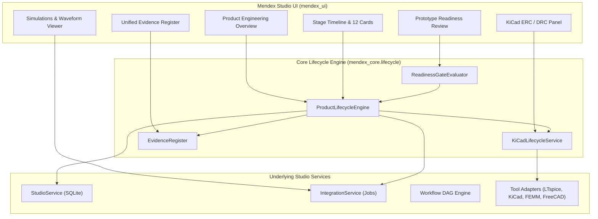

# Mendex Engineering Studio — Product Engineering Gaps & Architectural Analysis

**Document Version:** 1.0  
**Date:** 2026-11-11  
**Scope:** Identification of technical gaps in product lifecycle tracking, simulation association, PCB workflows, evidence aggregation, and readiness gating.

---

## 1. Identified Architecture & Functional Gaps

### Gap 1: Absence of a Unified Engineering Lifecycle Engine
- **Current State:** Mendex Studio provides product specifications (`Specification`), workspace directories, and generic engineering rules (`list_rules`), but has no formal state machine or evaluator that assesses the 12 core power electronics engineering stages.
- **Impact:** An engineer cannot answer whether electrical design is complete, whether simulations have succeeded, or what blockers remain.
- **Solution:** Implement `ProductLifecycleEngine` in `src/mendex_core/lifecycle/engine.py` with 12 typed stages and explicit status transitions (`NOT_STARTED`, `IN_PROGRESS`, `PENDING_VERIFICATION`, `PASSED`, `FAILED`, `BLOCKED`, `NOT_APPLICABLE`).

### Gap 2: Disconnection Between Product Records and Solver Jobs
- **Current State:** The `IntegrationService` submits jobs with a `workspace_id` (`default_workspace` or an `EngineeringWorkspace.workspace_id`), but does not record or filter by `product_id`.
- **Impact:** Simulation jobs run in the Simulation Lab or Workflow Studio are isolated from the Product Editor and cannot be attributed to SV-1000.
- **Solution:** Add `product_id` and `revision_id` parameters to `JobRequest` and `JobRecord` in `src/mendex_core/integration_contracts.py` and `integration_service.py`. Provide association methods to link existing jobs to a product revision.

### Gap 3: Conflation of "Tool Execution Exit 0" with "Engineering Validation Passed"
- **Current State:** A simulator exit code 0 simply means the program terminated without an OS crash. It does not verify whether the peak-to-peak output ripple is below $1.10\,\text{mV}$, whether MOSFET peak voltages exceed $40\,\text{V}$, or whether magnetic flux density exceeds saturation.
- **Impact:** False sense of security if solver exit 0 is interpreted as engineering approval.
- **Solution:** Enforce a strict distinction in data models and UI:
  - `solver_status`: Execution state (`SUCCEEDED`, `FAILED`, `TIMEOUT`, `CANCELLED`).
  - `engineering_validation`: Numerical criteria validation (`PASSED`, `FAILED`, `NOT_EVALUATED`, `WARNING`).

### Gap 4: Disconnected KiCad Schematic & PCB Workflow
- **Current State:** The Studio provides `KiCadAdapter` which wraps `kicad-cli`, but there is no product-level UI to:
  - View schematic and PCB files in the product workspace.
  - Run ERC directly from the product view and display categorized sheet violations.
  - Run DRC directly on board layouts and visualize clearance/track errors.
  - Export netlist, BOM, and Gerbers into the product release dossier.
- **Impact:** PCB design remains an external manual task with zero Studio traceability.
- **Solution:** Implement `KiCadLifecycleService` in `src/mendex_core/lifecycle/kicad_service.py` and embed PCB design controls into the Product Engineering Overview.

### Gap 5: Fragmented Evidence Traceability
- **Current State:** Evidence files are placed in raw filesystem folders (`circuit/`, `pcb/`, `simulations/`, `reports/`). Manual check records are stored in `validations`. Manifests are stored in `manifest.json`. There is no unified register querying all evidence records across a product.
- **Impact:** An auditor cannot inspect the complete chain of custody for a product revision in a single view.
- **Solution:** Implement `UnifiedEvidenceRecord` and `EvidenceRegister` in `src/mendex_core/lifecycle/models.py` with full provenance, SHA-256 hashes, source tools, execution timestamps, and reviewer sign-offs.

### Gap 6: Simplistic Readiness Evaluation
- **Current State:** Products have draft/review/approved metadata flags, but no engineering readiness gates checking whether mandatory criteria (requirements review, electrical simulation, magnetic FEA, KiCad ERC, PCB DRC, BOM review) are met.
- **Impact:** Risk of premature prototype fabrication before critical verification gates have passed.
- **Solution:** Implement `ReadinessGateEvaluator` which strictly blocks prototype readiness if any mandatory gate is missing, failed, or unverified.

---

## 2. Target System Architecture

---

## 3. Compliance and Verification Mandates

1. **Zero Fabrication:** If no KiCad file exists or no simulation was run, the stage status must be `NOT_STARTED` with an explicit blocker message.
2. **Product Independence Preserved:** General workspaces (`HVLC`), standalone Simulation Lab, and Workflow Studio remain functional without requiring a product.
3. **Immutability of Frozen Baselines:** Archived revisions cannot be mutated; new engineering work occurs in draft revisions.
