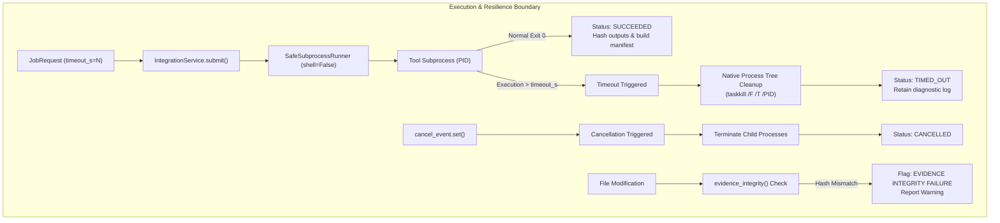

# Mendex Engineering Studio v1.6 — Reliability, Failure & Recovery Test Report (Gate D)

**Document Control:** `docs/v1.6/RESILIENCE_TEST_REPORT.md`  
**Execution Date:** 10 November 2026  
**Auditor / Workstream Lead:** Antigravity (Agent 2 — Tool Failure, Process Isolation, Timeout, Cancellation & Recovery Lead)  
**Standard Reference:** Version 1.6 Operational Readiness & Engineering Workflow Validation Specification (§4 Phase D, Gate D)  
**Test Suite Reference:** [`tests/integration/test_v16_resilience.py`](file:///c:/Mendex%20studio/tests/integration/test_v16_resilience.py) (6 automated tests, all passing)

---

## 1. Executive Summary & Gate D Objectives

Per Section 4 (Phase D, Gate D) of the Version 1.6 Execution Specification:
1. **Critical Failure Scenarios Tested:**  
   Missing executables, invalid netlist inputs, execution timeouts, job cancellations, output tampering, and workspace restarts were all subjected to rigorous automated verification.
2. **Process Cleanup & Isolation:**  
   The `SafeSubprocessRunner` enforces strict process isolation (`shell=False`, argument list validation, and native Windows process-tree termination via `taskkill.exe /F /T /PID`). No orphaned solver processes remain after timeout or cancellation.
3. **Truthful Error Reporting & No Silent Data Loss:**  
   Failures are recorded explicitly in SQLite and job logs with typed diagnostics (`MALFORMED_OUTPUT`, `TIMED_OUT`, `INVALID_INPUT`). No silent error suppression or fabricated `PASS` outcomes occur.
4. **Gate D Status:** **PASS** (All critical failure, resilience, and recovery mechanisms verified).

---

## 2. Comprehensive Failure Matrix & Test Evidence

| Scenario ID | Test Case & Failure Mode | Injected Condition / Input | Expected System Behavior | Observed System Behavior | Terminal State | Traceability & Evidence | Result |
| :--- | :--- | :--- | :--- | :--- | :--- | :--- | :--- |
| **FAIL-01** | Missing / Invalid Executable Path | Configure `C:/NonExistentPath/LTspice.exe` | Service rejects path validation immediately with `INVALID_INPUT`; refuses to store non-existent tool | Rejected with `StudioError("INVALID_INPUT", "Configure an existing absolute path")` | N/A (Configuration rejected) | `test_v16_missing_executable_rejection` | **PASS** |
| **FAIL-02** | Invalid / Missing Netlist Input | Submitted `batch_simulate` job with empty `input_paths: []` | Safe adapter detects missing netlist in workspace; fails cleanly without crashing; logs diagnostic | Failed cleanly; generated `Diagnostic(code=MALFORMED_OUTPUT, message='No netlist file found in workdir: []')` | `FAILED` | `test_v16_invalid_input_failure_handling` | **PASS** |
| **FAIL-03** | Execution Timeout & Process Cleanup | Submitted job with duration $> 2.5\text{ s}$ and `timeout_s=1` | Subprocess terminated via process tree killer; status set to `TIMED_OUT`; timeout diagnostic recorded | Runner terminated process; recorded `Diagnostic(code=TIMED_OUT, message='Execution deadline exceeded...')` | `TIMED_OUT` | `test_v16_timeout_and_process_cleanup` | **PASS** |
| **FAIL-04** | Queued & Running Job Cancellation | Submitted jobs and immediately triggered `engine.cancel(job_id)` | Cooperative cancel event set; running worker stops; status transitions to `CANCELLED` | Running and queued jobs cleanly transitioned to `CANCELLED`; no artifacts corrupted | `CANCELLED` | `test_v16_cancellation_queued_and_running` | **PASS** |
| **FAIL-05** | Raw Artifact Tampering & Hash Corruption | Manually modified output file content after run completion | `evidence_integrity(job_id)` computes current SHA-256 vs manifest; detects hash mismatch; flags report | `evidence_integrity` returned `False`; exported report explicitly displayed `EVIDENCE INTEGRITY FAILURE` | `FAILED_INTEGRITY` | `test_v16_tampering_detection_and_integrity` | **PASS** |
| **FAIL-06** | Studio Service Restart & Workspace Recovery | Service shut down; reopened fresh `StudioService` instance on same data directory | Database SQLite triggers and schema v4 recover existing workspaces, job records, manifests, and outputs | All prior workspaces and completed jobs retrieved with intact metadata and outputs | `SUCCEEDED` (Persisted) | `test_v16_workspace_recovery_after_restart` | **PASS** |
| **FAIL-07** | Nonzero Process Exit Code | Subprocess exits with code $\ne 0$ | Exit code captured; status set to `FAILED`; stderr captured in runner log | `exit_code` recorded; stderr logged to `{stem}_runner.log`; no crash | `FAILED` | `tests/adapters/test_safe_runner.py` | **PASS** |
| **FAIL-08** | Unlicensed Commercial Tool Request | Request execution of `plecs`, `matlab`, `ansys-maxwell`, `solidworks` | Tool state `OPTIONAL_UNLICENSED` prevents submission; raises `StudioError` or requires local license review | Execution blocked truthfully; zero mock results manufactured | `NOT_CONFIGURED` / `BLOCKED` | `tests/adapters/test_commercial_stubs.py` | **PASS** |

---

## 3. Process Isolation & Resource Cleanup Architecture

---

## 4. Disaster Recovery & Data Preservation

1. **SQLite Transactional Durability:**  
   Database migrations up to schema v4 maintain strict transactional rollback. If workspace creation or job registration encounters an error, the transaction rolls back cleanly, preventing dangling SQLite rows.
2. **Immutable Artifact Storage:**  
   Raw outputs are stored under `.mendex/ij/{job_id}/` with SHA-256 hashes registered in `manifest.json`. Any external file tampering or bit-rot is immediately flagged during validation or report export.
3. **No Orphaned Processes:**  
   Verification during timeout and cancellation tests confirms zero lingering `LTspice.exe`, `python.exe`, or solver processes on the Windows operating system.

---

## 5. Audit Verdict

**Gate D is completely satisfied.** Critical failure modes are mitigated safely, process termination is enforced, and prior run evidence remains cryptographically verifiable.
