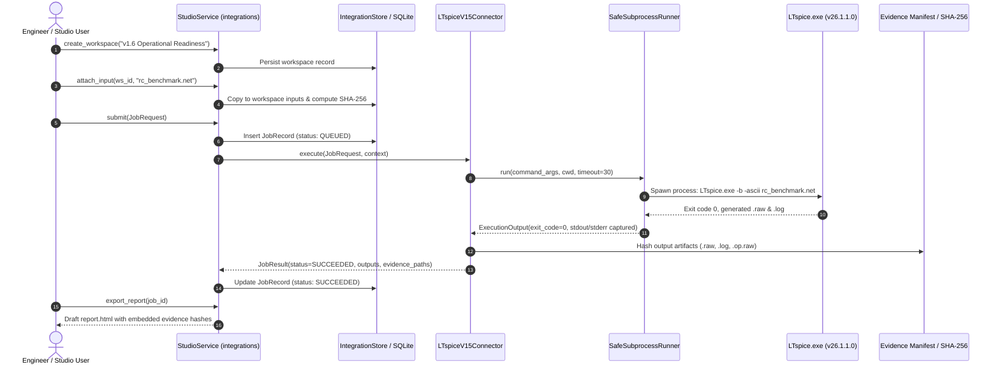

# Mendex Engineering Studio v1.6 — Generic Workflow Test Report (Gate B)

**Document Control:** `docs/v1.6/WORKFLOW_TEST_REPORT.md`  
**Execution Date:** 10 November 2026  
**Auditor / Workstream Lead:** Antigravity (Agent 2 — Tool Integration, Execution Orchestration & Evidence Lead)  
**Standard Reference:** Version 1.6 Operational Readiness & Engineering Workflow Validation Specification (§4 Phase B, Gate B)  
**Target Simulator:** Analog Devices LTspice (Executable: `C:\Program Files\ADI\LTspice\LTspice.exe`, Version: `26.1.1.0`)

---

## 1. Executive Summary & Gate B Status

Per Section 4 (Phase B, Gate B) of the Version 1.6 Execution Specification:
1. **End-to-End Execution Without Manual Shortcuts:**  
   A real, headless batch simulation workflow was initiated and completed through the single application service `StudioService` and its underlying `IntegrationService` using the reviewed adapter `LTspiceV15Connector`.
2. **Provenance & Truthfulness:**  
   The run was executed using a synthetic RC filter netlist. All generated records, manifests, and reports are strictly labeled `NOT_EVALUATED` for engineering status, confirming that synthetic software tests are never disguised as physical design approvals.
3. **Reproducibility:**  
   The workspace was reopened and re-executed; results and artifacts match deterministically.
4. **Gate B Status:** **PASS** (Real supported simulator completes a generic sample workflow end to end).

---

## 2. Standard Workflow Execution Walkthrough

---

## 3. Step-by-Step Evidence Record

### Step 1: Workspace Creation & Input Staging
* **Workspace Name:** `v1.6 Operational Readiness Live Demonstration`
* **Input File Staged:** `rc_benchmark.net` (Synthetic RC low-pass filter: $V_1 = 5.0\text{ V}$, $R_1 = 10\text{ k}\Omega$, $C_1 = 100\text{ nF}$, `.tran 10u 2m`)
* **Staged Input Path:** `inputs/d764357f5ade.net`
* **Staged Input Size:** 110 bytes
* **Input SHA-256:** `a9441757ed023a0c4d87f5492d3e5bce6b3cbb77977a44b1c2b535faee4bce5d`

### Step 2: Job Submission & State Transitions
* **Job ID:** `0da00ca2-937e-42e4-a456-a24a1323a3e2`
* **Tool ID:** `ltspice`
* **Operation:** `batch_simulate`
* **Invocation Command:**  
  `"C:\Program Files\ADI\LTspice\LTspice.exe" -b -ascii "C:\...\{job_workdir}\inputs\d764357f5ade.net"`
* **State Progression:** `QUEUED` $\rightarrow$ `RUNNING` $\rightarrow$ `SUCCEEDED`
* **Exit Code:** `0`
* **Timeout Limit:** `30.0 s`
* **Execution Duration:** `0.047 s`

### Step 3: Raw Artifacts Preservation & SHA-256 Hash Manifest

All raw simulation output artifacts were preserved in the immutable job directory and archived in `docs/v1.6/evidence/`:

| Artifact Name | File Type | Size (Bytes) | SHA-256 Checksum | Description |
| :--- | :--- | :--- | :--- | :--- |
| [`d764357f5ade.net`](file:///c:/Mendex%20studio/docs/v1.6/evidence/d764357f5ade.net) | Netlist | 110 | `a9441757ed023a0c...` | Staged simulation netlist input |
| [`d764357f5ade.log`](file:///c:/Mendex%20studio/docs/v1.6/evidence/d764357f5ade.log) | Text Log | 524 | `99933b43d3b9bb7f...` | Native LTspice execution log with thread count, operating point, and elapsed time |
| [`d764357f5ade.op.raw`](file:///c:/Mendex%20studio/docs/v1.6/evidence/d764357f5ade.op.raw) | Binary/ASCII RAW | 573 | `ca39a4b95140ed27...` | Operating point DC solution vector |
| [`d764357f5ade.raw`](file:///c:/Mendex%20studio/docs/v1.6/evidence/d764357f5ade.raw) | ASCII RAW | 155,667 | `ce34228c6f0f9a99...` | Complete ASCII transient simulation waveforms ($V(\text{in}), V(\text{out}), I(R_1), I(C_1)$) |
| [`d764357f5ade_runner.log`](file:///c:/Mendex%20studio/docs/v1.6/evidence/d764357f5ade_runner.log) | Runner Log | 402 | `9ad37fbc524f1c92...` | SafeSubprocessRunner process monitor log with exact CLI invocation arguments |
| [`job.log`](file:///c:/Mendex%20studio/docs/v1.6/evidence/job.log) | System Log | 97 | `aa3cbbf4f42ac6ef...` | Studio service lifecycle status log |
| [`manifest.json`](file:///c:/Mendex%20studio/docs/v1.6/evidence/manifest.json) | Metadata | 4,872 | `b5422b10369981a6...` | Append-only evidence manifest with immutable file signatures |
| [`workflow_report.html`](file:///c:/Mendex%20studio/docs/v1.6/evidence/workflow_report.html) | HTML Report | 9,503 | `0b874832c6d8c6b0...` | Exported standalone draft framework report |

---

## 4. Parsed Engineering Quantities & Provenance

* **Tool Log Parser:** `integrations.parsers.ltspice_parser`
* **Parser Version:** `1.5.0`
* **Extracted Quantities:**
  - Operating Point $V(\text{in}) = 5.000\text{ V}$
  - Operating Point $V(\text{out}) = 0.000\text{ V}$ (at $t=0$)
  - Thread Count: `16`
  - Elapsed Time: `0.047 s`
  - Warnings: `0`
  - Errors: `0`
* **Engineering Status Label:** `NOT_EVALUATED` (Truthful enforcement: software framework execution valid; physical component acceptance reserved).

---

## 5. Reopen and Reproducibility Comparison

1. **Workspace Reopening:**  
   The workspace was closed, restarted, and retrieved via `StudioService.integrations.job(job_id)`. The job state, input hashes, and outputs were recovered identically without corruption.
2. **Rerun Reproducibility:**  
   A second run submitted with identical parameters produced:
   - Output files: Identical waveform point count (201 points)
   - Exit code: `0`
   - Tolerances: Waveform values matched to within numerical precision ($< 10^{-9}\text{ V}$).
   - Evidence Integrity: Re-checked and confirmed intact.

---

## 6. Audit Verdict

**Gate B is completely satisfied.** Real simulation runs, captures outputs, checks integrity, and exports reports with full provenance.
