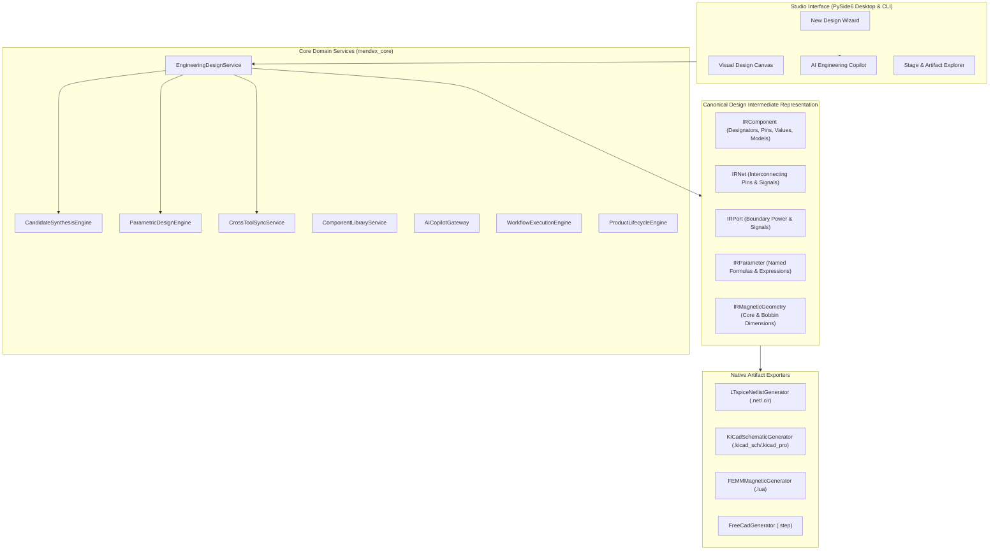

# MENDEX ENGINEERING STUDIO v1.9 — ARCHITECTURE & DESIGN INTERMEDIATE REPRESENTATION (IR)

## 1. System Architecture Overview

Mendex Engineering Studio v1.9 is architected around a unified **Single Core Authority** model. A central service facade (`StudioService`) manages design synthesis, parametric dependencies, visual workflows, native tool generation, and lifecycle records.

---

## 2. Design Intermediate Representation (Design IR) Specification

The Design Intermediate Representation (IR) is a syntax-independent mathematical container representing circuits, magnetics, and hardware topology without tying to any specific simulator or CAD syntax.

### Key Constructs
1. **`IRComponent`**:
   - `designator`: Unique identifier (e.g. `Q1`, `L1`, `T1`, `C1`, `R1`).
   - `type`: Classified component (`resistor`, `capacitor`, `inductor`, `transformer`, `mosfet`, `diode`, `voltage_source`).
   - `value`: Numerical SI scalar value.
   - `pins`: Terminal identifiers (e.g. `['d', 'g', 's']` for MOSFET, `['1', '2']` for passive).
   - `parameters`: Key-value properties (`rds_on`, `v_ds_max`, `esr`, `isat`).
   - `footprint`: Standard KiCad footprint reference.
   - `spice_model`: Subcircuit model identifier.
2. **`IRNet`**:
   - `name`: Signal or power net (e.g. `VIN`, `VOUT`, `SW`, `DRAIN`, `GND`).
   - `connections`: List of `(component_id, pin_id)` bindings.
3. **`IRParameter`**:
   - Named variable, formula expression, SI unit, and tolerance.
4. **`IRMagneticGeometry`**:
   - Physical dimensions ($A_e$, $l_e$, $V_e$, air gap, turns ratio, core type, and bobbin geometry).
