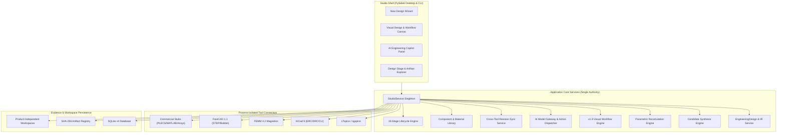

# MENDEX ENGINEERING STUDIO
## CONSOLIDATED MASTER IMPLEMENTATION SPECIFICATION | v1.9 REVISED
**Visual Workflow Studio • Specification-to-Design • AI Copilot • CAD/CAE Integration • Engineering Lifecycle**  
*Date: 11 November 2026 | Document Control: Internal Master Implementation Specification*

---

## 1. Executive Objective and Product Vision

Mendex Engineering Studio is an open, rigorous engineering creation environment—not a CRM-like product catalog or software launcher. An engineer must be able to begin with requirements, synthesize candidate topologies, run deterministic calculations, inspect and edit a canonical Design Intermediate Representation (IR), export editable native files (LTspice netlists/circuits, KiCad schematics/PCBs, FEMM models, FreeCAD 3D CAD), simulate in real solvers, iterate across revisions, and progress to manufacturing preparation with immutable cryptographic evidence.

### Canonical Workflow Experience
$$\text{Requirements} \longrightarrow \text{Candidate Synthesis} \longrightarrow \text{Calculations} \longrightarrow \text{Design IR} \longrightarrow \text{Native EDA/CAE} \longrightarrow \text{Simulation} \longrightarrow \text{Revision} \longrightarrow \text{PCB/BOM} \longrightarrow \text{Release}$$

**Core Authority Rule**: Products are strictly **optional** associations. A generic engineering workspace supports 100% of calculation, simulation, design, and verification capabilities without any product record. No specific product design (SV1000, MC100, etc.) is authorized or designed during this platform implementation.

---

## 2. Non-Negotiable Engineering Principles

1. **Deterministic Physics First**: Engineering calculations (area product, Steinmetz loss, Dowell AC resistance, ripple, stress) must use verified analytical equations. Zero fabricated or synthetic simulation results.
2. **True Verification vs. Solver Exit**: A solver exiting with code 0 indicates only that the process did not crash. Engineering validation is a separate evaluation against explicit criteria and tolerances.
3. **Immutable Evidence & Stale Marking**: Staged inputs and raw outputs are hashed via SHA-256. When upstream requirements or circuit parameters change, downstream evidence is automatically flagged `STALE` and reverts to `NOT_EVALUATED`.
4. **AI Governed by Typed Actions**: AI acts as an assistant that proposes, explains, and orchestrates. It can only execute registered, typed engineering actions (`analyze_requirements`, `calculate`, `generate_artifact`, etc.) with explicit engineer review and approval.
5. **No Commercial License Bypass**: Proprietary tools (PLECS, MATLAB/Simulink, Ansys Maxwell, Ansys Icepak, SolidWorks) operate as honest unlicensed connectors reporting `LICENSE_REQUIRED` or `UNAVAILABLE`.
6. **No Fake Completeness**: Missing tools or unexecuted validations remain strictly `NOT_EVALUATED`.

---

## 3. System Architecture and Domain Data Model

### Core Entities
- **Workspace**: Root context (`id`, `title`, `directory`, `unit_system`, `active_revision`, optional `product_id`).
- **EngineeringDesign**: Design record (`id`, `workspace_id`, `category`, `requirements_revision`, `design_revision`, `ir_data`, `status`).
- **DesignIntermediateRepresentation (Design IR)**: Canonical, syntax-independent circuit and physical model (components, nets, ports, geometric boundaries, parameters, constraints).
- **DesignCandidate**: Synthesized topology proposal (`topology`, `parameters`, `rationale`, `feasibility`, `review_status`).
- **DesignArtifact**: File record (`kind`, `path`, `format`, `sha256`, `source_service`, `revision_id`, `parent_ids`, `edit_provenance`).
- **WorkflowDefinition / Run**: Visual DAG graph schema and execution log.
- **ComponentRecord & MaterialRecord**: Sourced physical component data (ratings, models, footprints, supplier MPN).
- **ModelProviderConfig**: Configuration for AI providers (`provider`, `model`, `api_key_ref`, `budget`, `permissions`).

---

## 4. Design Synthesis and Parametric Engine

1. **Design Intermediate Representation (IR)**:
   - Holds abstract components (resistors, capacitors, inductors, transformers, switches, diodes, sources), net connections, parametric properties, and physical constraints.
   - Decoupled from specific simulator netlist syntax (LTspice `.cir`/`.net`, ngspice, KiCad `.kicad_sch`, FEMM `.fem`).
2. **Topology Synthesis & Screening**:
   - Matches requirements (e.g. input voltage range, output voltage, power throughput, galvanic isolation) against standard converter topologies (Buck, Boost, Flyback, Forward, Half-Bridge, Full-Bridge, Push-Pull, LLC).
   - Generates candidate ranking with documented analytical trade-offs.
3. **Parametric Dependency Graph**:
   - Directed dependency graph of all design variables ($f_{sw}$, $L_m$, $D_{max}$, $I_{pk}$, $\Delta V_{out}$, $A_p$).
   - Changing any parameter propagates recalculations and alerts user to constraint violations.

---

## 5. Visual Workflow Studio v1.9

- **Typed Node Canvas**: Draggable nodes with typed input/output ports (Scalar, Quantity, FileReference, DatasetReference, Netlist, Waveform, ValidationVerdict).
- **DAG Scheduler**: Topological execution with cycle detection, resource locks, and cooperative cancellation tokens.
- **Node Catalog**:
  - `Input`: Numeric, Text, Parameter, Dataset, File.
  - `Calculation`: Formula Evaluation (safe AST, zero arbitrary eval), Unit Conversion, Area Product, Steinmetz, Dowell.
  - `Tool`: LTspice, KiCad ERC/DRC, FEMM, FreeCADCmd.
  - `Validation`: Threshold Comparator, Range Check, Ripple Check.
  - `Reporting`: Traceable Report, Dossier Generator.
  - `Intelligence`: Requirement Analyzer, Trade-off Advisor.

---

## 6. AI Engineering Copilot & Action Gateway

- **Provider-Neutral Model Abstraction**: Supports Google Gemini API, OpenAI API, offline deterministic backend, and local models.
- **Action Sandbox**: The Copilot cannot directly write to disk or launch tools without user confirmation. All actions map to typed functions:
  `analyze_requirements`, `synthesize_candidates`, `evaluate_formulas`, `generate_native_artifacts`, `open_tool`, `run_solver`, `compare_waveforms`, `propose_revision`.
- **Traceability**: Every suggestion logs model provider, prompt timestamp, deterministic reasoning trace, and engineer approval decision.

---

## 7. Cross-Tool Revision-Aware Synchronization

- Generated files (LTspice `.net`, KiCad `.kicad_sch`, FreeCAD `.step`) carry SHA-256 checksums at generation time.
- When an engineer edits an artifact externally in KiCad or LTspice and returns to the Studio, the Studio detects hash divergence.
- Reconciles external changes into a new Design Revision, preserving previous immutable baselines.
- Marks downstream simulation results `STALE`.

---

## 8. 15-Stage Engineering Lifecycle & Evidence Policy

Covers Requirements $\to$ Architecture $\to$ Circuit Design $\to$ Calculations $\to$ Simulation $\to$ Magnetics $\to$ Schematic $\to$ PCB Layout $\to$ PCB DRC $\to$ Thermal/Mechanical $\to$ BOM $\to$ Validation $\to$ Prototype Gate $\to$ Physical Testing $\to$ Engineering Release.
- Requires explicit evidence records and authorized sign-offs for gate advancement.
- Never promotes to `PASSED` without underlying verified artifacts.
