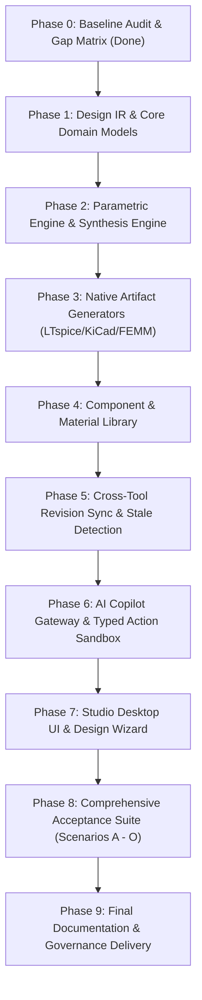

# MENDEX ENGINEERING STUDIO v1.9 REVISED
## IMPLEMENTATION GAP MATRIX & BASELINE AUDIT

**Audit Date**: 11 November 2026  
**Audited Baseline**: Commit `7b29c3f` on branch `v1.9-consolidated-master` (173 passed, 2 skipped, 0 failed)  
**Governance Scope**: Consolidated Master Implementation Specification v1.9 Revised

---

## 1. Subsystem Implementation Gap Assessment

| Subsystem / Capability | Current Implementation Baseline | Required by v1.9 Revised Spec | Classification | Action Required in Plan |
|---|---|---|---|---|
| **Core Architecture & Persistence** | `StudioService` central coordinator; SQLite schema v1–v4; product-independent workspaces. | Preserved single-core authority; SQLite persistence; UUID-based revision directories. | **COMPLETE & VERIFIED** | Retain; integrate with new design services. |
| **Design Intermediate Representation (IR)** | Product `Specification` exists, but no syntax-independent Design IR with abstract components, nets, and geometric constraints. | Canonical typed `DesignIntermediateRepresentation` independent of LTspice, KiCad, or FEMM syntax. | **MISSING** | Implement in `src/mendex_core/design/ir.py` & contracts. |
| **Design Candidate Synthesis** | Isolated calculation scripts for flyback sizing; no formal candidate synthesis engine. | Requirements interpreter $\to$ topology selection $\to$ candidate ranking with documented trade-offs. | **MISSING** | Implement in `src/mendex_core/design/synthesis.py`. |
| **Parametric Recalculation Engine** | AST math parser in workflow calculations; no directed parameter dependency graph. | Named parameters, unit-aware dependencies, constraint propagation, parameter sweeps, impact preview. | **PARTIALLY IMPLEMENTED** | Implement `ParametricDesignEngine` in `src/mendex_core/design/parametric.py`. |
| **Native Artifact Generators** | Standalone bobbin script generator and static templates; no automated IR-to-Native compiler. | Automated generation of valid LTspice circuits (`.net`/`.cir`), KiCad 9 schematics (`.kicad_sch`), and FEMM models. | **PARTIALLY IMPLEMENTED** | Build IR-to-EDA artifact exporters in `src/mendex_core/design/generators/`. |
| **Cross-Tool Revision Synchronization** | Hash verification in PCB workspace; no generic cross-tool diff and stale-marking engine. | Detect external edits in native tools; hash divergence alert; reconcile new revision; mark downstream evidence STALE. | **PARTIALLY IMPLEMENTED** | Implement `CrossToolSyncService` in `src/mendex_core/design/sync.py`. |
| **Component & Material Library** | Datasets (SwitchLossDB, MagNet) queryable; no typed component/material catalog with SPICE/footprint refs. | Structured `ComponentRecord` & `MaterialRecord` store with ratings, deratings, MPNs, and provenances. | **PARTIALLY IMPLEMENTED** | Implement `ComponentLibraryService` in `src/mendex_core/components/`. |
| **AI Copilot & Action Gateway** | Stub `UnavailableAIService` in `src/mendex_core/ai.py`. | Provider-neutral gateway (Gemini API, OpenAI, local/offline); typed registered actions; user permission gating. | **MISSING** | Implement full `AIGateway` and action sandbox in `src/mendex_core/ai/`. |
| **Visual Workflow Studio v1.9** | Typed DAG contracts, node registry, storage, execution engine, and test scenarios verified. | Complete desktop UI integration, interactive canvas editing, and multi-node execution view. | **COMPLETE & VERIFIED** | Wire canvas into Design Studio UI shell. |
| **Tool Ecosystem & Connectors** | 18 resources + ngspice audited; KiCad CLI, FreeCADCmd, Git, Python verified; commercial stubs honest. | Maintain honest availability; never bypass licensing; preserve subprocess sandboxing and SHA-256 manifests. | **COMPLETE & VERIFIED** | Retain existing process-isolated connectors. |
| **Physical Test & Measurements** | `MeasurementService` with CSV scope parser, calibration metadata, and RMSE waveform comparison. | Lab scope ingestion, simulation vs measurement correlation, and report labeling. | **COMPLETE & VERIFIED** | Wire into verification evidence register. |
| **15-Stage Engineering Lifecycle** | 15 typed stages, gate evaluations, and ECR service with impact analysis. | Strict evidence requirements; zero fake PASS; immutable audit trail. | **COMPLETE & VERIFIED** | Retain and bind to Design IR workflows. |

---

## 2. Dependency-Ordered Implementation Plan

---

## 3. Exit Criteria for Phase 0

- [x] Dedicated branch `v1.9-consolidated-master` initialized.
- [x] Zero regressions against baseline (173 passed, 2 skipped, 0 failed).
- [x] Master specification published in `docs/v1.9/CONSOLIDATED_MASTER_SPEC.md`.
- [x] Gap matrix published in `docs/v1.9/IMPLEMENTATION_GAP_MATRIX.md`.

Phase 0 is **PASSED**. Proceeding to Phase 1 (Foundations & Design IR).
