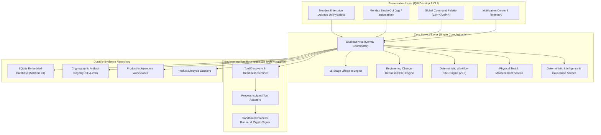

# MENDEX ENGINEERING STUDIO v2.0 — FINAL ARCHITECTURE SPECIFICATION

## 1. Architectural Authority & Topology

Mendex Engineering Studio v2.0 is an enterprise-grade power electronics and multiphysics engineering platform. The architecture strictly enforces a **Single Core Authority** principle, ensuring zero duplicated domain logic between desktop UI layers, CLI entry points, and automation harnesses.

---

## 2. Component Subsystems

### 2.1 Unified Core Service (`StudioService`)
- Central singleton façade coordinating state, storage, and tool executions.
- Guarantees transactional consistency across product records, revisions, and product-independent engineering workspaces.
- Embedded database migrations (Schema v1 $\to$ v4) with automatic table migrations for workflows, runs, measurements, and ECR tracking.

### 2.2 Product-Independent Engineering Workspaces
- Workspaces exist independently of commercial product records.
- Enables pure R&D, early calculation sweeps, simulation benches, and component evaluation without premature product tie-in.
- Downstream association mechanism allows linking independent workspace runs and artifacts to formal product lifecycle gates at milestone milestones.

### 2.3 15-Stage Lifecycle & Gate Engine
- Comprehensive coverage from requirements definition through physical qualification:
  1. `REQUIREMENTS` — Product specs, environmental parameters, operating boundaries.
  2. `ARCHITECTURE` — System topology, converter configuration, stress allocation.
  3. `ELECTRICAL_DESIGN` — Analytical circuit calculations, loss models, passive sizing.
  4. `ENGINEERING_CALCULATIONS` — Transformer area product, Dowell factor, semiconductor switching losses.
  5. `CIRCUIT_SIMULATION` — Transient, AC, and DC SPICE / OpenModelica / ngspice runs.
  6. `MAGNETIC_ANALYSIS` — Finite element analysis (FEMM), core saturation, flux density distributions.
  7. `SCHEMATIC_VERIFICATION` — KiCad schematic capture, Electrical Rule Check (ERC), pin connectivity.
  8. `PCB_DESIGN` — KiCad PCB layout, stackup design, thermal relief, copper planes.
  9. `PCB_VERIFICATION` — Design Rule Check (DRC), clearance/track width compliance, net continuity.
  10. `THERMAL_MECHANICAL` — FreeCAD 3D enclosure/bobbin STEP export, thermal resistance calculations.
  11. `BOM_SOURCING` — Component review, active manufacturer verification, sourcing risk assessment.
  12. `ENGINEERING_VALIDATION` — Multiphysics verification, cross-domain parameter alignment.
  13. `PROTOTYPE_READINESS` — Formal gate review, mandatory evidence completeness, blocker assessment.
  14. `PHYSICAL_TESTING` — Oscilloscope trace ingestion, lab test procedure execution, waveform correlation.
  15. `ENGINEERING_RELEASE` — Production release, immutable release dossier, export bundles.

### 2.4 Traceable Physical Test & Measurement Subsystem
- Ingests laboratory oscilloscope waveforms (CSV format) with SHA-256 integrity hashing.
- Stores calibration records, instrument metadata, serial numbers, operator tags, and test procedures.
- Performs automated waveform correlation against simulation traces: computes Root Mean Square Error (RMSE), Mean Absolute Error (MAE), and Peak-to-Peak variance.

### 2.5 Sandboxed Execution & Process Isolation
- Subprocess isolation with deterministic execution timeouts, stdout/stderr capture, and clean task cancellation.
- Tool detection truthfully checks real executable presence and licenses. Commercial tools (MATLAB, PLECS, Maxwell, Icepak, SolidWorks) operate as honest unlicensed stubs without artificial pass results.
- Cryptographic artifact manifest generated for every executed run.

---

## 3. UI/UX Architecture

- **PySide6 Desktop Application** with unified dark/light enterprise themes.
- **Global Command Palette (`Ctrl+K` / `Ctrl+P`)**: Instant search and navigation across all tools, workspaces, products, and actions.
- **Notification Center**: Real-time event logging, tool status alerts, execution results, and gate warnings.
- **Workflow Studio v1.9**: Visual node canvas supporting mathematical formula evaluation, tool invocation, input parameters, and results visualization.
- **Interactive Waveform Viewer**: High-performance multi-trace plotting with pan/zoom and cursor inspection.
- **Native CAD/CAE Router**: Dispatches `.step` to FreeCAD, `.kicad_sch` to KiCad Eeschema, `.kicad_pcb` to Pcbnew, `.raw` to LTspice, and `.fem` to FEMM.

---

## 4. Security & Compliance Posture

1. **Zero Fabrication Policy**: Unavailable tools, missing files, or unexecuted jobs remain strictly `NOT_EVALUATED` or `FAILED`.
2. **Deterministic Computations**: Analytical equations (Steinmetz, Dowell, RC time constants) are computed via safe AST evaluators and deterministic math without arbitrary `eval()`.
3. **Immutable Evidence**: Staged inputs and outputs are hashed via SHA-256. Any post-run modification is detected and marked `TAMPERED`.
