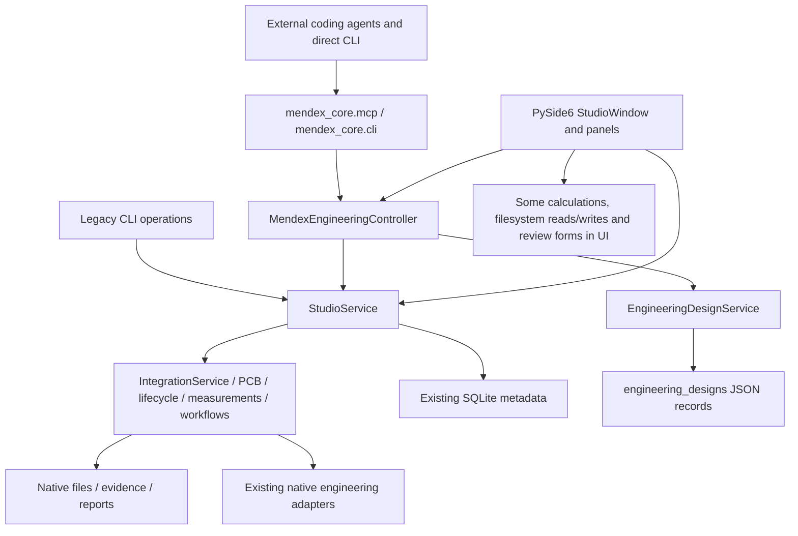

# v3.1 current-state audit

Date: 12 November 2026. Scope: repository source, current uncommitted work, read-only
SQLite schema inspection and focused local regression tests. This audit follows the
v3.1 master request's instruction to present findings and a sequence before major
changes. No implementation, schema migration, product development or legacy removal
was performed at this milestone.

The earlier `docs/v3/` audit remains historical. v3.1 supersedes its proposed editable
desktop scope: agents initiate engineering operations; Studio displays authoritative
records. A Tauri/React frontend has not been implemented in this working tree.

## Actual architecture



`main.py` and `src/main.py` launch `mendex_ui.__main__`. It creates
`StudioService(root)` and a `StudioWindow`, currently titled v2.1. The seven requested
navigation modules already exist. CLI and MCP use the engineering controller, while
legacy CLI and many Qt panels also call domain services directly. CLI currently
constructs a service and a controller, which constructs another service. The Qt
simulation panel also constructs a controller. Preserve one authoritative service
implementation and introduce explicit service-instance ownership at the transport
boundary; this does not require rebuilding the core.

## Reusable engineering functionality

| Area | Observed source and behavior | Qualification / limit |
|---|---|---|
| Projects/specifications | `service.py`, `controller.py`, `models.py`: product-backed project IDs, initial revision, typed SI specifications, metadata saves, revision creation | Reuse IDs; do not invent separate project records. Some older independent workspaces must remain independently addressable. |
| Calculations | `controller.run_calculation`: Dowell, losses, Steinmetz and flyback; existing deterministic Python calculation modules; newer analysis in `intelligence/calculations.py` | Core calculations exist, but generic durable calculation-run records with stage/context/assumptions are missing. Several newer tools still call calculations inside Qt dialogs. |
| Designs | `design/service.py`, `design/models.py`: requirements, candidates, native artifacts, design revisions, parameter changes and iteration | JSON-backed design cache loads at construction. Cross-process freshness and atomic persistence require work. Product revisions and design revisions are different identities. |
| Simulations | `controller.run_simulation`, design runners, integration adapters and `IntegrationService` | Controller run path is synchronous; integration jobs have a different submit/cancel/recovery path. Do not infer interchangeable cancellation/progress support. No solver executed during this audit. |
| LTspice | Existing integration adapter, design runner and waveform parser modules | Reuse; real execution, raw format coverage and packaged compatibility remain NOT_EVALUATED here. Consulted connected LTspice quickstart reference; no circuit or raw file edited. |
| FEMM | Existing adapter/design runner and script workflow | Reuse; native execution and physical validity remain NOT_EVALUATED here. |
| KiCad | Adapter, lifecycle KiCad service and `StudioService.pcb` | PCB service already provides snapshot-based ERC/DRC evidence/integrity checks; parallel lifecycle UI paths need consolidation through the safer shared service. Native qualification is not established by this audit. |
| Validation | `evidence.py`, `service.validation_summary`, PCB evidence checks, integration manifests | Reuse append-only numerical records and effective staleness/integrity status. Generic stage acceptance/review is not supplied by these alone. |
| Reviews | `lifecycle/engine.py`: `record_stage_approval`, latest approvals; ECR review service | Reviewer identity is caller-supplied. No authenticated authorization boundary was found in this path; do not expose it as agent self-approval or claim authorization. |
| Measurements | `measurements/service.py`: instrument/operator/procedure fields, CSV traces, measurement records and comparisons | Existing storage/service is reusable; current MCP/CLI do not expose the full workflow. Physical provenance still requires real supplied evidence. |
| Reports | Core revision HTML/JSON reports, integration job export, controller report facade, Qt dossier generation | Reuse proven generators; move orchestration out of Qt as needed. Listing/export/package operations are incomplete at the agent facade. |
| Files | Controller artifact inventory/hash/native open, design artifacts and PCB imports | General file registration with durable stage/revision/evidence association is incomplete; discovery is not registration or validation. |
| Components | In-memory seeded component/material/core library and research dataset services | Existing records can be displayed with source limits. A comment saying verified is not independent datasheet verification. Do not assert inventory or availability. |

## Lifecycle and workflow findings

`lifecycle/models.py` contains fixed stage enums with older aliases and fixed statuses.
`ProductLifecycleEngine` contains 12-stage metadata and additional 15-stage metadata;
product assessment and independent-workspace assessment have different profiles.
These assess files, persisted records and caller-supplied approvals. They do not
implement a configurable nine-stage definition with persisted per-stage executions.

Some historical assessment heuristics are unsuitable as new completion gates: source
text can affect evidence labels, filenames containing `clean` can affect ERC evidence
labels, and a recorded passed approval can override stage state without the new
explicit criteria/evidence gate. Preserve these records as legacy assessments; never
silently convert their PASSED values into v3.1 COMPLETED stages.

`workflows/contracts.py`, `storage.py` and `engine.py` implement visual node graphs,
connections, execution and reports, with SQLite `workflows`/`workflow_runs`. Reuse
calculation/adaptor services underneath them. A visual graph and canvas state are not
the lifecycle definition requested in v3.1. Do not build another visual editor or
reuse an existing graph COMPLETED state as proof of lifecycle completion.

## Actual data model

The existing database was inspected through SQLite `mode=ro`; StudioService was not
instantiated against live data. Observed `PRAGMA user_version`: **4**. Observed tables:

```text
activities                       engineering_change_requests
integration_datasets             integration_health
integration_jobs                 integration_settings
integration_workspaces           lifecycle_approvals
measurements                     products
reports                          revisions
runs                             tool_settings
validations                      workflow_runs
workflows
```

Observed append-only triggers: `runs_no_delete`, `runs_no_update`,
`validation_no_delete`, `validation_no_update`. This is not evidence that every table
or historical file is immutable. No product payloads were exported by the schema probe.

`integration_store.migrate_v5` adds workspace/activity fields but leaves
`PRAGMA user_version=5` commented out; `StudioService` rejects versions above 4.
Workflow/lifecycle/ECR/measurement tables are also initialized separately. A simple
blind bump to version 5 would break existing startup. Establish a tested compatibility
migration and backup first. Existing schema docs describe earlier foundations and
cannot substitute for actual inspection.

Other authoritative content lives in `products/<UUID>/revisions/<UUID>`,
`workspaces`, `engineering_designs/*.json`, evidence/check directories and reports.
There is no justification for a second SQLite database or wholesale JSON conversion.

## Current agent interface

AST inspection found **29 MCP tool definitions**, including project/workspace/product
CRUD subsets, specification save/validate, design generation/read, calculations,
simulation run/list, artifacts, tools, revisions, validation summary and report
generation. Settings text claiming 22 tools and an ACTIVE server is not a live check.

CLI exposes legacy commands plus `project`, `workspace`, `specification`, `design`,
`calculate`, `simulation`, `artifact` and `tool` groups. PCB import/check/notes and
report generation exist directly in CLI, but are not all available as MCP tools.
Neither facade provides the requested generic lifecycle definition/start/complete/
block/review/evidence/history operations. See the operation matrix in document 02.

## Desktop actions still requiring manual interaction

| Current action/source | Existing reusable backend | Move to agents / retained UI role |
|---|---|---|
| Project creation and specification editor (`window.py`, wizard) | Controller/service project/specification/revision methods | Agent creates/updates once; Studio views and compares |
| Guided sizing and artifact scaffolding (`product_wizard_dialog.py`) | Partial reuse of calculations and core project creation; direct UI file writes remain | Extract orchestration into core before removing UI; no new product-specific synthesis |
| Simulation form/worker (`simulation_center_panel.py`) | Controller run path, integration job APIs | Agent initiates; Studio monitors logs/results without configuring another run |
| Sizing/loss/thermal/core comparisons (component and comparator dialogs) | Existing Python analytical functions | Core calculation capability wrappers and persisted results; Studio displays results |
| PCB import/ERC/DRC and Gerber controls (`product_lifecycle_panel.py`, `pcb_panel.py`) | PCBWorkspaceService, KiCad lifecycle service | Agent registers/checks supported artifacts; Studio opens/inspects evidence; export is not manufacturing approval |
| Manual validation form and evidence attachment (`panels.py`) | `record_validation` and integrity-aware summaries | Agent can submit attributed evidence/criteria, never authenticate reviewer or approve work |
| Stage PASS/FAIL review forms (`product_lifecycle_panel.py`) | `record_stage_approval` with caller-supplied name | Keep historical records, separate review requests from authorized review; no agent approval endpoint |
| Revision comparison/dialog and edits | Core product/design revision services | Agents create revisions; Studio timeline/comparison remains |
| Dossier/report button | Core report generators plus UI composition | Agent requests generation; Studio lists/opens/exports |
| Visual workflow canvas and netlist editor | Existing backend graph engine, native editors | Preserve backend, retire UI only after parity; do not reproduce authoring in React |

## Tests, packaging and operational readiness

Focused local baseline on this current tree: **52 passed in 23.45 seconds**, using
service, controller, project, CLI, MCP, product lifecycle, v2.0 lifecycle, graph workflow,
end-to-end and navigation tests. Exact command is recorded in document 04. This is
not the full suite and does not prove the v3.1 features exist.

No Tauri/React project directories found. rustc/cargo were not found on PATH; absence
elsewhere was not established. Earlier observed Node 22.19.0/npm 10.9.3 and Python
3.13.7 are development prerequisites, not a compatibility guarantee. Python packaging
declares Pydantic/PySide6, but NumPy imports need a dependency audit. The existing
Windows setup script invokes pythonw and does not prove standalone frozen runtime
installation. Native solver tests, WebView2/MSVC, offline packaging, performance and
clean-machine installation remain NOT_EVALUATED.

Pre-existing modified/untracked application files, handbook/playbook documents and
tests were preserved. This milestone adds only v3.1 audit documents and a checklist
entry; it does not change the existing v3 audit or release labels.
