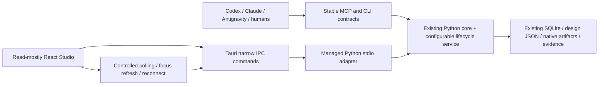

# v3.1 implementation plan for review

Date: 12 November 2026. Phase 0 audit complete at source/feature-family level.
The user approved implementation after this audit on 12 November 2026. The first
backend lifecycle milestone and its initial CLI/MCP coverage are now implemented;
see documents 06, 07, 09, 10 and 14 for actual scope and limits. Later phases remain
pending. The original sequence below is retained for traceability. The v3.1 request finalizes the
responsibility split and target technology; those decisions do not need to be reopened.
Its first-action instruction requires presenting the audit/plan before major changes
and then proceeding with the approved implementation.

## Simplest safe target



Keep one core implementation and existing IDs/storage. Add the lifecycle service as
a `StudioService` domain component; both agent facades and desktop transport delegate
to it. Reuse deterministic calculations, design and native tool services. Do not
introduce a visual workflow framework, another frontend, HTTP server, cloud messaging
or AI-provider logic. Keep Qt entry points available until parity is demonstrated.

## Phase 1 — configurable lifecycle and guarded persistence

Default nine stages:

| ID | Stage | Required completion basis |
|---|---|---|
| project_initialization | Project Initialization | Existing project/revision identity, explicit context and initialization record |
| requirements | Requirements and Specifications | Structured versioned requirements/criteria, unresolved-input findings and traceable specification |
| feasibility | Feasibility and Architecture | Recorded alternatives, assumptions, decisions and risk evidence |
| calculations | Engineering Calculations | Supported calculation-run records with exact inputs/units/assumptions/results and acceptance outcomes |
| design_development | Engineering Design Development | Registered artifacts tied to design/specification revision and their validation findings |
| simulation | Simulation and Analysis | Actual solver/job records, input/output hashes, logs/results and applicable acceptance outcomes |
| verification | Engineering Verification | Requirement coverage, integrity-checked calculated/simulated/measured evidence and unresolved findings |
| prototype_testing | Prototype and Physical Testing | Real test plan/prototype/instrument/operator/measurement evidence or explicit justified optional-stage disposition |
| documentation | Final Engineering Documentation | Reports, manifest/revision/evidence references and accurate review status; never manufacturing authorization |

Use strict versioned JSON packaged with the core. Validate unique stage/criterion IDs,
dependency references, acyclic dependencies, registered rule types, evidence kinds,
optional-stage rules and review gates. No executable expressions/configuration.
Disciplines may add optional/additional stages; no specific product numbers/default
electrical requirements are embedded. Inapplicability needs recorded justification,
not an assumption that a missing solver makes a stage optional.

Separate stage state (NOT_STARTED, IN_PROGRESS, BLOCKED, AWAITING_REVIEW, COMPLETED,
FAILED, NOT_APPLICABLE) from effective engineering evaluation (NOT_EVALUATED, PASS,
FAIL and any existing physical-verification status). Preserve original history and
recompute effective evaluation against current specification/evidence. Allow new
attempts/iterations and explicit reopening with history. Never infer completion from
a file, a solver exit code or an agent's requested state.

Use explicit criteria and referenced evidence, not generic arbitrary PASS fields.
Human-review-required stages stay awaiting review without an authorized decision.
Existing approval strings are historical assertions, not a new authentication scheme.
Do not implement manufacturing approval or permit agent self-approval.

Before modifying schema: consistent backup + artifact/evidence manifest, restoration
test, transactional additive migration and fresh/current/old/future-schema fixtures.
Coordinate the current user_version=4 guard and v5-style additive columns. No live-data
migration is performed just to run tests; all migration development uses isolated copies.

Gate: configuration rejection, dependency/optional/iteration behavior, no-evidence
completion rejection, stale/tampered evidence, revision isolation, append-only history,
rollback, replay/idempotency and legacy data compatibility tests pass.

## Phase 2 — complete shared MCP/CLI control

Implement the gap matrix in document 02 incrementally through typed shared service
methods. Begin with definition/list/get/enroll, start/block/request-review/history,
attach evidence and guarded completion. Add project metadata, requirements/coverage,
calculation capability/run history, artifact registration, job details/logs/results,
measurement records, report metadata/list/export and supported validation methods.

Reuse existing entry points and retain old names/response contracts where necessary.
New contracts are versioned and reject unknown fields/nonfinite values. Persist
execution source/correlation/idempotency metadata; same key+same request returns the
committed result, changed payload conflicts. No unrestricted reflection or shell tool.
Cancellation is capability- and ownership-aware; unsupported paths return an explicit
error rather than changing a label and claiming the solver stopped.

Gate: CLI/MCP parity on the same stored records, structured errors, malformed requests,
retries, process interruption and headless operation with no desktop process.

## Phase 3 — generic engineering prompt library

Create the requested `engineering-workflows/` master, nine stage prompts, validation
rules and six report/review/specification templates. Each stage covers all thirteen
requested fields: purpose, inputs, engineer questions, tools, actual MCP/CLI operations,
artifacts, stored records, validation, evidence, completion, human review, errors and
next-stage guidance. Include command examples only after the implemented contract is
tested. Prompts discover capabilities, ask for missing requirements and never invent
values, approvals, physical results, regulatory compliance or next-stage completion.
Keep agent-specific setup separate from the agent-independent core.

Gate: verify all referenced commands/tools exist, every stage has all required fields,
examples use disposable generic software fixtures and no destructive cleanup is suggested.

## Phase 4 — automatic synchronization

Start with controlled polling of active backend queries (initial proposal: two seconds
while visible), refresh on focus and bounded exponential backoff on failures. Show
last successful sync, stale/disconnected state and errors. Normal external writes
must appear without a manual refresh or desktop restart. Poll through the backend;
React never reads SQLite or engineering files directly.

Backend read methods must query fresh SQLite records and refresh JSON design records;
fix the long-lived design-cache behavior before claiming polling works. A short-lived
new SQLite connection's data_version is not a reliable cross-poll change token.
Initially refetch bounded queries directly; add optimization only after measurement.
Watcher/events may be hints later, with polling reconciliation for missed notifications.
No mutation/solver request is automatically replayed after reconnect. Desktop shutdown
must not cancel jobs independently owned by CLI/MCP.

Gate: separate CLI/MCP and backend/UI processes, external create/update/job/revision/
evidence changes visible within the measured polling window; rapid updates, deleted/
damaged evidence, crash/reconnect and stale cache covered. UI thread stays responsive.

## Phases 5–7 — simplified modern desktop and visualization

First prove each manual engineering workflow has an agent equivalent. Then build one
additive `desktop/` Tauri 2 + React/TypeScript/Vite application. Do not delete legacy
Qt or mutate current UI while replacement parity is unverified.

Use narrow private JSON-lines stdio IPC and a Tauri-owned Python process with exact
executable/argument handling, handshake/version check, bounded frames/queue/timeouts,
stderr logging, health and bounded shutdown. No public port or general shell/database
command. Development interpreter choice is explicit; release needs an actual frozen
Python proof, not dependence on the development venv. Shared core stays headless.

Use dark/light semantic tokens, Tailwind/shadcn components and Lucide icons; TanStack
Query for automatic refresh and backend state. Choose actual compatible versions and
validate peer/engine ranges before installation. Load Plotly on waveform routes and
ECharts only for real available dashboard data. No decorative fake metrics.

Seven routes: Dashboard, Engineering Projects, Simulation Center, Component Library,
Engineering Tools, Reports & Evidence, Settings. Project detail covers Overview,
Lifecycle, Specifications, Designs, Calculations, Simulations, Engineering Files,
Validation, Revisions and Reports. Retain search/filter/open/compare/export/preferences
and diagnostics; no specification editor, design wizard, calculation/simulation form,
AI chat or visual workflow builder. Review actions remain unavailable without a
backend authorization path; review status/requests can be displayed.

Waveforms preserve original samples/domain/units/tool metadata and expose exact data
export. Decimation, if necessary, is presentation-only and disclosed. No fabricated
traces, silent interpolation or implicit FFT transforms. Run comparison validates
units/domain and explicit alignment. Separate configured/started/completed/extracted/
validated/reviewed states; SUCCEEDED means execution, not engineering approval.

Gate: frontend tests, real-record desktop integration, keyboard/empty/error/disconnect
behavior, visible automatic sync, native open allowlists, waveform fixtures and
measured performance. No percent-complete display unless its denominator is explicit
and objectively evaluated. Native tool installed/detected/tested/operational remain
separate facts.

## Phases 8–10 — regressions, end-to-end acceptance, verified cleanup

Run existing Python/core/calculation/adapter/CLI/MCP/UI tests plus new lifecycle,
migration/security/idempotency/synchronization and frontend/desktop tests. Distinguish
software fixtures from real solver evidence. Use a disposable generic reference
project for end-to-end demonstration, never begin a commercial product. Run real
native checks only where available; unavailable checks remain NOT_EVALUATED.

Demonstrate project -> requirements -> recorded supported calculation/design -> real
supported simulation where available -> evidence/verification -> review request ->
report, with Studio observing external changes. Physical testing remains blocked or
explicitly justified not applicable without actual laboratory evidence. Do not force
all stages COMPLETED to make the demonstration appear successful.

Package manually; verify frozen Python/resources, no development-Python dependency,
WebView2/offline prerequisites, clean-machine install/start/shutdown/uninstall preserving
data, and CLI/MCP operation while UI is closed. Record startup/dashboard/project/
waveform latency, memory and package size. No CI/CD or automatic deployment.

Only after action-level parity and regression/acceptance review, remove verified
unused Qt screens/dependencies/entry paths. Keep engineering services and historical
records. Legacy deletion needs a concrete reviewed list; audit candidates are not
permission for blanket removal.

## Current verification and implementation status

Executed locally on the inspected tree:

```powershell
.\.venv\Scripts\python.exe -m pytest tests/core/test_service.py tests/core/test_v21_controller.py tests/core/test_v21_engineering_projects.py tests/core/test_v21_cli.py tests/core/test_v21_mcp.py tests/core/test_product_lifecycle.py tests/core/test_v20_lifecycle.py tests/core/test_workflow_contracts.py tests/core/test_workflow_engine.py tests/integration/test_v21_e2e.py tests/ui/test_command_center_cleanup.py -q
```

Result: **52 passed in 23.45 seconds**. Baseline only; v3.1 lifecycle/transport/frontend
do not exist yet. Native solvers, performance, Rust/MSVC/WebView2, frozen runtime and
clean-machine packaging acceptance: **NOT_EVALUATED**. No claim of production readiness.

Remaining documentation 05–16 will record actual implementation and verification as
each phase is completed. Do not publish blank final-readiness or end-to-end-success
reports as if they were execution evidence.

## Review decision

The responsibility split and Tauri/React/Python/SQLite stack are already finalized by
the v3.1 request. The new implementation decision ready for review is the additive
configurable nine-stage lifecycle and evidence/event model above, followed by shared
MCP/CLI coverage, prompt library and polling synchronization before UI retirement.

Implementation authorization received: "great lets start implementation". Do not
reopen the settled stack or request permission for routine reversible implementation
choices within this approved sequence. Live data enrollment and legacy retirement
are not implied by backend development/testing on disposable roots.
