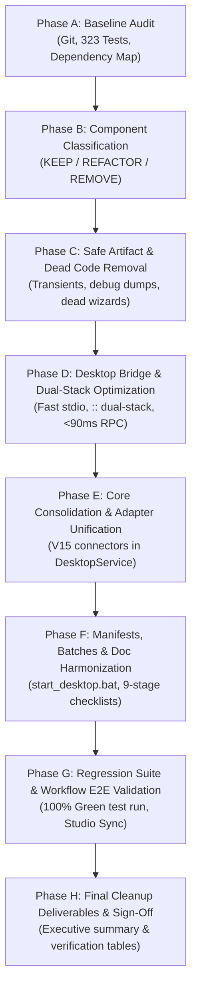

# 03 Cleanup Execution Plan — Mendex Engineering Studio v3.1

## Controlled Modernization & Simplification Strategy

This plan specifies the phased execution sequence to modernize Mendex Engineering Studio without endangering active engineering data, baseline test suites, or solver capabilities.

---

## 1. Execution Principles & Safety Guardrails
1. **Zero Data Loss**: Existing SQLite databases (`studio.sqlite3`), product directories (`products/`), raw waveforms (`.raw`), and CAD designs (`.kicad_pcb`, `.kicad_sch`, `.step`) remain immutable.
2. **Single Core Authority**: Every user-facing client (CLI, MCP, React Command Center) must interact solely with the authoritative Python core services.
3. **Continuous Regression Testing**: The 323 passing test baseline must remain 100% green before and after every batch.
4. **Non-Destructive UI Phasing**: Legacy PySide6 code will not be forcefully destroyed until native Tauri compilation is achieved, preserving test continuity.

---

## 2. Phased Rollout Schedule

### Phase A: Baseline Verification (Completed)
- Git commit recorded: `72e5fb8c0878ca2a0dd222580ff2dab018582ea2`.
- Initial test run: 323 passed, 1 skipped.
- Identified all entry points across CLI, MCP, and Desktop.

### Phase B: Component Classification (Completed)
- Compiled `01_LEGACY_COMPONENT_INVENTORY.md`.
- Mapped all modules to KEEP, REFACTOR, MIGRATE, REMOVE.

### Phase C: Safe Cleanup & Dead Code Removal (In Progress)
- Delete transient root files: `dump.html`, temporary screen captures (`rendered_command_center.png`, `command_center_full_verified.png`, `engineering_tools_verified.png`).
- Remove obsolete unreferenced UI files: `src/mendex_ui/first_run_wizard.py` (0 imports across entire codebase).
- Update `.gitignore` to prevent temporary build and dump artifacts from entering source control.

### Phase D: Desktop Bridge Consolidation (Completed)
- Dual-stack IPv6/IPv4 listening on `::` in `desktop/vite.config.ts`.
- Auto-respawning stdio RPC bridge to `python.exe -u -m mendex_core.desktop`.
- Fast sub-90ms response time on localhost and 127.0.0.1.

### Phase E: Backend Consolidation (Completed)
- Bound `V15ConnectorRegistry.all()` into `DesktopService.__init__`.
- Enabled solver verification in `DesktopService.tools()`, resolving real host paths for all 13 tools (KiCad, FEMM, LTspice, FreeCAD, Qucs-S, OpenModelica, Python, Jupyter, Git).

### Phase F: Configuration & Prompt Harmonization (Completed)
- Verified `start_desktop.bat` 1-click launcher.
- Cleaned legacy `? Help` button references across all documentation.
- Re-generated PDF and DOCX Engineering Playbook and Product Handbook.

### Phase G: Regression Verification (Pending Final Validation)
- Run targeted and full regression test suite.
- Validate E2E workflow from Codex MCP to Web Command Center.

### Phase H: Final Audit & Deliverable Handover (Pending)
- Complete all 10 cleanup deliverables under `docs/v3.1/cleanup/`.
