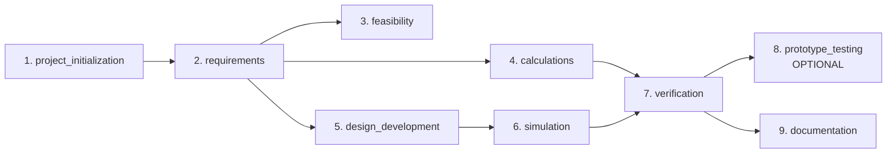

# 03. Engineering Lifecycle Verification

**Target:** Generic 9-Stage Engineering Lifecycle  
**Status:** **PASS** (Backend Core & Contracts)

---

## 1. Stage Definitions & Ordering

The 9 default stages defined in `src/mendex_core/config/engineering-lifecycle.json` and verified in `src/mendex_core/engineering_lifecycle/service.py`:

| Sequence | Stage Identifier | Name | Optional? | Review Required? | Dependencies |
|---|---|---|---|---|---|
| 1 | `project_initialization` | Project Initialization | No | No | None |
| 2 | `requirements` | Requirements and Specifications | No | Yes | `project_initialization` |
| 3 | `feasibility` | Feasibility and Architecture | No | Yes | `requirements` |
| 4 | `calculations` | Engineering Calculations | No | Yes | `requirements` |
| 5 | `design_development` | Engineering Design Development | No | Yes | `requirements` |
| 6 | `simulation` | Simulation and Analysis | No | Yes | `design_development` |
| 7 | `verification` | Engineering Verification | No | Yes | `calculations`, `simulation` |
| 8 | `prototype_testing` | Prototype and Physical Testing | **Yes** | Yes | `verification` |
| 9 | `documentation` | Final Engineering Documentation | No | Yes | `verification` |

---

## 2. Test Execution & Verification

- `tests/core/test_engineering_lifecycle.py`: **22 passed in 7.74s**
- `tests/integration/test_engineering_lifecycle_interfaces.py`: **3 passed in 1.38s**

### Negative Tests Verified:
1. **Unenrolled Revision Access**: Raises `StudioError("NOT_FOUND", "Revision has not been enrolled in a lifecycle")`.
2. **Dependency Violation**: Attempting to complete `requirements` before `project_initialization` is rejected.
3. **Missing Evidence Rejection**: Attempting to complete a stage without required validation records is blocked.
4. **Acyclic Graph Enforcement**: Circular dependencies in custom definitions raise validation errors.
5. **No Agent Self-Approval**: Stages with `review_required=True` transition to `AWAITING_REVIEW` and require an authorized reviewer decision.
