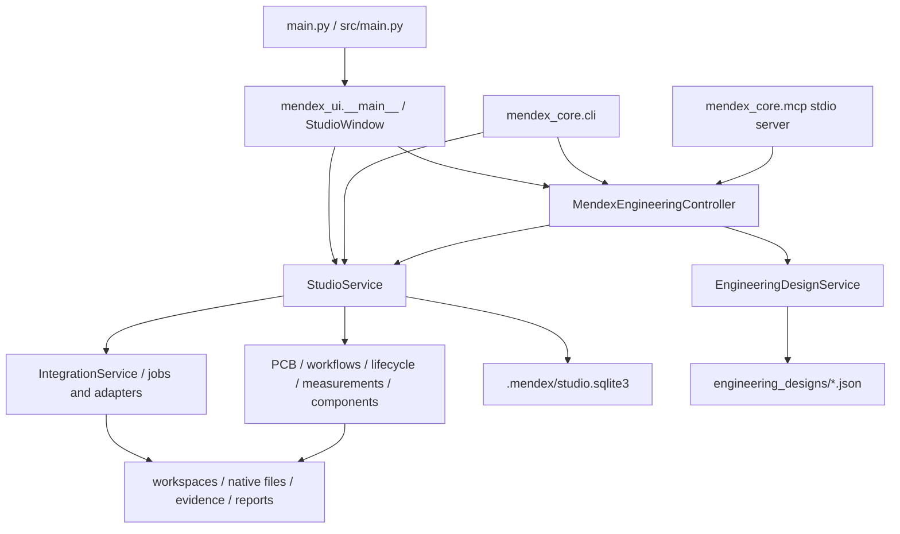

# v3 current architecture audit

Inspected 12 November 2026. This is a source audit of the current working tree,
including pre-existing uncommitted changes, not a certification of engineering results.
No application source, persisted project, baseline or evidence was changed by this audit.

## Actual architecture



The seven requested top-level navigation entries already exist in Qt. The migration
replaces presentation technology; it does not introduce a new engineering platform.
`StudioWindow` consumes `StudioService`, while Simulation Center creates a controller
which creates another service instance. CLI retains both direct service operations
and controller-backed v2.1 operations. The desired single authoritative service
boundary exists conceptually but is not uniformly enforced by all Qt features.

## Source findings

| Area | Current implementation and migration implication |
|---|---|
| Entry points | Root `main.py`, `src/main.py`, and `python -m mendex_ui` converge on `mendex_ui.__main__.main`; `--root` and `--smoke-test` exist. Preserve all during coexistence. |
| Desktop composition | `src/mendex_ui/window.py`: QMainWindow, seven stacked pages, project specification/revision editor, command palette, notifications, theme and preferences. Several compatibility panels are constructed outside the visible stack. |
| Shared core | `service.py` owns SQLite and composes integration, workflow, lifecycle, ECR, measurement, PCB, design and component services. `controller.py` exposes project, specification, design, calculation, simulation, artifact, revision, report and tool operations. |
| Contracts | Pydantic models in `models.py`, `evidence.py`, `integration_contracts.py`, design/lifecycle/component modules; JSON schemas in `contracts/`, including frozen v1.5 contracts. Use new versioned transport envelopes rather than rewriting old contracts. |
| Storage | SQLite metadata plus product/revision directories, integration workspaces and JSON design records. This is not an exclusively SQLite application. Preserve identifiers and all storage locations. |
| Schema version | `StudioService` rejects user_version >4; `integration_store.migrate_v5` adds columns/tables while deliberately not setting user_version=5. Do not normalize this during UI migration. `docs/architecture.md` describes earlier versions and is incomplete for current code. |
| CLI | `pyproject.toml` registers `mendex_core.cli:main`. Legacy commands coexist with project/workspace/specification/design/calculate/simulation/artifact/tool subcommands. Deletion commands exist but must not become default migration operations. |
| MCP | `mendex_core/mcp/server.py` provides JSON-RPC stdio dispatch, tool schemas, batch handling and protocol errors; delegates to the controller. Keep independent of desktop lifecycle. |
| Adapters | Legacy discovery registry, integration adapters, v1.5 connector registry and design runners coexist. Current code supports execution paths beyond old foundation documentation. Capability or executable discovery is not workstation qualification. |
| Jobs | `integration_contracts.JobRecord`, `JobRequest`, `JobResult` and IntegrationService persist job status and evidence. IntegrationService supports submit/cancel/retry/wait/logs/recovery/shutdown; controller simulation dispatch has a separate synchronous path. Do not promise universal live progress or cancellation. |
| Waveforms | `mendex_ui/waveform_viewer.py` uses QtCharts and NumPy with sample traces, metrics, interpolated cursors and resampled FFT. Core parser module exposes ASCII raw parsing/metrics. Binary/frequency-domain compatibility and large-file limits require separate fixtures and verification. |
| Reports | `StudioService.generate_report`, integration job report export, controller report facade and lifecycle dossier UI coexist. Preserve existing generators and frozen input snapshots; audit each report type for parity. |
| Revisions and validation | Product revisions, design revisions, lifecycle/gates, manual numerical validation and PCB checks are distinct records. Effective evidence status must come from backend integrity/staleness checks. Approval controls in Qt do not authorize adding new approval capabilities. |
| Component sources | ComponentLibraryService seeds in-memory component/material/core records; research datasets have separate provenance mechanisms. A source comment calling records verified is not documentary verification. No persisted editable catalog can be assumed. |
| Logging/errors | StudioError codes, Pydantic validation, integration logs and MCP logger exist. Qt frequently uses broad exception handlers/dialogs; controller/design load paths sometimes suppress errors. No unified desktop-sidecar log/health contract exists. |
| Packaging | Python wheel/source scripts exist. `build_windows_installer.ps1` generates a copy/shortcut setup script invoking pythonw; it does not establish a bundled Python runtime or clean-machine qualification. Packaging README describes source/wheel support. |
| Dependencies | pyproject declares Python >=3.13,<3.14, Pydantic and PySide6; lock file includes Qt and pytest. Current waveform UI imports NumPy without declaring it there. No package.json, React frontend or Tauri project found in the inspected tree. |
| Possible obsolete code | Hidden compatibility panels, older workspace/research/design/workflow screens, duplicate launchers and overlapping simulation/report interfaces need reachability and parity verification. Nothing is removed at audit stage. |

## Local baseline

Python 3.13.7, Node 22.19.0 and npm 10.9.3 were observed. `Get-Command`
did not find rustc or cargo on PATH. This does not prove they are absent from disk.
MSVC, WebView2, Rust targets and installer prerequisites remain NOT_EVALUATED.

The following focused baseline passed: 24 tests in 8.38 seconds:

```powershell
.\.venv\Scripts\python.exe -m pytest tests/core/test_v21_controller.py tests/core/test_v21_engineering_projects.py tests/core/test_v21_mcp.py tests/core/test_v21_cli.py tests/ui/test_command_center_cleanup.py -q
```

An initial invocation used a nonexistent integration-test path and collected no tests;
the corrected command above is the reported result. This baseline is not the full
regression suite, a solver qualification, UI visual QA or packaged acceptance.

Additional service/end-to-end baseline: 10 passed in 1.61 seconds using
`python -m pytest tests/core/test_service.py tests/integration/test_v21_e2e.py -q`
under the same virtual environment. Total focused baseline: 34 passed.
