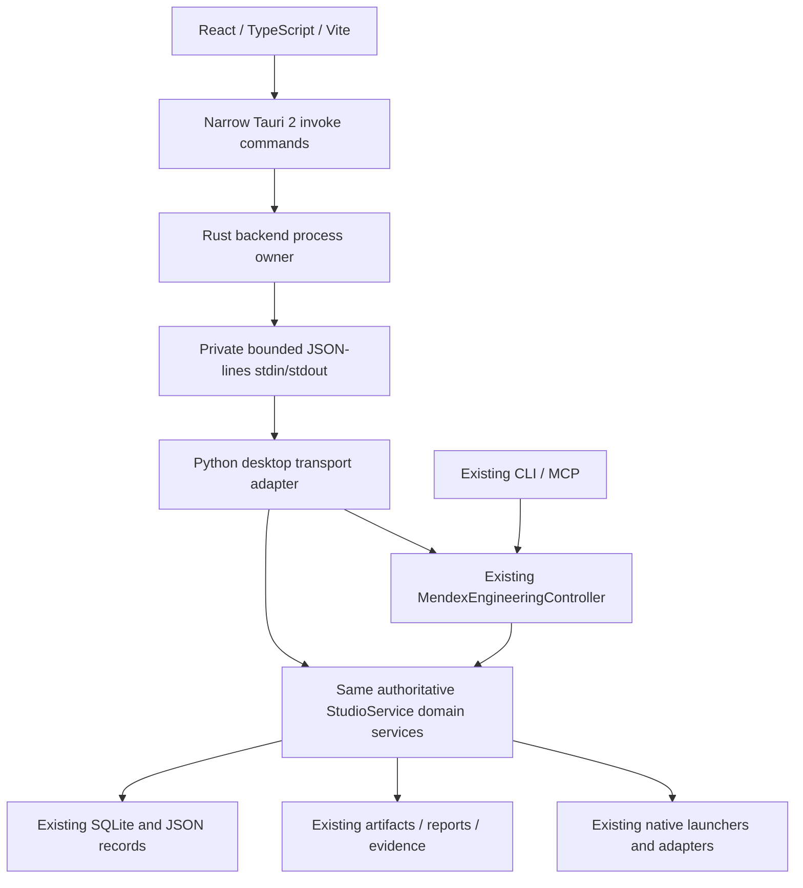

# v3 proposed architecture — pending approval

This proposal is based on the inspected repository, 12 November 2026. It is not an
implemented interface or a claim of package compatibility.

## Integration options

| Option | Fit | Decision |
|---|---|---|
| Managed Python process + private stdio | Matches existing headless/controller and stdio experience; no network port; packaging and lifecycle require implementation | Recommended |
| Authenticated loopback HTTP | Convenient for a browser preview; adds server dependency, credentials, origin validation and port lifecycle | Keep as fallback only if packaged IPC proof reveals a concrete blocker |
| Launch existing CLI for each query | Reuses operations but incurs repeated startup, recovery/cache effects and fragmented lifecycle | Useful contract oracle; avoid as application transport |
| Embed Python in Rust | Interpreter/extension distribution and GIL integration complexity without a current repository need | Not recommended |

## Backend ownership and transport

Add a transport adapter in the Python core package. It wraps existing public methods;
it contains no engineering rules, replacement SQL queries or separate database.
Use one controller/service graph per desktop backend and delegate to the appropriate
existing service where the controller lacks a read API. Refactor constructor injection
only where needed and prove compatibility with existing CLI/MCP behavior.

Proposed envelope: `{protocol_version, id, method, params}` and responses carrying
the same id/version with either `result` or `{code, message}` error. Define strict
Pydantic parameter models, reject unknown methods/fields, and generate transport
schemas separately from frozen historical schemas. Use finite JSON numbers, UUID
validation, bounded request/result sizes, bounded outstanding calls and explicit
timeouts. Reserve stdout for protocol frames and stderr for redacted diagnostics.
Correlation IDs must survive timeout, disconnect and malformed-message handling.

Start with health/protocol handshake, project list/detail/specifications, revision
history, simulation/job reads, component/dataset reads and tool inventory. Extend
to evidence/report/file reads through existing integrity/path checks. No generic
method reflection, arbitrary command line, SQL, absolute-path open or raw filesystem
endpoint. Native launches remain narrowly scoped backend operations.

Long requests must not block health or cancellation traffic. Use bounded work queues
and existing job IDs; poll persisted job state initially. Distinguish transport
cancellation from actual solver cancellation. Restart after backend crash must not
repeat mutations or solver requests. Reconcile pending calls to an explicit error,
rehydrate state, and leave recoverable job semantics to the existing core.

Rust owns the exact child executable and argument vector, startup/handshake deadline,
health checks, stderr capture/rotation and graceful shutdown with bounded fallback.
No network listener or shell execution is required. Auto-restart, if added, is bounded;
never silently replay a write. CLI/MCP remain usable without the Tauri application.

## Frontend structure and dependencies

Proposed location: `desktop/` with `src/`, `src-tauri/`, transport contracts and tests.
React Router supplies seven lazy routes matching current navigation. TanStack Query
owns backend snapshots, refetch and errors; localStorage holds appearance/sidebar
preferences only. Explicit refresh invalidates backend caches so externally created
records become visible. Avoid Zustand until local state complexity justifies it.

Tailwind semantic tokens plus suitable shadcn components supply compact dark/light
themes; Lucide supplies icons. React Hook Form/Zod are for supported editing forms;
TanStack Table for searchable/sortable records. Load Plotly only on waveform routes;
add ECharts only when a real persisted dataset needs a dashboard chart. Do not install
the entire suggested library list without demonstrated use. Resolve actual package
versions, Node engine constraints and peer compatibility before installation.

UI state distinguishes loading, empty, disconnected, error, unsupported and
NOT_EVALUATED. Unknown numeric values are absent, never substituted with zero.
Dashboard aggregations count actual records and retain record provenance; unsupported
counts show unavailable. Controller's current constant ACTIVE label must not be used
as evidence of a separately persisted project activity lifecycle.

## Engineering presentation boundaries

Map backend SUCCEEDED to Completed for execution only; retain FAILED, CANCELLED and
TIMED_OUT details. QUEUED and RUNNING map directly. Blocked is a reasoned unsupported/
unavailable presentation state, not a fabricated persisted JobStatus. Engineering
validation remains a separate effective backend status.

Waveform payloads need job/artifact identity, checksum/integrity, domain, trace labels,
units, solver metadata and original x/y samples. Implement bounded retrieval for large
data. Rendering-only decimation must be disclosed and reversible to original samples;
export returns original available data. Comparison requires matching units/domain
and explicit alignment rules. Python owns metrics and any future explicit transforms.
Synthetic examples and implicit resampling are excluded from result views.

Preserve separate project revision, design revision, validation, PCB-check, simulation
request and execution-job concepts. Never combine them into a single approval badge.
Report generators remain Python implementations. No new manufacturing approval,
hardware control, AI copilot, cloud dependency or deployment system is in scope.

## Security and distribution gates

Production webview loads bundled assets under a restrictive CSP; no remote content,
unrestricted shell/SQL/filesystem plugins or exposed secrets. Audit invoke permissions,
path traversal/symlinks, link schemes, diagnostic log contents and dependency licenses.
Backend checks remain authoritative even if the UI hides an action.

Keep Qt runnable during migration. Prove a frozen Python runtime includes NumPy and
all actual headless dependencies/resources without importing Qt presentation code.
Verify source-root vs installed-data-root resolution, Windows resource paths, WebView2
availability/offline installation, process cleanup, uninstall preserving engineering
data and clean-machine startup with no development Python. Manual packaging only;
CI/CD and automatic deployment are excluded.
