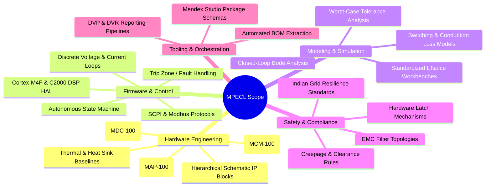

# MPECL Engineering Scope & Technical Boundaries

**Document ID:** MPECL-DOC-OVR-003  
**Revision:** v1.0  
**Status:** APPROVED FOR DESIGN  
**Target Organization:** Mendex Electronics LLP  

---

## 1. System Engineering Scope

The Mendex Power Electronics Core Library covers five foundational engineering disciplines across the full design lifecycle:

---

## 2. Product Class Coverage & Roadmap Alignment

MPECL targets power conversion across the following roadmap product categories:

1. **Non-Isolated DC-DC Converters:**
   - Synchronous Buck (Step-Down): Point-of-load, battery discharge regulation (18 V – 75 V down to 5 V – 24 V, 100 W – 1 kW).
   - Boost (Step-Up): Solar PV maximum power point tracking (MPPT) converters, fuel cell voltage boost (24 V – 48 V up to 200 V – 400 V, 250 W – 3 kW).
   - Non-Isolated Four-Switch Buck-Boost: Wide-input automotive and industrial battery interfaces.
2. **Isolated DC-DC Converters:**
   - Low-to-Mid Power Isolated: Multi-output Flyback and Forward converters for auxiliary supplies and low-noise sensor bias (10 W – 250 W).
   - High-Efficiency Resonant Converters: Half-Bridge and Full-Bridge LLC Resonant converters for fixed/narrow ratio telecom, server, and EV on-board DC-DC (500 W – 3 kW).
   - Wide-Range Industrial Isolated: Phase-Shifted Full-Bridge (PSFB) for wide output voltage battery chargers and plasma/industrial power supplies (1 kW – 10 kW).
   - Bidirectional Isolated: Dual Active Bridge (DAB) converters for battery energy storage systems (BESS) and vehicle-to-grid (V2G) power stages (3 kW – 15 kW).
3. **Programmable & Laboratory Power Equipment:**
   - High-precision programmable DC power supplies with Constant Voltage (CV) and Constant Current (CC) automatic crossover, sub-millivolt ripple, and SCPI/Mendex Studio remote automation (500 W – 15 kW).

---

## 3. Power Tier Definition

To resolve the physical incompatibility between low-power and high-power physical layouts, MPECL strictly segments engineering into three defined tiers:

| Attribute | Tier 1: Low-Voltage Platform | Tier 2: Mid-Power Platform | Tier 3: High-Power Industrial |
|---|---|---|---|
| **Target Power Range** | 100 W to 500 W (Roadmap: up to 1 kW) | 1 kW to 3 kW (Roadmap: up to 5 kW) | 5 kW to 15 kW (Roadmap: up to 30 kW) |
| **Primary Voltage Range** | 18 V – 75 V DC (telecom / 48V battery) | 200 V – 450 V DC (PFC link / 400V battery)| 400 V – 800 V DC (3-phase rectified / 800V EV) |
| **Switching Devices** | Silicon MOSFETs (40 V – 100 V) | Discrete SiC MOSFETs / GaN HEMTs (650 V) | Discrete SiC / Power Modules (1200 V) |
| **Gate Drive Architecture** | Non-isolated bootstrap or dual low-side | Galvanically isolated (bipolar/unipolar, CMTI > 50 kV/µs) | Reinforced isolated (+18V/-4V, DESAT, CMTI > 100 kV/µs) |
| **Current Sensing** | Low-side or high-side resistive shunt + diff-amp | Fluxgate or isolated $\Sigma\Delta$ / Hall-effect | Closed-loop Hall-effect / Rogowski / CT |
| **Physical Construction** | Single mainboard + MDC-100 daughtercard | Power motherboard + MDC-100 + MCM-100 | Modular sub-rack chassis with laminated busbars |
| **Isolation Barrier** | Functional or SELV (No mains isolation required) | Reinforced (IEC 62368-1 / IEC 60664-1, 6.4 mm creepage) | Industrial Reinforced (IEC 62477-1, 8.0 mm creepage) |

---

## 4. Phase 1 Immediate Boundary

In Phase 1 of MPECL execution:
- Focus is strictly on **architecture, technical specifications, interface standardization, simulation models, and documentation**.
- No physical PCB manufacturing, hardware assembly, or firmware deployment is performed.
- Immediate prototyping in subsequent phases (Phase 2 & 3) will focus exclusively on **Tier 1 (48 V to 12 V/24 V, 100 W – 500 W Synchronous Buck and Boost)** to validate the core architecture before expanding to high-voltage isolated designs.
