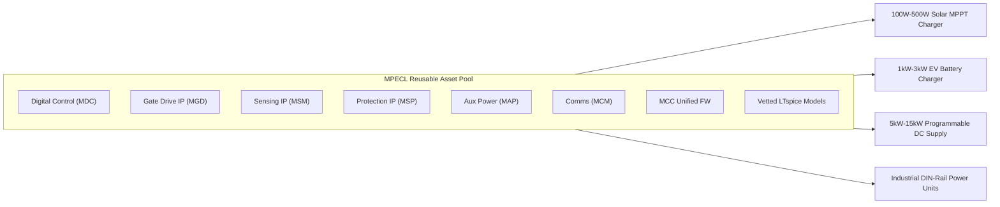

# MPECL Project Vision

**Document ID:** MPECL-DOC-OVR-001  
**Revision:** v1.0  
**Status:** APPROVED FOR DESIGN  
**Target Organization:** Mendex Electronics LLP  

---

## 1. Context & Business Drivers

Mendex Electronics LLP is an Indian power electronics engineering and manufacturing enterprise. The Indian industrial power conversion market is expanding rapidly across several key sectors:
- **Clean Energy & Solar:** Decentralized MPPT string charge controllers, solar hybrid micro-inverters, and off-grid power hubs.
- **E-Mobility & Charging Infrastructure:** Light electric vehicle (LEV, 2W/3W) on-board and off-board DC fast chargers (48 V to 72 V systems up to 3 kW), followed by mid-power DC fast-charging modules (up to 15 kW).
- **Industrial Automation & Process Power:** DIN-rail high-reliability DC power supplies, plating rectifiers, plasma power conversion, and motor drive front-ends.
- **R&D and Laboratory Instrumentation:** Precision programmable DC power supplies and regenerative electronic loads.

Historically, hardware manufacturers develop bespoke products sequentially. Each new project re-engineers auxiliary power circuits, microcontroller pinouts, gate driver loops, current sensing stages, and safety trip logic. This practice results in:
1. **Long Development Cycles:** 9 to 18 months per converter variant.
2. **High Unit Costs:** Inability to aggregate component purchase volumes across product lines.
3. **Field Reliability Variances:** Bugs eliminated in one product line re-emerge in another due to fragmented schematic blocks and unstandardized firmware forks.
4. **Knowledge Silos:** Design know-how remains locked in individual engineer notebooks rather than enterprise-level verified IP assets.

---

## 2. The Core Library Vision

The primary vision of the **Mendex Power Electronics Core Library (MPECL)** is to establish an industrial-grade, institutionalized, reusable hardware, firmware, and validation platform that reduces new product development time by up to **60%**, while guaranteeing consistent safety, reliability, and thermal robustness under harsh Indian operating conditions.

---

## 3. Guiding Architectural Tenets

To ensure the library remains physically viable and commercially successful, MPECL is founded on five non-negotiable architectural tenets:

1. **Physical Reality over Theoretical Uniformity (Hybrid Modularity):**  
   High $dv/dt$ ($>50\text{ V/ns}$) and high $di/dt$ ($>2\text{ A/ns}$) power stages cannot be connectorized without introducing catastrophic parasitic loop inductance. Physical modularity is strictly reserved for digital control, communications, auxiliary power, and HMI. High-frequency power conversion and gate drives are standardized as verified **Schematic and PCB Design IP Blocks**.

2. **Categorical Power Tiering:**  
   Power conversion spanning 100 W to 15 kW cannot share a single power bus or semiconductor package. MPECL formalizes three distinct power and voltage tiers:
   - **Tier 1 (Low Voltage, 100 W – 500 W, 18 V – 75 V DC):** Optimized for high-volume, low-cost Silicon MOSFETs and 4-layer FR4 boards.
   - **Tier 2 (Mid Power / Isolated, 1 kW – 3 kW, 200 V – 450 V DC):** Optimized for discrete SiC/GaN switches, high-frequency planar/ferrite magnetics, and reinforced galvanic isolation.
   - **Tier 3 (High Power / Grid-Tied, 5 kW – 15 kW, 400 V – 800 V DC):** Optimized for multi-phase/interleaved SiC power modules, laminated busbars, and industrial three-phase grid compliance.

3. **Robustness to the Indian Operating Environment:**  
   All MPECL building blocks are engineered from Day 1 for:
   - High ambient operating temperatures: $45^\circ\text{C}$ nominal, $50^\circ\text{C}$ peak derating.
   - Poor AC grid quality: Sustained overvoltages up to 300 VAC, neutral float up to 440 VAC, and Category III/IV transient spikes.
   - Component sourcing resilience: Multi-sourced BOM footprints readily available through local Indian distributors (Arrow, Avnet, Element14, Mouser India).

4. **Zero Unverified Claims & Absolute Provenance:**  
   Every performance figure, derating coefficient, and safety parameter must be traceable to manufacturer datasheets, validated LTspice simulations, or bench test reports. When empirical evidence is unavailable, ratings remain formally declared as `NOT_EVALUATED` / `TBD`.

5. **Integration with Mendex Studio:**  
   Every MPECL module is packaged with standardized JSON metadata, BOM files, KiCad netlists, and test procedures, allowing Mendex Studio to orchestrate requirements traceability, simulation runs, and automated engineering report generation.
