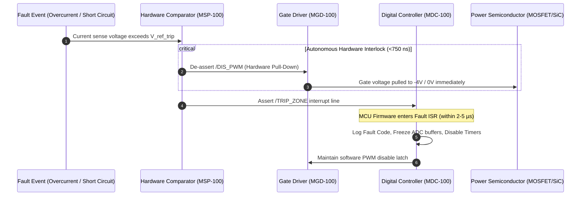

# MPECL System Architecture Specification

**Document ID:** MPECL-DOC-ARC-001  
**Revision:** v1.0  
**Status:** APPROVED FOR DESIGN  
**Target Organization:** Mendex Electronics LLP  

---

## 1. Top-Level Architectural Framework

The **Mendex Power Electronics Core Library (MPECL)** implements a hybrid hardware-software architecture that decouples control, communications, and intelligence from the physical power stage while respecting high-frequency switching constraints.

```mermaid
graph TB
    subgraph Controller_Plane ["Controller Plane (Low Voltage / Low Noise)"]
        MDC["MDC-100 Universal Control Card<br/>(STM32G474 / TMS320F280039C)"]
        MCM["MCM-100 Comms Card<br/>(Isolated RS485 / CAN-FD / USB)"]
        MHM["MHM-100 HMI Interface<br/>(OLED / Rotary / Keys)"]
        MDC <-->|UART / SPI / I2C| MCM
        MDC <-->|I2C / GPIO| MHM
    end

    subgraph Interface_Plane ["Interface Plane (MCMIS Standard)"]
        PWM_BUS["PWM Control Signals (High-Speed / Low Skew)"]
        SENSE_BUS["Analog & Isolated Feedback (V, I, Temp)"]
        TRIP_BUS["Fast Hardware Trip Zone (Active-Low Latched)"]
        AUX_RAILS["Regulated Auxiliary Rails (+3.3V, +5V, +12V/15V)"]
    end

    subgraph Power_Plane ["Power & Safety Plane (High Voltage / High di/dt)"]
        MAP["MAP-100 Aux Power Supply"]
        MEM["MEM-100 Input EMI Filter"]
        MGD["MGD-100 Gate Driver Circuit IP"]
        MPS["MPS-xxx Power Stage IP<br/>(Buck / Boost / LLC / PSFB)"]
        MSM["MSM-100 Sensing Subsystem"]
        MSP["MSP-100 Smart Protection Subsystem"]
        MTM["MTM-100 Thermal & Fan Controller"]
    end

    MDC -->|PWM Output| PWM_BUS
    PWM_BUS --> MGD
    MGD -->|Direct Gate Drive| MPS

    MPS --> MSM
    MSM -->|Conditioned Signals| SENSE_BUS
    SENSE_BUS --> MDC

    MSM --> MSP
    MSP -->|Instantaneous Trip (<750 ns)| TRIP_BUS
    TRIP_BUS -.->|Hardware Gate Mute| MGD
    TRIP_BUS -->|External Interrupt / TZ| MDC

    MAP --> AUX_RAILS
    AUX_RAILS --> MDC
    AUX_RAILS --> MCM
    AUX_RAILS --> MGD
    AUX_RAILS --> MSM

    MEM --> MPS
    MPS --> MTM
    MTM -->|Temp Telemetry| SENSE_BUS
```

---

## 2. The Hybrid Modularity Model: Physical vs. Design IP

To prevent parasitic loop inductance and high-frequency ringing, MPECL strictly enforces the boundary between physical plug-in modules and schematic IP blocks:

| Module Class | Implementation Format | Physical Form Factor | Technical Justification |
|---|---|---|---|
| **Control Card (MDC-100)** | Physical Plug-In Daughtercard | 120-pin / 200-pin standard edge connector | Protects sensitive mixed-signal MCU from power heat; permits rapid MCU upgrades; standardizes firmware platform across all converters. |
| **Comms Card (MCM-100)** | Physical Plug-In Daughtercard | Standard header / 40-pin PCIe-style slot | Allows tailoring communication protocol (CAN, RS485, Modbus, Ethernet) to customer requirements without spinning the power PCB. |
| **HMI Module (MHM-100)** | Physical Panel Assembly | Panel mount with ribbon/wire harness | Decouples front-panel mechanical enclosure design from internal electronics. |
| **Auxiliary Supply (MAP-100)** | Modular Daughtercard or Surface Mount SIP | High-density vertical daughterboard | Wide-input switcher contains independent magnetics and high-voltage isolation; modularizing simplifies safety testing. |
| **Gate Driver (MGD-100)** | **Design IP Block (Hierarchical Schematic/Layout)** | Laid out directly on power PCB | **Critical:** Gate drive loops must have $< 5\text{ nH}$ inductance. Must be located $\le 15\text{ mm}$ from switch terminals. Connectors prohibited in gate loop! |
| **Power Stage (MPS-xxx)** | **Design IP Block (Hierarchical Schematic/Layout)** | Laid out on power motherboard | High-current traces ($10\text{ A} - 100\text{ A}$) and high-voltage DC busbars cannot pass through pluggable headers without high loss and parasitics. |
| **Sensing (MSM-100)** | **Design IP Block** | Integrated on motherboard | Shunt kelvin connections and high-voltage dividers must be located at exact sensing points to avoid ground loop noise. |
| **EMI Filter (MEM-100)** | **Design IP Block** | Integrated at enclosure entry | Placement must prevent noise coupling from the converter to the filter input. |

---

## 3. Grounding and Signal Integrity Architecture

High-power switching creates intense electromagnetic noise ($dv/dt$ and $di/dt$). MPECL establishes a three-ground domain architecture:

```mermaid
graph LR
    PGND["Power Ground (PGND)<br/>High current return, switches, snubbers"]
    AGND["Analog Ground (AGND)<br/>ADC references, shunt sense, precision dividers"]
    DGND["Digital Ground (DGND)<br/>MCU core, flash, digital communication"]
    PE["Protective Earth (PE)<br/>Chassis enclosure, safety shielding"]

    AGND ---|Single Point Star Ground<br/>(Net Tie under MCU / ADC)| DGND
    AGND ---|Single Point Kelvin Connection<br/>at Sense Shunt| PGND
    PGND ---|High Voltage Y-Cap / Bleed Resistor| PE
```

1. **Digital Ground (DGND):** Dedicated reference for microcontroller core logic, high-speed clocks, and digital communication buffers.
2. **Analog Ground (AGND):** Quiet, low-noise ground plane dedicated exclusively to precision reference voltages ($V_{ref}$), ADC input decoupling capacitors, and operational amplifier feedback networks. Connects to DGND at a single physical point (Net Tie) directly beneath the controller IC.
3. **Power Ground (PGND):** Low-impedance copper pour designed to carry high circulating switching currents ($I_{sw}$) and DC link return currents. Connects to the analog sensing circuit only at the Kelvin sense terminal of the shunt resistor.
4. **Protective Earth (PE):** Connected to the metal chassis. Common-mode Y-capacitors from positive/negative power rails drain high-frequency displacement currents safely to PE.

---

## 4. Hardware/Firmware Fault Protection Hierarchy

MPECL enforces a two-tier defense-in-depth protection architecture:



* **Layer 1: Autonomous Hardware Trip (Ultra-Fast, $< 750\text{ ns}$):**
  - Completely independent of MCU software, clocks, or interrupts.
  - Dedicated ultra-fast window comparators (e.g., TI LMH7220 or integrated MCU analog comparators CMPSS) continuously monitor sensing outputs.
  - Upon threshold violation, the comparator output drives an active-low open-drain line directly disabling the gate driver output stages.
* **Layer 2: Firmware Supervisory Control (Deterministic, $10\,\mu\text{s} - 10\text{ ms}$):**
  - Triggered by hardware trip zone (TZ) interrupt.
  - Captures pre-fault telemetry buffer (ring buffer of last 32 ADC samples).
  - Implements thermal integration ($I^2t$ protection), overvoltage slope detection, and controlled soft-stop sequences.
