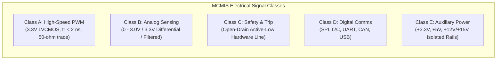

# MPECL Module Interfaces & Physical Boundaries

**Document ID:** MPECL-DOC-ARC-003  
**Revision:** v1.0  
**Status:** APPROVED FOR DESIGN  
**Target Organization:** Mendex Electronics LLP  

---

## 1. Interface Boundary Classification

To maintain high signal integrity and avoid ground bounce and EMI cross-talk, MPECL strictly categorizes all inter-module signals into standardized electrical classes:

---

## 2. Signal Group Definitions & Pin Allocation Strategy

Under the **Mendex Common Module Interface Standard (MCMIS v1.0)**, all connections to the Universal Digital Controller Card (**MDC-100**) are organized into functional groups.

The physical connector chosen for MDC-100 is an industry-standard **PCIe 1x / 4x Edge Connector or 120-Pin High-Density Board-to-Board Connector (0.8 mm pitch)**, ensuring:
1. Low contact resistance ($< 30\text{ m}\Omega$).
2. Controlled impedance for high-speed PWM and SPI traces.
3. High mechanical vibration tolerance for industrial and automotive applications.
4. Readily available from multiple authorized manufacturers (Samtec, Hirose, Amphenol, local Indian distribution).

### Signal Pinout Allocation Summary:

| Pin Group | Signal Type | Pin Count | Description | Electrical Constraints |
|---|---|---|---|---|
| **PWM Group** | Class A | 12 Pins | 6 Complementary PWM pairs (PWM1H/L to PWM6H/L) | 3.3 V CMOS, series $22\,\Omega$ damping, matched length $\pm 0.5\text{ mm}$ |
| **Trip / Fault** | Class C | 4 Pins | `/TRIP_ZONE1`, `/TRIP_ZONE2`, `/FAULT_OUT`, `/RST` | Active-low open-drain, pull-up to 3.3V on MDC-100, hardware interrupt |
| **Analog Feedback** | Class B | 16 Pins | 8 Differential ADC channels (V_OUT, I_OUT, V_IN, I_IN, etc.) | 0 to 3.0 V / 3.3 V full-scale, shielded by interleaved AGND pins |
| **Temperature** | Class B | 4 Pins | 4 Single-ended NTC / PT1000 conditioning inputs | 0 to 3.3 V filtered DC |
| **High-Speed SPI** | Class D | 6 Pins | Isolated ADC/DAC communication (CLK, MOSI, MISO, CS1-3) | Up to $40\text{ MHz}$, 3.3 V logic |
| **Internal Comms** | Class D | 8 Pins | UART (to MCM-100), I2C (to MHM-100/EEPROM), CAN-RX/TX | 3.3 V logic level, standard ESD protection |
| **Auxiliary Rails** | Class E | 16 Pins | $+3.3\text{V}$ (Logic), $+5\text{V}$ (Analog/Driver), $+12\text{V}$ (Gate Bias) | Multiple parallel pins for current rating ($\ge 2\text{ A}$ per rail) |
| **Ground Planes** | Return | 34 Pins | DGND (Digital ground) and AGND (Analog ground) | Interleaved between high-speed PWM and analog lines for shielding |
| **Reserved / ID** | Config | 20 Pins | Module ID, revision straps, JTAG / SWD debugging | 100k pull-up/down encoding |
| **Total** | - | **120 Pins** | Standardized MCMIS-120 Interface | - |

---

## 3. Physical vs. Virtual (Design IP) Modular Boundaries

A critical failure mode in modular power electronics design is placing connectors in low-impedance or high-frequency loops. MPECL establishes the following absolute layout rules:

```mermaid
graph TD
    subgraph Prohibited_Architecture ["PROHIBITED ARCHITECTURE (Parasitic Disaster)"]
        MDC_BAD["Controller Card"] -->|Ribbon Cable| MGD_BAD["Pluggable Gate Driver Card"]
        MGD_BAD -->|Board-to-Board Connector<br/>L_loop > 25 nH| MPS_BAD["Power Stage Card"]
    end

    subgraph Approved_Architecture ["APPROVED MPECL ARCHITECTURE"]
        MDC_GOOD["MDC-100 Control Daughtercard<br/>(Pluggable 120-pin)"]
        subgraph Monolithic_Motherboard ["Single Motherboard Copper Layout"]
            MGD_GOOD["MGD-100 Gate Driver Circuit IP<br/>(<15mm from FET)"]
            MPS_GOOD["MPS-xxx Power Switches & Magnetics<br/>(L_loop < 3 nH)"]
            MSM_GOOD["MSM-100 Kelvin Shunts & Dividers"]
        end
        MDC_GOOD -->|Shielded Edge Connector| MGD_GOOD
        MGD_GOOD ===|Direct Copper Traces| MPS_GOOD
        MPS_GOOD ===|Direct Kelvin Traces| MSM_GOOD
        MSM_GOOD -->|Shielded Edge Connector| MDC_GOOD
    end
```

### Mandatory Rules for Physical Boundaries:
1. **Rule 1 (Gate Drive Loop Proximity):** The gate driver output stage (MGD-100), gate series resistor, and anti-parallel Schottky diode must reside on the exact same physical PCB layer as the power switch gate/source terminals, with distance $\le 15\text{ mm}$ and loop area $\le 15\text{ mm}^2$.
2. **Rule 2 (DC Bus Decoupling):** High-frequency ceramic decoupling capacitors ($C_{film}$ or $C_{cer}$) must be placed directly across the high-side drain and low-side source with zero intervening connectors.
3. **Rule 3 (Current Shunt Kelvin Connection):** Shunt sense traces must be routed as an unbroken tightly-coupled differential pair directly from the inner pads of the 4-terminal current shunt to the differential amplifier inputs, passing through no intermediate headers.
