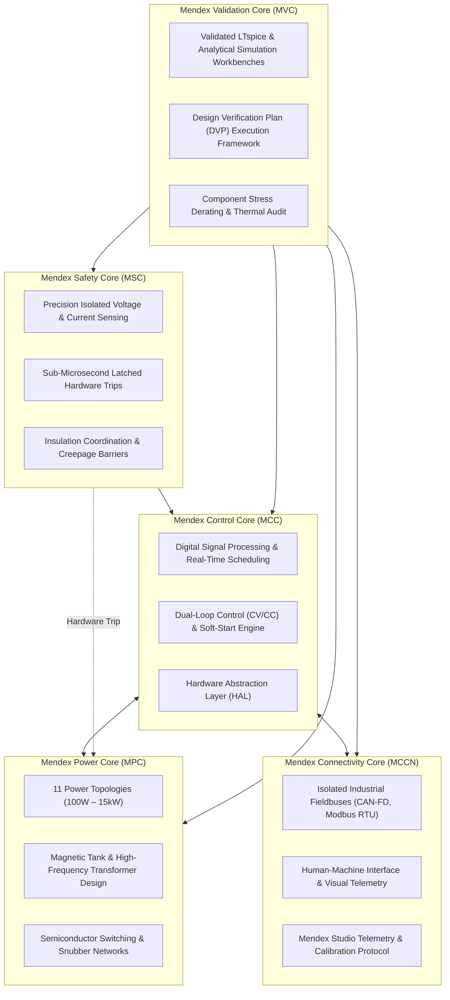

# MPECL Core Platform Design

**Document ID:** MPECL-DOC-ARC-002  
**Revision:** v1.0  
**Status:** APPROVED FOR DESIGN  
**Target Organization:** Mendex Electronics LLP  

---

## 1. Overview of the Five Core Platforms

The MPECL architecture is partitioned into five specialized engineering cores. Each core encapsulates a dedicated domain of responsibility with formalized interfaces and clear separation of concerns.

---

## 2. Platform Detailed Responsibilities

### A. Mendex Control Core (MCC)
* **Core Function:** Real-time digital control loop execution, PWM pulse generation, and converter sequencing.
* **Key Components:**
  - Standardized control card hardware (MDC-100).
  - High-Resolution PWM generation with dead-time compensation ($< 1\text{ ns}$ edge placement).
  - Synchronous ADC sampling triggered at switching midpoint (eliminating switching ripple).
  - Inner Current Loop ($100\text{ kHz}$ update rate) + Outer Voltage Loop ($10\text{ kHz}$ update rate).
  - Deterministic state machine governing startup, pre-charge, steady-state, transient load response, and safe shutdown.
  - Multi-target HAL supporting STM32G474 (ARM Cortex-M4F) and TI C2000 (TMS320F280039C).

### B. Mendex Power Core (MPC)
* **Core Function:** High-efficiency electrical power conversion across DC-DC, AC-DC, and bidirectional domains.
* **Key Components:**
  - 11 Standardized Topologies: Non-isolated (Buck, Boost, Buck-Boost, Synchronous Buck), Basic Isolated (Flyback, Forward, Half-Bridge, Full-Bridge), and Advanced Resonant/Bidirectional (LLC Resonant, Phase-Shifted Full-Bridge, Dual Active Bridge).
  - Semiconductor selection criteria (Si vs. SiC vs. GaN based on blocking voltage and switching frequency).
  - High-frequency magnetics design rules (skin effect, proximity effect, Litz wire, core loss calculation via Steinmetz equations).
  - Thermal interface modeling (Foster and Cauer RC network thermal transient models).

### C. Mendex Safety Core (MSC)
* **Core Function:** Safeguarding equipment, operators, and surrounding installations from electrical, thermal, and mechanical failure.
* **Key Components:**
  - Hardware-level instantaneous protection (Overcurrent, Short-circuit, Overvoltage, Undervoltage, Overtemperature).
  - Redundant sensing architectures: differential amplifier shunt sensing for low voltage; isolated delta-sigma modulators and Hall-effect sensors for high voltage.
  - Creepage, clearance, and solid insulation compliance conforming to IEC 62368-1, IEC 60664-1, and IEC 62477-1.
  - Galvanic isolation monitoring and residual current monitoring (RCD) for grid-connected and high-voltage DC systems.

### D. Mendex Connectivity Core (MCCN)
* **Core Function:** External communication, industrial automation integration, human interaction, and engineering telemetry.
* **Key Components:**
  - Isolated CAN-FD interface for high-speed automotive and industrial powertrain networking.
  - Isolated RS485 supporting standard Modbus RTU for PLC and SCADA integration.
  - USB-CDC interface supporting IEEE 488.2 SCPI (Standard Commands for Programmable Instruments) for automated test bench integration.
  - Standardized HMI protocol for OLED/TFT displays, rotary encoders, and physical status annunciators.
  - Unified Mendex Studio RPC interface for parameter tuning, firmware flashing, and real-time blackbox data logging.

### E. Mendex Validation Core (MVC)
* **Core Function:** Verification and validation framework guaranteeing that every manufactured unit strictly complies with technical specifications.
* **Key Components:**
  - Open-source and industry-standard simulation tooling (LTspice, QSPICE, Python analytical solvers).
  - Automated Design Verification Plan (DVP) matrix linking every requirement in the SRS to verifiable empirical tests.
  - Automated bench testing test procedures (load regulation, line regulation, Bode plot phase margin analysis, thermal imaging, efficiency mapping).
  - Environmental stress screening standards (conforming to Indian industrial temperatures: $0^\circ\text{C}$ to $55^\circ\text{C}$ ambient, 95% non-condensing RH).
