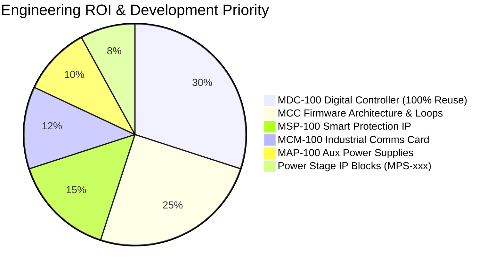

# MPECL Platform Reusability Matrix

**Document ID:** MPECL-DOC-ARC-004  
**Revision:** v1.0  
**Status:** APPROVED FOR DESIGN  
**Target Organization:** Mendex Electronics LLP  

---

## 1. Reusability Classification Definitions

Every module proposal within MPECL is evaluated across target product converter families and classified into one of five rigorous engineering reuse tiers:

1. **Directly Reusable (DR):** The exact identical physical PCB assembly or schematic block is used with zero hardware or BOM modifications.
2. **Reusable with Configuration (RC):** The hardware remains identical; configuration is achieved via software parameters, firmware build flags, or resistor strapping.
3. **Requires Hardware Variant (HV):** The core circuit topology and pinout are preserved, but specific component values (e.g., MOSFET voltage rating, inductor turns, divider ratios) change based on voltage/current class.
4. **Requires Redesign (RD):** The module architecture is fundamentally incompatible with the physical, electrical, or thermal demands of this product class and must be re-engineered.
5. **Not Applicable (NA):** The module function is not required in this converter class.

---

## 2. Reusability Matrix Across Representative Converter Products

| Module ID | Module Name | Product 1: 48V $\to$ 12V, 100W (Sync Buck) | Product 2: 48V $\to$ 24V, 500W (Sync Buck) | Product 3: 24V $\to$ 48V, 500W (Sync Boost) | Product 4: 400V $\to$ 48V, 3kW (LLC / PSFB) | Product 5: 15kW Prog. DC Supply (Parallel / 3-Ph) |
|---|---|---|---|---|---|---|
| **MDC-100** | Universal Digital Controller | **DR** | **DR** | **DR** | **RC** (FW: Resonant) | **RC** (FW: Master/Slave) |
| **MGD-100** | MOSFET Gate Driver IP | **DR** (Dual Low/High) | **DR** (Dual Low/High) | **DR** (Low-Side Boost) | **HV** (Isolated SiC Driver) | **HV** (Isolated Module Driver) |
| **MSM-100** | Sensing Subcircuit IP | **RC** (Resistive Shunt) | **RC** (Resistive Shunt) | **RC** (Resistive Shunt) | **HV** (Isolated $\Sigma\Delta$ / Hall) | **HV** (Fluxgate / Closed-Loop) |
| **MSP-100** | Smart Protection IP | **DR** (HW Fast Latch) | **DR** (HW Fast Latch) | **DR** (HW Fast Latch) | **RC** (Threshold Adjust) | **RC** (Multi-channel Trip) |
| **MAP-100** | Aux Power Supply | **DR** (Wide Buck: 18-75V)| **DR** (Wide Buck: 18-75V)| **DR** (Wide Buck: 18-75V)| **HV** (High-V Flyback) | **HV** (High-V Flyback / 3-Ph) |
| **MCM-100** | Communication Card | **RC** (UART / RS485) | **RC** (RS485 / CAN) | **RC** (RS485 / CAN) | **DR** (Isolated CAN/Modbus)| **RC** (Ethernet / SCPI) |
| **MHM-100** | Human Machine Interface | **NA** / Optional | **RC** (Status LEDs / I2C) | **RC** (Status LEDs / I2C) | **DR** (OLED + Rotary) | **DR** (Full Color TFT / Keys) |
| **MTM-100** | Thermal Monitoring IP | **RC** (1x NTC) | **RC** (2x NTC + Fan) | **RC** (2x NTC + Fan) | **DR** (Multi-NTC + PWM Fan)| **DR** (Multi-zone Fan Control)|
| **MPS-100** | Buck Power Stage IP | **DR** (Si FETs, 20A L) | **HV** (Dual Phase / 30A) | **NA** | **NA** | **NA** |
| **MPS-200** | Boost Power Stage IP | **NA** | **NA** | **DR** (Si FET, Inductor) | **NA** | **NA** |
| **MPS-300** | Isolated Power Stage IP | **NA** | **NA** | **NA** | **DR** (Full-Bridge LLC/PSFB)| **HV** (Interleaved / Scaled) |
| **MEM-100** | EMI/EMC Interface IP | **RC** (DC Common-Mode) | **RC** (DC Common-Mode) | **RC** (DC Common-Mode) | **HV** (High-V Differential/CM)| **HV** (3-Phase AC Active Filter)|
| **MPC-100** | Parallel Control Module | **NA** | **NA** | **NA** | **RC** (Current Share Bus) | **DR** (Active Digital Share) |
| **MVT-100** | Validation & Test Harness | **DR** (Edge Breakout) | **DR** (Edge Breakout) | **DR** (Edge Breakout) | **DR** (Edge Breakout) | **DR** (Edge Breakout) |

---

## 3. Detailed Technical Justification by Module

### 1. MDC-100 (Universal Digital Controller Card)
* **Technical Justification:** MDC-100 achieves **$100\%$ direct reusability or software reconfigurability** across all products. The pinout allocates high-resolution PWMs, multi-channel high-speed ADCs, and digital communication buses universally. For Products 1–3, the firmware configures basic voltage-mode or peak-current-mode control loops. For Product 4 (LLC), the firmware reconfigures the timer to variable-frequency resonant mode ($100\text{ kHz} - 300\text{ kHz}$) with zero hardware change. For Product 5, the MCU executes active droop current sharing algorithms.
* **Return on Investment (ROI):** **EXTREMELY HIGH.** Eliminates MCU schematic design, layout routing, crystal oscillator debugging, and reset circuitry on every single product.

### 2. MGD-100 (Gate Driver Subcircuit IP)
* **Technical Justification:** Products 1–3 operate at low DC voltages ($< 75\text{ V}$) where standard non-isolated half-bridge bootstrap drivers (e.g., TI UCC27282 or Diodes Inc DGD05473) provide high performance at minimum cost ($< \$0.50$). However, Products 4 and 5 operate at 400 V–800 V and require **galvanically isolated bipolar gate drivers** (e.g., TI UCC21520 or Skyworks Si823x) with negative turn-off bias ($-4\text{ V}$) and high CMTI ($> 100\text{ kV/}\mu\text{s}$). Forcing an isolated bipolar driver onto a 100W 48V buck would represent an unacceptable cost penalty.
* **ROI:** **HIGH**, managed as two standardized schematic blocks: Low-Voltage Bootstrap (MGD-100-LV) and High-Voltage Isolated (MGD-100-HV).

### 3. MAP-100 (Auxiliary Power Supply)
* **Technical Justification:** Products 1–3 share a wide-input non-isolated buck auxiliary converter (18 V – 75 V input, providing regulated 12 V and 3.3 V rails). Products 4–5 operate from 400 V DC bus or 3-phase AC mains, requiring an isolated high-voltage flyback converter (85 V – 450 V input, generating 4 reinforced isolated outputs for upper gate drivers and SELV logic).
* **ROI:** **HIGH**, standardizing on two physical daughterboards: MAP-100-LV (Non-isolated wide buck) and MAP-100-HV (Reinforced isolated flyback).

### 4. MPS-100 / MPS-200 / MPS-300 (Power Stages)
* **Technical Justification:** Power stages represent the core topological diversity. Synchronous buck (MPS-100) cannot be reused as an isolated LLC converter (MPS-300). Attempting to create a "universal reconfigurable power board" would introduce excessive copper losses, unoptimized loop areas, and bulky packaging. Power stages must remain dedicated topological schematic IP blocks.
* **ROI:** **MODERATE TO HIGH**, achieved by standardizing footprint libraries, magnetics bobbins (e.g., standard ETD39, ETD49, PQ3230 cores), and power semiconductor packages (TO-220, TO-247-4L, D2PAK-7L).

---

## 4. Engineering ROI & Prioritization Summary

1. **Tier 1 Highest ROI Assets:** MDC-100 (Digital Controller) and MCC Firmware Core. Delivering these two assets alone decouples 50% of the engineering work from every future converter project.
2. **Tier 2 High ROI Assets:** MSP-100 (Protection), MCM-100 (Comms), and MAP-100 (Auxiliary Power).
3. **Tier 3 Application-Specific Assets:** MPS-xxx power stages, custom transformers, and chassis mechanical design.
