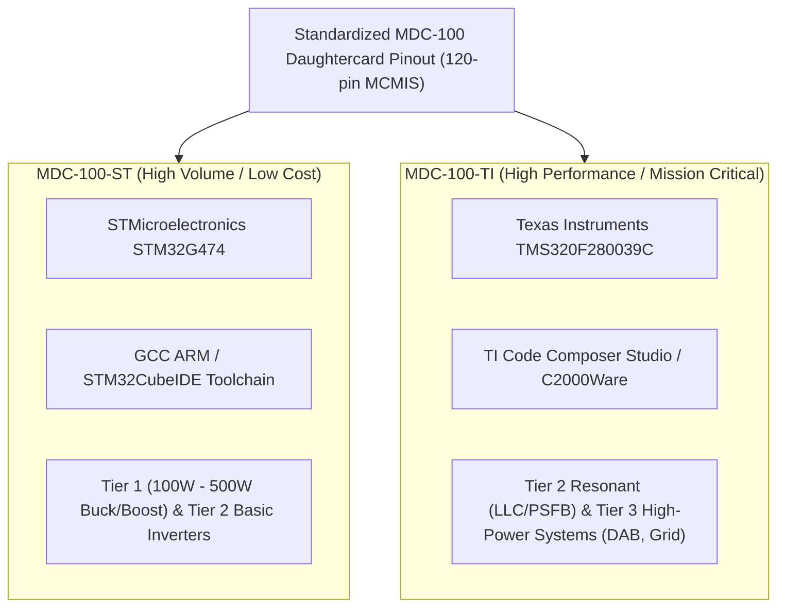

# MPECL Microcontroller & DSP Evaluation & Selection

**Document ID:** MPECL-DOC-MCC-002  
**Revision:** v1.0  
**Status:** APPROVED FOR DESIGN  
**Target Organization:** Mendex Electronics LLP  

---

## 1. Controller Requirements for Digital Power

Digital control of switch-mode power converters imposes stringent hardware peripheral requirements that general-purpose microcontrollers cannot meet:
1. **High-Resolution PWM (HRPWM):** Necessary to avoid "limit cycling"—an instability where the digital control loop oscillates between adjacent discrete duty cycles because the ADC quantization and PWM step size are insufficiently fine. Target resolution: **$< 500\text{ ps}$**.
2. **Fast Synchronized ADCs:** SAR ADCs capable of $\ge 3.5\text{ MSPS}$ with sample-and-hold aperture delay $< 100\text{ ns}$ and hardware triggering linked directly to the PWM counter peak/valley.
3. **On-Chip Fast Analog Comparators with DAC Reference:** Reaction time $< 30\text{ ns}$ with blanking window filters to ignore turn-on diode recovery current spikes, driving PWM trip inputs directly in silicon.
4. **Hardware Floating-Point / Trigonometric Math Acceleration:** Enabling 32-bit single-precision floating point matrix operations and 2P2Z/3P3Z difference equations within $< 15\text{ CPU cycles}$.

---

## 2. Comparative Evaluation Matrix

| Parameter / Feature | STMicroelectronics STM32G474RET6 | Texas Instruments TMS320F280039CPN | Microchip dsPIC33CK256MP506 | NXP LPC55S69 |
|---|---|---|---|---|
| **Core Architecture** | ARM Cortex-M4F @ 170 MHz | TI C28x 32-bit DSP @ 120 MHz + CLA | 16-bit dsPIC DSP @ 100 MHz | Dual ARM Cortex-M33 @ 150 MHz |
| **PWM Peripheral** | HRTIM1 (High-Resolution Timer) | HRPWM (High-Resolution PWM) | High-Resolution PWM | Standard SCTimer |
| **PWM Resolution** | **184 ps** (delay-line architecture) | **150 ps** (MEP - Micro Edge Position) | **250 ps** | ~6.6 ns (Clock limited) |
| **PWM Features** | 10 complementary outputs, burst mode, fault input | 16 ePWM channels, trip zones, dead-band generator | 8 PWM generators, fault inputs | General timer PWM |
| **ADC Performance** | 4x 12-bit SAR ADCs @ **4.0 MSPS** (up to 42 channels) | 3x 12-bit SAR ADCs @ **3.45 MSPS** (up to 16 channels) | 3x 12-bit SAR ADCs @ **3.5 MSPS** | 1x 16-bit SAR ADC @ 1.0 MSPS |
| **Analog Comparators** | 7x Ultra-fast comparators (16 ns) with 7x 12-bit DACs | 4x CMPSS (Comparator Subsystems with 12-bit DACs & digital filter) | 3x Analog comparators with 12-bit DAC | 1x Analog comparator |
| **Math Accelerator** | FMAC (Filter Math Accel) + CORDIC (Sin/Cos/Atan) | TMU (Trig Math Unit) + VCRC + CLA (Control Law Accelerator) | Hardware DSP accumulator (40-bit) | PowerQuad DSP accelerator |
| **Flash / SRAM** | 512 KB Flash / 128 KB SRAM | 384 KB Flash / 69 KB SRAM | 256 KB Flash / 24 KB SRAM | 640 KB Flash / 320 KB SRAM |
| **Toolchain & Compiler** | GCC ARM (Free / Open-Source), STM32CubeIDE | TI Code Composer Studio (Free), TI Clang | MPLAB XC16 (Commercial / Restricted Free) | MCUXpresso (Free) |
| **Indian Distributor Availability** | **Extremely High** (Stocked in large volume across Arrow, Element14, Mouser India) | **High** (Standard stocking; dedicated TI India field support) | Moderate (Limited stock in India, longer lead times) | Moderate |
| **Unit Price (1k-5k Volume in India)** | **~\$3.80 - \$4.50 USD** | **~\$4.90 - \$5.80 USD** | ~\$3.20 - \$3.90 USD | ~\$4.20 - \$5.00 USD |

---

## 3. Dual-Target Controller Strategy for MDC-100

Rather than locking Mendex Electronics into a single semiconductor vendor, **MDC-100 defines a standardized 120-pin pinout that accommodates two pin-compatible hardware variants**:

### Strategic Recommendations:
1. **MDC-100-ST (STM32G474):**
   - **Target Applications:** Tier 1 converters (100 W – 500 W Synchronous Buck/Boost), Solar MPPT charge controllers, standard industrial DIN-rail power supplies.
   - **Rationale:** Open-source GCC toolchain, zero licensing overhead, outstanding 184 ps HRTIM, 4 MSPS ADCs, and ubiquitous component availability in India with short delivery lead times.
2. **MDC-100-TI (TMS320F280039C):**
   - **Target Applications:** Tier 2 and Tier 3 converters (LLC Resonant, Phase-Shifted Full-Bridge, Dual Active Bridge, 15 kW Programmable Power Supplies).
   - **Rationale:** The TI C2000 series is the global gold standard for complex resonant and multi-loop converters. The dedicated Control Law Accelerator (CLA) executes the resonant control loop fully in parallel with the main CPU, guaranteeing jitter-free frequency modulation ($100\text{ kHz} - 500\text{ kHz}$) and seamless phase-shift control.
