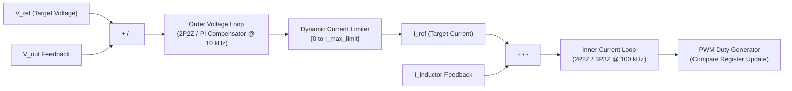
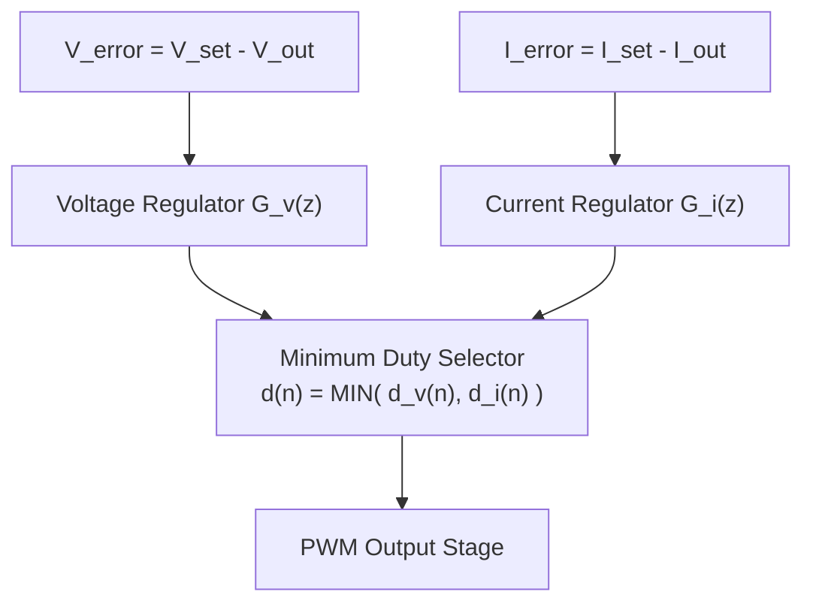

# MPECL Digital Control Loop Architecture

**Document ID:** MPECL-DOC-MCC-003  
**Revision:** v1.0  
**Status:** APPROVED FOR DESIGN  
**Target Organization:** Mendex Electronics LLP  

---

## 1. Dual-Loop Cascaded Control Architecture

MPECL converters utilize a cascaded dual-loop digital control structure for both non-isolated and isolated topologies. This architecture decouples fast inner current dynamics from slower outer voltage regulation, providing inherent short-circuit current limiting, robust audio-susceptibility rejection, and stability across wide line/load steps.

---

## 2. Discrete Digital Compensator Equations (2P2Z and 3P3Z)

Continuous s-domain transfer functions $G_c(s)$ designed via frequency-response analysis are mapped to discrete z-domain difference equations using the **Bilinear (Tustin) Transformation**:

$$s = \frac{2}{T_s} \frac{1 - z^{-1}}{1 + z^{-1}}$$

Where $T_s$ is the digital loop sampling period ($T_s = 10\,\mu\text{s}$ at $100\text{ kHz}$).

### A. Two-Pole Two-Zero (2P2Z) Compensator
The 2P2Z compensator is equivalent to a digital PID controller with a high-frequency noise filter pole:

$$H_{2P2Z}(z) = \frac{u(n)}{e(n)} = \frac{b_0 + b_1 z^{-1} + b_2 z^{-2}}{1 - a_1 z^{-1} - a_2 z^{-2}}$$

The real-time difference equation executed in the high-priority ADC interrupt service routine is:

$$u(n) = b_0 \cdot e(n) + b_1 \cdot e(n-1) + b_2 \cdot e(n-2) + a_1 \cdot u(n-1) + a_2 \cdot u(n-2)$$

* $e(n) = r(n) - y(n)$ is the instantaneous tracking error.
* $u(n)$ is the computed controller output (PWM duty cycle or current reference).
* Past errors $e(n-1), e(n-2)$ and past outputs $u(n-1), u(n-2)$ are stored in a circular ring buffer.

### B. Anti-Windup and Output Clamping
To prevent integrator windup during load transients, soft-start, or current limit saturation, the output $u(n)$ is clamped before updating history registers:

$$u_{sat}(n) = \begin{cases} u_{max} & \text{if } u(n) > u_{max} \\ u_{min} & \text{if } u(n) < u_{min} \\ u(n) & \text{otherwise} \end{cases}$$

When saturation occurs ($u(n) \ne u_{sat}(n)$), the accumulator history is frozen (conditional integration) to ensure zero recovery delay upon re-entering the linear control region.

---

## 3. Constant Voltage (CV) and Constant Current (CC) Automatic Crossover

For programmable DC power supplies, battery chargers, and laboratory equipment, seamless transition between CV and CC modes without output voltage spikes or current surges is mandatory:

* **Principle:** Both the voltage compensator and current compensator execute continuously. The effective duty cycle fed to the PWM modulator is strictly selected as:

$$d(n) = \min\left(d_v(n), d_i(n)\right)$$

* When $I_{out} < I_{set}$, $I_{error} > 0$ pushes $d_i(n)$ toward its maximum limit ($100\%$). Thus $d_v(n) < d_i(n)$, and the converter operates strictly in **Constant Voltage Mode**.
* When load impedance decreases such that $I_{out}$ attempts to exceed $I_{set}$, $d_i(n)$ throttles down. As soon as $d_i(n) < d_v(n)$, control seamlessly crosses over to **Constant Current Mode** without mode switching relays or state resets.

---

## 4. Limit Cycle Oscillation Avoidance Criterion

Limit cycling is a persistent low-frequency oscillation of output voltage caused by non-linear quantization in the ADC and PWM. To guarantee that limit cycle oscillations **cannot physically occur**, MPECL designs enforce the fundamental Nyquist-quantization inequality:

$$\Delta V_{PWM} < \Delta V_{ADC}$$

Where:
* $\Delta V_{ADC} = \frac{V_{ref}}{2^{N_{ADC}} \cdot H_{divider}}$ is the voltage change corresponding to 1 LSB of the ADC.
* $\Delta V_{PWM} = V_{in} \cdot \Delta D_{PWM} = V_{in} \cdot \frac{t_{step}}{T_{sw}}$ is the output voltage change corresponding to 1 LSB of PWM duty cycle.

### Concrete Quantitative Example (Tier 1 Buck: 48V to 12V @ 100 kHz):
* $T_{sw} = 10\,\mu\text{s}$
* 12-bit ADC with 3.3V reference and divider ratio $H = \frac{3.3}{16} = 0.20625$:
  $$\Delta V_{ADC} = \frac{3.3}{4096 \times 0.20625} = 3.906\text{ mV}$$
* If standard timer PWM without high-resolution is used at 170 MHz ($t_{step} = 5.88\text{ ns}$):
  $$\Delta D = \frac{5.88\text{ ns}}{10000\text{ ns}} = 0.000588 \implies \Delta V_{PWM} = 48\text{ V} \times 0.000588 = 28.2\text{ mV}$$
  **Result:** $\Delta V_{PWM} (28.2\text{ mV}) \gg \Delta V_{ADC} (3.9\text{ mV})$. **Severe limit cycling guaranteed!**
* Using STM32G4 HRTIM (184 ps resolution) or TI HRPWM (150 ps):
  $$\Delta D = \frac{0.184\text{ ns}}{10000\text{ ns}} = 0.0000184 \implies \Delta V_{PWM} = 48\text{ V} \times 0.0000184 = 0.88\text{ mV}$$
  **Result:** $\Delta V_{PWM} (0.88\text{ mV}) < \Delta V_{ADC} (3.9\text{ mV})$. **Limit cycling completely eliminated!**

---

## 5. Soft-Start and Soft-Stop Trajectory Engine

To prevent saturation of magnetic cores and destructive inrush currents into capacitive filter banks, the reference voltage $V_{ref}(t)$ follows an S-curve or controlled linear ramp:

* **Soft-Start Sequence:**
  1. PWM generators initialize with zero duty cycle.
  2. Synchronous rectification low-side MOSFET is disabled initially (diode emulation mode) to prevent sinking current from pre-biased outputs.
  3. $V_{ref}(t)$ ramps from $0\text{ V}$ to $V_{target}$ at a rate of:
     $$\frac{dV}{dt} \le \frac{I_{chg\_max}}{C_{out}}$$
  4. Once $V_{out} \ge 0.9 \cdot V_{target}$, synchronous rectification is activated smoothly.
* **Soft-Stop Sequence:**
  1. $V_{ref}(t)$ is ramped down to $0\text{ V}$ at controlled rate.
  2. Gate drivers are disabled, ensuring clean de-energization of all inductors.
