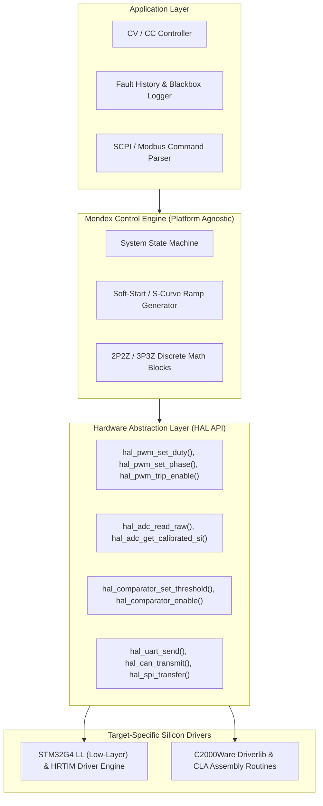
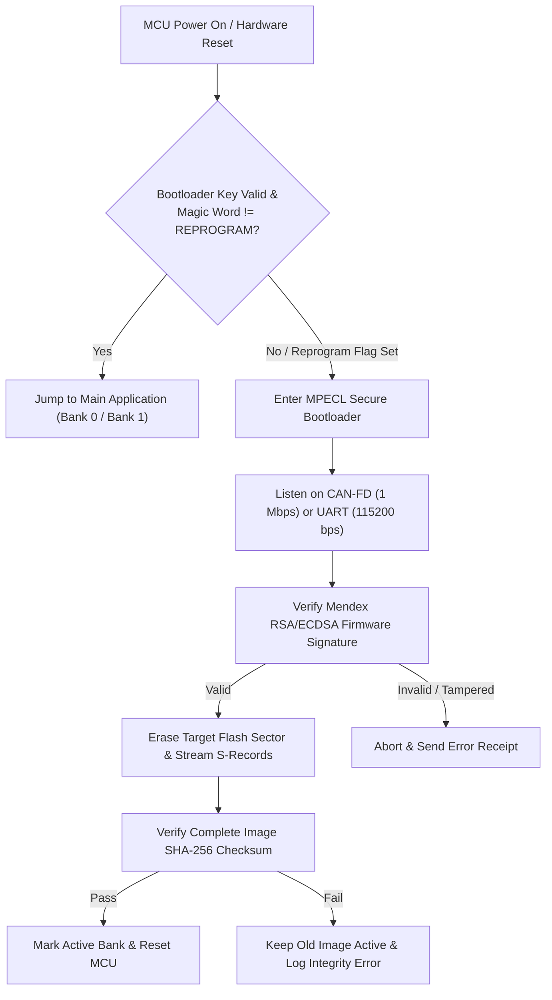

# MPECL Firmware Architecture & Abstraction Specification

**Document ID:** MPECL-DOC-MCC-004  
**Revision:** v1.0  
**Status:** APPROVED FOR DESIGN  
**Target Organization:** Mendex Electronics LLP  

---

## 1. Multi-Target Firmware Layering

The MCC firmware architecture enforces a strict four-layer separation to ensure portability across STMicroelectronics (STM32G474) and Texas Instruments (TMS320F280039C) silicon targets:

---

## 2. Real-Time Interrupt & Priority Hierarchy

To guarantee zero timing jitter in high-frequency power conversion, MCU hardware interrupt priorities are configured in strict hierarchical order:

| Interrupt Vector | Trigger Source | Frequency / Rate | Execution Latency Limit | Priority (Cortex-M4 / C28x) | Function |
|---|---|---|---|---|---|
| **TRIP_ZONE_IRQ** | Hardware Comparator / External Trip Pin | Asynchronous Event | $< 500\text{ ns}$ | **Level 0 (Highest)** | Emergency PWM shutdown, hardware latch capture, fault log trigger |
| **ADC_CONV_IRQ** | PWM Timer Midpoint Trigger | $100\text{ kHz} - 300\text{ kHz}$ | $\le 2.5\,\mu\text{s}$ | **Level 1** | Read ADC registers, execute inner current loop 2P2Z, update PWM compare registers |
| **VOLT_LOOP_IRQ** | General Hardware Timer | $10\text{ kHz}$ | $\le 12\,\mu\text{s}$ | **Level 2** | Execute outer voltage regulation loop, CV/CC clamping, update current reference |
| **CAN_RX_TX_IRQ** | CAN-FD Controller | Asynchronous / Up to 1 Mbps | $\le 5\,\mu\text{s}$ | **Level 3** | Ingest incoming vehicle/PLC frame into ring buffer |
| **UART_DMA_IRQ** | UART DMA Complete (Modbus/SCPI)| Up to 115.2 kbps | $\le 20\,\mu\text{s}$ | **Level 4** | Notify background task of received command packet |
| **SYSTICK_IRQ** | System Tick Timer | $1\text{ kHz}$ | $\le 25\,\mu\text{s}$ | **Level 5** | Increment system uptime, trigger 100 ms HMI refresh, run cooperative background loop |

---

## 3. Blackbox Pre-Fault Ring Buffer Logging

When an overcurrent, overvoltage, or short-circuit event occurs, post-mortem analysis requires knowing the exact system state preceding the failure.

The MCC firmware maintains a **circular pre-fault ring buffer** in high-speed internal SRAM:
* **Buffer Depth:** 64 consecutive switching cycles.
* **Captured Channels:**
  - $V_{in}$ (Raw ADC & Calibrated SI Volts)
  - $V_{out}$ (Raw ADC & Calibrated SI Volts)
  - $I_{inductor}$ (Raw ADC & Calibrated SI Amps)
  - Computed Duty Cycle ($d$)
  - System State Variable
* **Freeze Trigger:** Asserted on `TRIP_ZONE_IRQ` entry.
* **Storage:** Upon hardware shutdown, the 64-sample snapshot is written to non-volatile EEPROM/Flash along with a 64-bit UTC timestamp and fault code, enabling deep post-mortem diagnostics in Mendex Studio.

---

## 4. Bootloader & In-Field Firmware Update Standard

MPECL controllers support in-field firmware updates over CAN-FD or isolated RS485 without opening the physical enclosure:

* **Dual-Bank Flash Memory Architecture:** Flash memory is partitioned into two identical operational banks (Bank 0 and Bank 1).
* **Zero Bricking Guarantee:** A new firmware image is completely written and verified via SHA-256 checksum in the inactive bank before switching the boot vector. If verification fails or power drops during flashing, the controller continues booting from the intact original bank.
