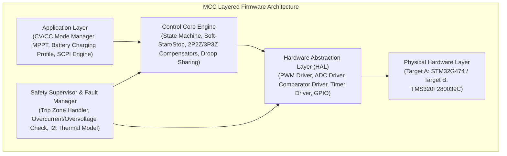
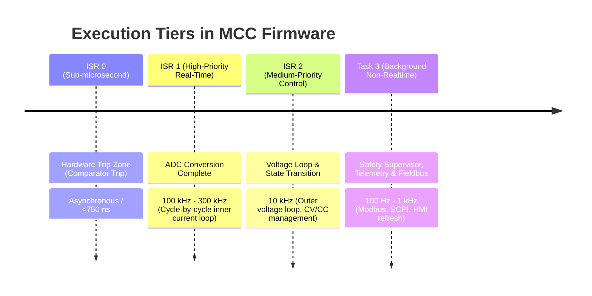
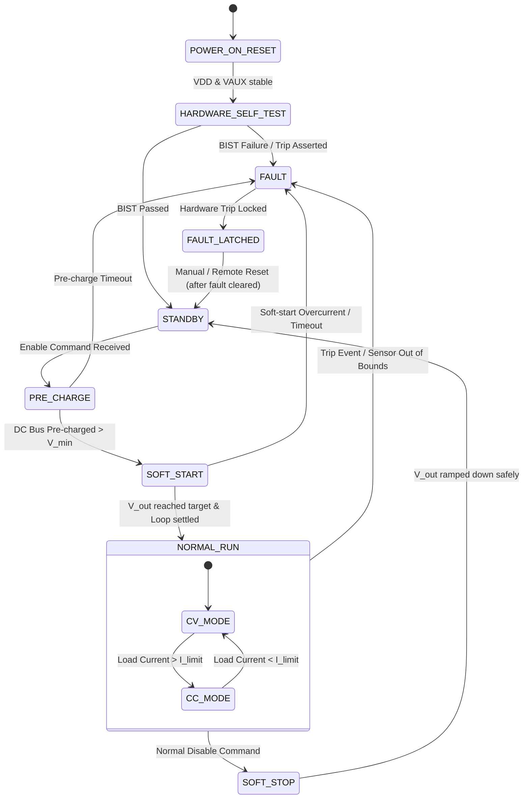

# Mendex Control Core (MCC) Platform Overview

**Document ID:** MPECL-DOC-MCC-001  
**Revision:** v1.0  
**Status:** APPROVED FOR DESIGN  
**Target Organization:** Mendex Electronics LLP  

---

## 1. Scope & Architectural Mandate

The **Mendex Control Core (MCC)** governs all embedded real-time intelligence, digital control loop computation, PWM modulation, system sequencing, and supervisory communications across Mendex power conversion products.

The fundamental objective of MCC is to establish a **topology-agnostic, multi-target firmware platform**. The firmware must run on a standardized hardware controller card (**MDC-100**) without requiring algorithmic rewrites when transitioning between converter topologies (e.g., from a 500 W Synchronous Buck to a 3 kW Phase-Shifted Full-Bridge).

---

## 2. Hard Real-Time Timing & Scheduling Requirements

Power electronics digital control requires deterministic, low-latency execution. A missed interrupt or uncontrolled phase jitter in a high-frequency converter causes immediate duty cycle saturation, inductor saturation, and semiconductor destruction.

MPECL firmware establishes three deterministic execution tiers:

1. **Tier 0: Asynchronous Hardware Trip Zone ($< 750\text{ ns}$):**
   - Implemented via hardware comparator (CMPSS) triggering PWM trip pins directly in silicon.
   - Bypasses software interrupt latency entirely. Shuts down gate drives immediately.
2. **Tier 1: High-Frequency Inner Loop ISR ($100\text{ kHz} - 300\text{ kHz}$):**
   - Triggered by ADC conversion completion (synchronized to PWM carrier midpoint).
   - Worst-case execution budget: **$\le 2.5\,\mu\text{s}$** (utilizing $< 35\%$ CPU capacity at $100\text{ kHz}$).
   - Computes inner inductor current control ($I_L$), cycle-by-cycle peak limiting, and updates PWM compare registers.
3. **Tier 2: Medium-Frequency Outer Loop ISR ($10\text{ kHz}$):**
   - Triggered by a dedicated hardware timer.
   - Worst-case execution budget: **$\le 15\,\mu\text{s}$**.
   - Computes outer voltage regulation ($V_{out}$), Constant Current (CC) / Constant Voltage (CV) smooth clamping, slew rate limiting, and soft-start ramps.
4. **Tier 3: Low-Priority Background Task ($10\text{ Hz} - 1\text{ kHz}$):**
   - Runs in a non-preemptive cooperative round-robin scheduler.
   - Handles isolated Modbus RTU, CAN-FD frame parsing, SCPI commands, OLED display refresh, and non-critical thermal telemetry ($I^2t$ modeling).

---

## 3. Universal State Machine

Every power converter managed by MCC executes an identical top-level deterministic finite state machine (FSM):

* **POWER_ON_RESET:** Initializes clocks, sets all PWM pins to high-impedance (tri-state), configures safety trip zones.
* **HARDWARE_SELF_TEST:** Verifies internal references ($V_{ref}$), confirms ADC zero-offset calibration, checks temperature sensors, and verifies that the `/TRIP_ZONE` line is de-asserted.
* **STANDBY:** Awaits physical enable switch, SCPI command, or fieldbus start flag.
* **PRE_CHARGE:** Activates inrush current limiting contactor/resistor; verifies input DC link capacitors charge safely.
* **SOFT_START:** Linearly ramps the reference voltage/current over a programmable duration ($10\text{ ms} - 500\text{ ms}$) to prevent inductor current overshoot.
* **NORMAL_RUN:** Seamless automatic crossover between Constant Voltage (CV) and Constant Current (CC).
* **FAULT_LATCHED:** Latches all PWMs low, records high-resolution fault snapshot in non-volatile memory, and illuminates the red fault indicator.
