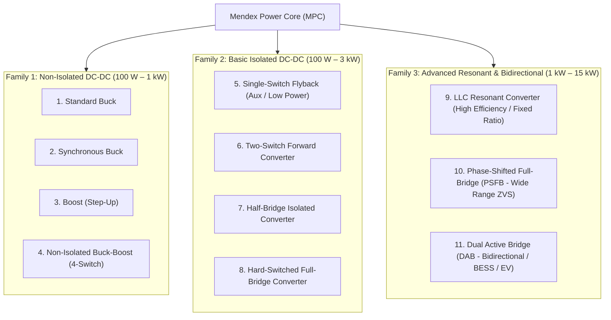

# Mendex Power Core (MPC) Platform Overview

**Document ID:** MPECL-DOC-MPC-001  
**Revision:** v1.0  
**Status:** APPROVED FOR DESIGN  
**Target Organization:** Mendex Electronics LLP  

---

## 1. Scope & Topology Taxonomy

The **Mendex Power Core (MPC)** encompasses the power conversion topologies, power semiconductor selection criteria, high-frequency magnetic tank design guidelines, and thermal management architectures required to support Mendex power conversion products from **100 W to 15 kW**.

To eliminate guesswork and avoid applying improper circuit topologies outside their optimal operating zones, MPECL organizes power conversion into three topological families across 11 standard topologies:

---

## 2. Semiconductor Technology Selection Matrix (Si vs. SiC vs. GaN)

Choosing between Silicon (Si) MOSFETs, Silicon Carbide (SiC) MOSFETs, Gallium Nitride (GaN) HEMTs, and Insulated Gate Bipolar Transistors (IGBTs) is strictly governed by operating voltage, switching frequency, thermal boundaries, and Indian supply chain economics:

| Semiconductor Technology | Voltage Range | Optimal Frequency | Conduction vs. Switching Loss | Typical Package | Sourcing & Cost in India | MPECL Topology Application |
|---|---|---|---|---|---|---|
| **Silicon MOSFET (Superjunction)** | $20\text{ V} - 150\text{ V}$ | $50\text{ kHz} - 300\text{ kHz}$ | Very low $R_{DS(on)}$ ($< 5\text{ m}\Omega$), high $Q_g$ | TO-220, D2PAK, PDFN56 | Readily available, lowest cost ($< \$1.50$) | Tier 1 Synchronous Buck/Boost (100W–500W) |
| **Silicon MOSFET (600V SJ)** | $500\text{ V} - 650\text{ V}$ | $40\text{ kHz} - 120\text{ kHz}$ | Moderate $R_{DS(on)}$, high reverse recovery ($Q_{rr}$) | TO-220, TO-247 | Highly available, low cost ($< \$3.00$) | Hard-switched Forward, Half-Bridge, Low-Power Flyback |
| **Gallium Nitride (GaN HEMT)** | $100\text{ V} - 650\text{ V}$ | $200\text{ kHz} - 1\text{ MHz}$ | Zero reverse recovery ($Q_{rr}=0$), ultra-low $C_{iss}$ | DFN, QFN, GaN-mount | Limited local stock; premium pricing; fragile gate ($\le 6\text{V}$) | High-density compact adapters, ultra-high-frequency DC-DC |
| **Silicon Carbide (SiC MOSFET)** | $650\text{ V} - 1200\text{ V}$ | $80\text{ kHz} - 250\text{ kHz}$ | Low $R_{DS(on)}$ at high temperature, low $Q_{rr}$, high $T_{j,max}$ ($175^\circ\text{C}$) | TO-247-4L (Kelvin source), Half-bridge Modules | Readily stocked via Arrow/Element14; moderate cost | Tier 2 & 3 LLC, PSFB, DAB, 15kW DC Power Supplies |
| **IGBT (Field Stop Trench)** | $650\text{ V} - 1200\text{ V}$ | $15\text{ kHz} - 40\text{ kHz}$ | Constant $V_{CE(sat)}$ drop, high tail current switching losses | TO-247, SOT-227, Power Modules | Very high local stock, low cost | High-current low-frequency industrial grid rectifiers ($> 10\text{ kW}$) |

---

## 3. High-Frequency Magnetics Design Philosophy

Magnetic components (inductors, resonant chokes, planar transformers) are the largest, heaviest, and most failure-prone elements in power converters. In accordance with Mendex engineering rules, all magnetic designs must enforce:

1. **Operating Flux Density Derating:**
   - Standard ferrite materials (e.g., TDK N87, DMEGC DMR44, Ferroxcube 3C95) have a saturation flux density $B_{sat} \approx 0.40\text{ T} - 0.45\text{ T}$ at $25^\circ\text{C}$, which drops to $\approx 0.32\text{ T}$ at $100^\circ\text{C}$.
   - **MPECL Mandate:** Peak operational flux density must be limited to:
     $$B_{pk} \le 0.25\text{ T} \quad \text{at } 100^\circ\text{C}$$
   - This guarantees a minimum **$25\%$ safety margin** against core saturation under maximum line voltage, dynamic load steps, and $50^\circ\text{C}$ Indian ambient conditions.
2. **Skin and Proximity Effect Mitigation:**
   - At switching frequencies $f_{sw} \ge 100\text{ kHz}$, the copper skin depth is:
     $$\delta = \frac{66}{\sqrt{f_{sw}}} \approx 0.21\text{ mm} \quad (\text{at } 100\text{ kHz})$$
   - Any single conductor with diameter $d > 2\delta \approx 0.42\text{ mm}$ (approx. AWG 26) suffers severe AC resistance penalties ($R_{ac} / R_{dc} \gg 1.5$).
   - **MPECL Mandate:** For transformer windings and resonant chokes carrying $> 5\text{ A}_{RMS}$ at $\ge 100\text{ kHz}$, **Litz wire** (multi-strand insulated wire with strand diameter $\le 0.1\text{ mm}$) or **copper foil with interleaved primary/secondary layers** is strictly mandatory.
