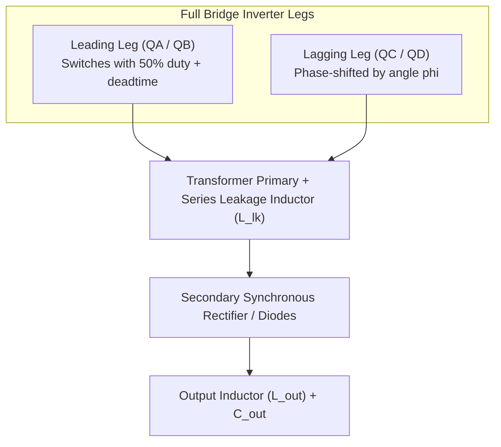
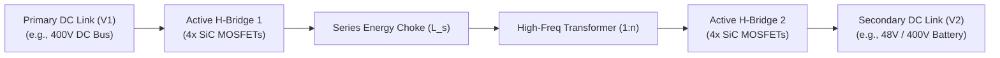

# MPECL Advanced Resonant & Bidirectional Topologies

**Document ID:** MPECL-DOC-MPC-004  
**Revision:** v1.0  
**Status:** APPROVED FOR DESIGN  
**Target Organization:** Mendex Electronics LLP  

---

## 1. LLC Resonant Converter (MPS-300-LLC IP Block)

### 1.1 Working Principle & Soft-Switching (ZVS/ZCS)
The LLC resonant converter is the industry standard for high-efficiency, isolated DC-DC power conversion in telecommunications, server power, and EV on-board chargers. The resonant tank comprises a series resonant inductor ($L_r$), a series resonant capacitor ($C_r$), and the magnetizing inductance of the high-frequency transformer ($L_m$).

### 1.2 Mathematical Governing Equations
1. **Series Resonant Frequency ($f_0$):**
   $$f_0 = \frac{1}{2\pi \sqrt{L_r \cdot C_r}}$$
2. **Lower Resonant Frequency ($f_p$):**
   $$f_p = \frac{1}{2\pi \sqrt{(L_r + L_m) \cdot C_r}}$$
3. **Inductance Ratio ($k$) and Quality Factor ($Q$):**
   $$k = \frac{L_m}{L_r}, \quad Q = \frac{\sqrt{L_r / C_r}}{R_{ac}}$$
   Where $R_{ac} = \frac{8}{\pi^2} \left(\frac{N_p}{N_s}\right)^2 R_{load}$ is the equivalent AC load resistance.
4. **Zero-Voltage Switching (ZVS) Condition:**
   To guarantee primary switch turn-on under zero drain-source voltage (ZVS), magnetizing current $I_{m,pk}$ during dead-time $t_{dead}$ must fully discharge the switch output capacitance $C_{oss}$:
   $$I_{m,pk} = \frac{V_{in}}{4 \cdot f_{sw} \cdot L_m} \ge \frac{2 \cdot V_{in} \cdot C_{oss}}{t_{dead}} \implies L_m \le \frac{t_{dead}}{8 \cdot f_{sw} \cdot C_{oss}}$$
5. **Practical Power & Voltage Range:**
   - Input: $380\text{ V} - 420\text{ V}$ (PFC regulated bus).
   - Output: $24\text{ V} - 48\text{ V}$.
   - Power Range: **$500\text{ W} - 3\text{ kW}$**.
   - Peak Efficiency: **$> 97.5\%$** at resonant frequency $f_0$.

---

## 2. Phase-Shifted Full-Bridge (PSFB) Converter (MPS-300-PSFB IP Block)

### 2.1 Working Principle & Constant-Frequency Phase-Shift Control
While LLC relies on variable frequency modulation (which complicates EMI filter optimization over wide input/output ranges), the **Phase-Shifted Full-Bridge (PSFB)** operates at a **constant switching frequency**. 

Output voltage regulation is achieved by modulating the relative phase-shift angle ($\phi \in [0^\circ, 180^\circ]$) between the leading leg ($Q_A, Q_B$) and the lagging leg ($Q_C, Q_D$):

### 2.2 ZVS Mechanism & Lagging Leg Challenge
* **Leading Leg ZVS:** Readily achieved across full load range because primary current plus reflected inductor current discharges $C_{oss}$.
* **Lagging Leg ZVS:** Achieved strictly using the kinetic energy trapped in the primary leakage inductance $L_{lk}$:
  $$\frac{1}{2} L_{lk} I_{pri}^2 > \frac{4}{3} C_{oss} V_{in}^2$$
  At light load ($I_{pri} \to 0$), the lagging leg loses ZVS and enters hard switching.
* **MPECL Design Guideline:** Integrate a small saturable inductor or external shim inductor ($L_{shim}$) and configure adaptive dead-time in firmware via MDC-100 to extend ZVS down to $20\%$ load.
* **Practical Power Range:** **$1\text{ kW} - 10\text{ kW}$** (Ideal for wide-range battery chargers and industrial plating/plasma supplies).

---

## 3. Dual Active Bridge (DAB) Converter (MPS-300-DAB IP Block)

### 3.1 Bidirectional Power Transfer Principle
The Dual Active Bridge consists of two active full-bridge inverters separated by a high-frequency isolation transformer and an energy-transfer inductance $L_s$ (integrated transformer leakage + external series choke). Power flow is inherently bidirectional, controlled purely by the phase-shift angle $\phi$ between the primary bridge AC voltage $v_1(t)$ and secondary bridge AC voltage $v_2(t)$.

### 3.2 Governing Power Flow Equation
Under Single Phase Shift (SPS) modulation, power transfer $P$ is governed by:

$$P = \frac{V_1 \cdot V_2'}{2 \pi f_{sw} \cdot L_s} \cdot \phi \cdot \left(1 - \frac{|\phi|}{\pi}\right)$$

Where:
* $V_2' = \frac{V_2}{n}$ is the secondary DC voltage reflected to the primary.
* $\phi \in [-\frac{\pi}{2}, +\frac{\pi}{2}]$ is the phase-shift angle in radians.
* Positive $\phi$ transfers power from $V_1 \to V_2$; negative $\phi$ reverses power flow ($V_2 \to V_1$).
* Maximum theoretical power transfer occurs at $\phi = \frac{\pi}{2}$ ($90^\circ$ phase shift).

### 3.3 Soft-Switching Boundaries & Target Applications
* All eight switches achieve Zero-Voltage Switching (ZVS) when the voltage conversion ratio $d = \frac{V_1}{n \cdot V_2} \approx 1.0$.
* When $V_1$ and $V_2$ deviate significantly from unity gain ($d \ll 1$ or $d \gg 1$), circulating reactive currents increase, resulting in partial ZVS loss and higher conduction loss. To counteract this, MDC-100 firmware supports Extended Phase Shift (EPS) and Dual Phase Shift (DPS) modulation modes.
* **Target Applications:** Battery Energy Storage Systems (BESS), Vehicle-to-Grid (V2G) DC fast-charging bidirectional modules, and solid-state transformers.
* **Power Range:** **$3\text{ kW} - 15\text{ kW}$**.
