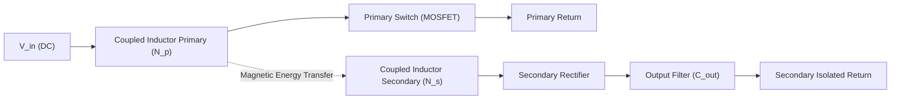
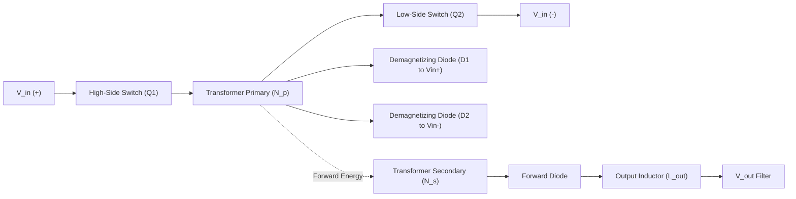

# MPECL Basic Isolated DC-DC Topologies

**Document ID:** MPECL-DOC-MPC-003  
**Revision:** v1.0  
**Status:** APPROVED FOR DESIGN  
**Target Organization:** Mendex Electronics LLP  

---

## 1. Single-Switch Flyback Converter (Auxiliary / Low-Power IP)

### 1.1 Working Principle & Topology
The Flyback converter is an isolated topology derived from the buck-boost converter where the inductor is replaced by a multi-winding coupled inductor (flyback transformer). Energy is stored in the transformer core air gap during the primary switch ON-time and transferred to the secondary load during the switch OFF-time.

### 1.2 Key Design Equations & Snubber Considerations
1. **Voltage Conversion Ratio (CCM):**
   $$\frac{V_{out}}{V_{in}} = \frac{N_s}{N_p} \cdot \frac{D}{1 - D}$$
2. **Primary Switch Drain Voltage Stress:**
   $$V_{DS,pk} = V_{in,max} + \frac{N_p}{N_s} \cdot (V_{out} + V_F) + V_{spike\_leakage}$$
   * **Leakage Inductance Snubber:** Primary leakage inductance ($L_{lk}$) traps energy $E = \frac{1}{2} L_{lk} I_{pk}^2$ upon switch turn-off, generating a destructive voltage spike.
   * **MPECL Standard:** A dedicated RCD (Resistor-Capacitor-Diode) clamp or TVS clamp is mandatory across the primary winding to clamp $V_{DS,pk}$ to $\le 80\%$ of the switch breakdown rating ($V_{(BR)DSS}$).
3. **Application & Power Limit:**
   - **Target Applications:** Auxiliary power supplies (MAP-100), isolated gate driver bias rails, low-power sensor supplies.
   - **Practical Power Limit:** **$\le 150\text{ W}$**. (Beyond 150 W, peak currents and transformer core size make flyback inefficient compared to forward or resonant converters).

---

## 2. Two-Switch Forward Converter

### 2.1 Working Principle & Core Reset
Unlike the flyback converter, the Forward converter transfers energy directly to the secondary load during the switch ON-time via true transformer action. Energy is not stored in the core gap.

### 2.2 Core Reset & Duty Cycle Constraint
* **Two-Switch Advantage:** When $Q_1$ and $Q_2$ turn off simultaneously, demagnetizing diodes $D_1$ and $D_2$ clamp the primary voltage to $V_{in}$, returning magnetizing energy directly back to the input DC link capacitors.
* **Maximum Duty Cycle:** Because magnetizing reset voltage equals input voltage, core reset requires:
  $$D_{max} < 0.50$$
  This prevents transformer saturation under all operating conditions without requiring tertiary reset windings.
* **Switch Voltage Stress:** Clamped strictly to $V_{in,max}$, allowing standard, lower-cost $600\text{ V}$ MOSFETs instead of expensive $1000\text{ V}$ switches.
* **Practical Power Range:** **$150\text{ W} - 800\text{ W}$**.

---

## 3. Half-Bridge & Full-Bridge Isolated Converters

### 3.1 Half-Bridge Converter (300 W – 1.5 kW)
* **Architecture:** The transformer primary is connected between the midpoint of a two-switch inverter leg ($Q_1, Q_2$) and the midpoint of a capacitive voltage divider ($C_1, C_2$).
* **Primary Voltage:** $\pm \frac{V_{in}}{2}$.
* **Flux Walking Mitigation:** A series DC blocking capacitor ($C_{block}$) is placed in series with the primary winding. Any DC voltage imbalance caused by asymmetric switch switching speeds or gate delays is absorbed across $C_{block}$, preventing transformer core saturation.

### 3.2 Hard-Switched Full-Bridge Converter (1 kW – 5 kW)
* **Architecture:** Four switches arranged in an H-bridge configuration ($Q_1, Q_2, Q_3, Q_4$).
* **Primary Voltage:** Alternates symmetrically between $+V_{in}$ and $-V_{in}$.
* **Conversion Ratio:**
  $$\frac{V_{out}}{V_{in}} = 2 \cdot \frac{N_s}{N_p} \cdot D \quad (D \le 0.48)$$
* **Limitation:** At high switching frequencies ($> 50\text{ kHz}$), hard-switching turn-on and turn-off losses in four high-voltage switches generate excessive heat. This motivates the transition to **Phase-Shifted Full-Bridge (PSFB)** or **LLC Resonant** topologies for multi-kilowatt designs.
