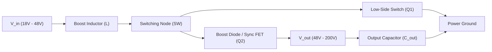

# MPECL Non-Isolated DC-DC Topologies

**Document ID:** MPECL-DOC-MPC-002  
**Revision:** v1.0  
**Status:** APPROVED FOR DESIGN  
**Target Organization:** Mendex Electronics LLP  

---

## 1. Synchronous Buck Converter (MPS-100 IP Block)

### 1.1 Working Principle & Schematic Architecture
The Synchronous Buck converter steps down a higher DC input voltage $V_{in}$ to a lower regulated DC output voltage $V_{out}$ with high electrical efficiency by replacing the freewheeling diode with a low-$R_{DS(on)}$ active Silicon MOSFET (synchronous rectifier).

```mermaid
circuit
    %% Conceptual Functional Flow
    graph LR
        VIN["V_in (18V - 75V)"] --> Q_HIGH["Q_high (High-Side MOSFET)"]
        Q_HIGH --> SW_NODE["Switching Node (SW)"]
        SW_NODE --> INDUCTOR["Inductor (L)"]
        SW_NODE --> Q_LOW["Q_low (Synchronous Rectifier)"]
        Q_LOW --> PGND["Power Ground"]
        INDUCTOR --> VOUT["V_out (12V / 24V)"]
        VOUT --> COUT["Output Capacitor (C_out)"]
        COUT --> PGND
```

### 1.2 Mathematical Governing Equations
1. **Ideal Voltage Conversion Ratio (CCM):**
   $$D = \frac{V_{out} + V_{drop\_sync}}{V_{in} - V_{drop\_high}} \approx \frac{V_{out}}{V_{in}}$$
2. **Inductor Sizing ($L$):**
   To maintain the inductor current ripple ratio $r = \frac{\Delta I_L}{I_{out}}$ between $0.20$ and $0.40$ (standard design optimum balancing core size and RMS copper losses):
   $$L = \frac{V_{out} \cdot (1 - D)}{r \cdot I_{out} \cdot f_{sw}}$$
3. **Output Capacitor Sizing ($C_{out}$):**
   Governed by maximum allowable peak-to-peak output ripple voltage $\Delta V_{out}$ and equivalent series resistance (ESR):
   $$\Delta V_{out} \approx \Delta I_L \cdot \left( ESR_{C} + \frac{1}{8 \cdot f_{sw} \cdot C_{out}} \right)$$
4. **Semiconductor Electrical Stress:**
   - Maximum Drain-Source Voltage Stress: $V_{DS,max} = V_{in,max} + V_{spike}$ (requires minimum **$25\%$ derating margin**).
   - High-Side RMS Current: $I_{RMS,high} = I_{out} \cdot \sqrt{D \cdot \left(1 + \frac{r^2}{12}\right)}$
   - Low-Side RMS Current: $I_{RMS,low} = I_{out} \cdot \sqrt{(1 - D) \cdot \left(1 + \frac{r^2}{12}\right)}$

### 1.3 Application & Ratings Classification
* **Target Applications:** Point-of-load DC regulators, battery pack discharge regulators, auxiliary power conditioning.
* **Input Voltage Range:** $18\text{ V} - 75\text{ V}$ (Nominal $48\text{ V}$ telecom / battery rail).
* **Output Voltage Range:** $12\text{ V} \pm 2\%$ or $24\text{ V} \pm 2\%$.
* **Power Class:** $100\text{ W} - 500\text{ W}$ (Single Phase); up to $1\text{ kW}$ (Interleaved Dual Phase).
* **Target Efficiency:** $> 96.5\%$ at full load.
* **Component Ratings:** Specific inductance, capacitance, and switch part numbers are `TBD` pending thermal simulation in Mendex Studio.

---

## 2. Boost (Step-Up) Converter (MPS-200 IP Block)

### 2.1 Working Principle & Schematic Architecture
The Boost converter steps up a lower DC input voltage $V_{in}$ (e.g., from solar PV panels or fuel cells) to a higher DC bus voltage $V_{out}$.



### 2.2 Mathematical Governing Equations
1. **Ideal Voltage Conversion Ratio (CCM):**
   $$\frac{V_{out}}{V_{in}} = \frac{1}{1 - D}$$
2. **Inductor Sizing ($L$):**
   $$L = \frac{V_{in} \cdot D}{r \cdot I_{in} \cdot f_{sw}} = \frac{V_{in}^2 \cdot D \cdot (1 - D)}{r \cdot P_{out} \cdot f_{sw}}$$
3. **Right-Half-Plane (RHP) Zero Constraint:**
   In continuous conduction mode (CCM), the boost converter exhibits a right-half-plane zero in its control-to-output transfer function:
   $$\omega_{RHPZ} = \frac{R_{load} \cdot (1 - D)^2}{L}$$
   **Control Rule:** The closed-loop crossover frequency $f_c$ must be strictly limited to:
   $$f_c \le \frac{f_{RHPZ}}{4} = \frac{R_{load} \cdot (1 - D)^2}{8 \pi L}$$
   Attempting to push bandwidth beyond this limit results in closed-loop instability and phase margin collapse.

---

## 3. Four-Switch Non-Isolated Buck-Boost Converter

### 3.1 Working Principle
For applications where the input voltage can be higher, lower, or equal to the output voltage (e.g., $18\text{ V} - 72\text{ V}$ battery entering a regulated $24\text{ V}$ or $48\text{ V}$ bus), the **Four-Switch Synchronous Buck-Boost** topology provides seamless bidirectional voltage conversion with high efficiency.

* **Control Modes:**
  - **Buck Mode ($V_{in} > 1.15 \cdot V_{out}$):** Switch pair 2 remains in permanent conduction ($Q_4$ ON, $Q_3$ OFF); switch pair 1 modulates as a synchronous buck.
  - **Boost Mode ($V_{in} < 0.85 \cdot V_{out}$):** Switch pair 1 remains in permanent conduction ($Q_1$ ON, $Q_2$ OFF); switch pair 2 modulates as a synchronous boost.
  - **Mixed Buck-Boost Mode ($0.85 \cdot V_{out} \le V_{in} \le 1.15 \cdot V_{out}$):** Interleaved 4-switch modulation preventing transition glitches.
