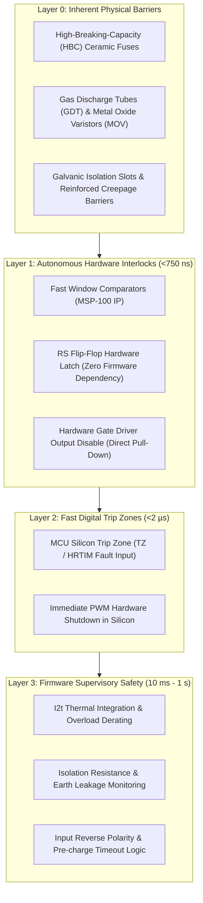

# Mendex Safety Core (MSC) Platform Overview

**Document ID:** MPECL-DOC-MSC-001  
**Revision:** v1.0  
**Status:** APPROVED FOR DESIGN  
**Target Organization:** Mendex Electronics LLP  

---

## 1. Safety Philosophy & Defense-in-Depth

The **Mendex Safety Core (MSC)** establishes a multi-tiered, redundant safety and sensing architecture designed to protect equipment, operators, and surrounding infrastructure from catastrophic electrical, thermal, or mechanical failures.

In industrial power electronics, software bugs, MCU clock glitches, or memory corruption must **never be capable of causing fires, explosions, or lethal electric shocks**. MSC enforces a strict hardware-software separation:



---

## 2. Low-Voltage vs. High-Voltage Domain Separation

MSC establishes distinct safety architectures depending on the voltage classification of the power stage:

| Domain Attribute | Low-Voltage Safety Domain (Tier 1) | High-Voltage Safety Domain (Tiers 2 & 3) |
|---|---|---|
| **Voltage Boundary** | $\le 60\text{ V DC}$ (SELV - Safety Extra Low Voltage) | $> 60\text{ V DC}$ up to $1000\text{ V DC}$ (Hazardous Live Voltage) |
| **Applicable Standards** | IEC 62368-1, IS 13252 | IEC 62368-1, IEC 60664-1, IEC 62477-1 |
| **Clearance (Air)** | $\ge 1.5\text{ mm}$ (Basic functional) | **$\ge 4.0\text{ mm} - 6.0\text{ mm}$** (Reinforced insulation) |
| **Creepage (Surface)** | $\ge 2.0\text{ mm}$ (Functional) | **$\ge 6.3\text{ mm} - 8.0\text{ mm}$** (Pollution Degree 2, Material Group IIIa) |
| **Sensing Architecture** | Non-isolated Kelvin shunts & resistive dividers | Galvanically isolated ($\Sigma\Delta$ optical/magnetic, Hall effect) |
| **Gate Drive Isolation** | Non-isolated bootstrap or functional level shifter | **Reinforced galvanic isolation ($\ge 5.7\text{ kV}_{RMS}$ surge, CMTI $> 100\text{ kV/}\mu\text{s}$)** |
| **Grounding Reference** | Signal ground bonded to negative DC terminal | Primary high-voltage ground strictly separated from SELV chassis ground |
| **Isolation Monitoring** | Not required | **Active DC insulation resistance monitoring ($\ge 100\text{ k}\Omega/\text{V}$)** |

---

## 3. Autonomous Hardware Trip Mechanism

The core protection primitive in MSC is the **autonomous hardware latch**:

```mermaid
circuit
    %% Conceptual Flow of Hardware Trip
    graph LR
        SENSE_IN["Sense Input (V or I)"] --> COMP["Fast Comparator (LMH7220 / CMPSS)"]
        REF["Precision Threshold (V_ref_trip)"] --> COMP
        COMP --> SET["RS Latch / Hardware Flip-Flop (SET)"]
        SET --> LATCH_OUT["Latched Fault Active-Low (/FAULT)"]
        LATCH_OUT --> GATE_DIS["Gate Driver /DIS Pin (Pulled Low via NFET)"]
        LATCH_OUT --> MCU_TZ["MCU Hardware Trip Pin (TZ1)"]
        MCU_RESET["MCU Clear Fault Command"] --> RESET["RS Latch (RESET)"]
```

1. **Deterministic Action:** The comparator asserts the latch output without software intervention.
2. **Latching Rule:** Once tripped, the gate drivers remain disabled even if the sensed current or voltage drops back below the trip threshold (e.g., after the switch turns off).
3. **Safe Clear Rule:** A fault can only be cleared by an explicit software write or physical push button after confirming that the operating conditions have returned to normal for at least $100\text{ ms}$.
