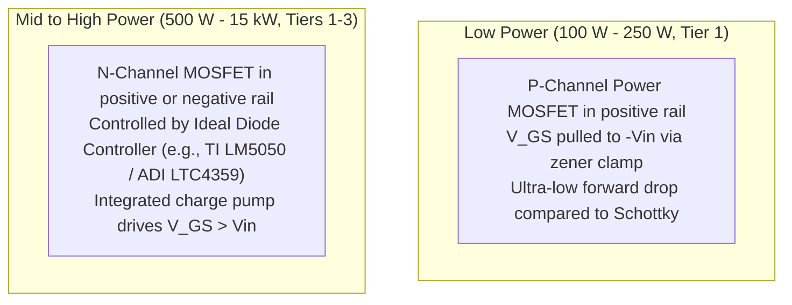
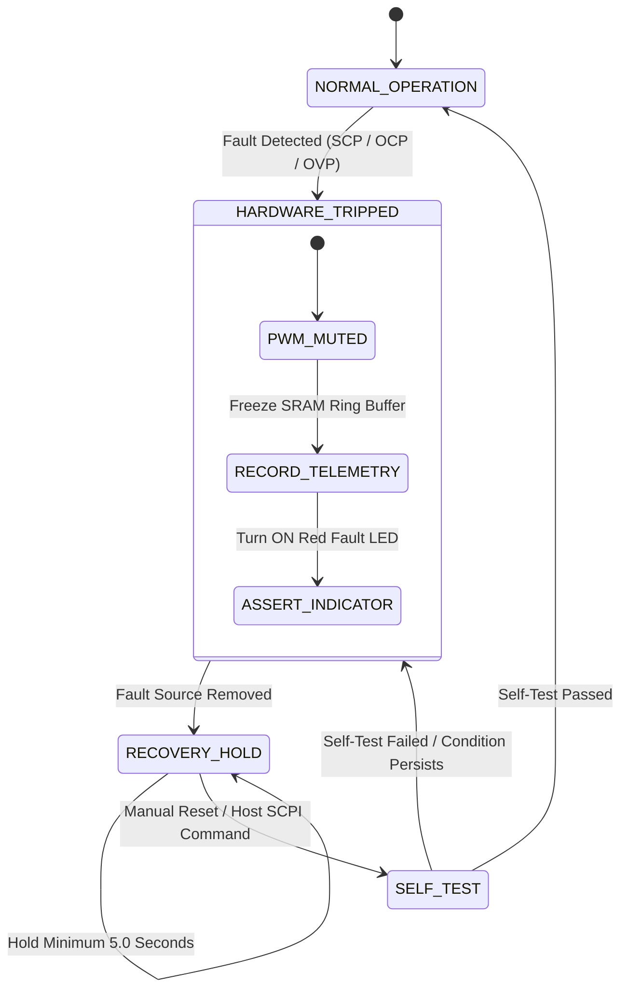

# MPECL Protection Circuits & Fault Handling

**Document ID:** MPECL-DOC-MSC-003  
**Revision:** v1.0  
**Status:** APPROVED FOR DESIGN  
**Target Organization:** Mendex Electronics LLP  

---

## 1. Protection Response Time Specifications

To prevent semiconductor destruction, thermal runaway, and electrical fires, MPECL defines strict maximum response times across all fault categories:

| Fault Classification | Protection Layer | Maximum Latency | Action Taken | Recovery Mechanism |
|---|---|---|---|---|
| **Short Circuit (SCP)** | Hardware (Layer 1) | **$< 750\text{ ns}$** | Gate driver hardware pull-down + latched trip | Latched. Requires explicit power cycle or reset command |
| **Instantaneous Overcurrent (OCP)** | Hardware (Layer 1) | **$< 1.0\,\mu\text{s}$** | Cycle-by-cycle PWM truncation / latch if repeated | Automatic retry up to 3 cycles; latch if persistent |
| **Output Overvoltage (OVP)** | Hardware (Layer 1) | **$< 2.0\,\mu\text{s}$** | Immediate PWM disable + optional crowbar thyristor | Latched. Manual reset required |
| **Input Undervoltage (UVP)** | Firmware (Layer 2) | $\le 10\text{ ms}$ | Controlled soft-stop + disable gate drivers | Auto-recovery with $10\%$ hysteresis once Vin normalizes |
| **Overtemperature (OTP)** | Firmware (Layer 3) | $\le 100\text{ ms}$ | Linear power derating above $85^\circ\text{C}$; shutdown at $105^\circ\text{C}$ | Auto-recovery once heatsink cools $\le 65^\circ\text{C}$ |
| **Input Reverse Polarity** | Physical / Hardware | **$0\text{ ns}$ (Instant)** | Series Ideal Diode Controller or Reverse P-FET | Inherent physical protection |
| **Emergency Stop (E-Stop)** | Hardware Line | **$< 5\,\mu\text{s}$** | Primary power contactor open + gate drivers muted | Hardwired physical reset |

---

## 2. Short-Circuit & Overcurrent Protection Circuitry (MSP-100 IP)

The Short-Circuit Protection subcircuit is an autonomous, ultra-fast window comparator network:

```mermaid
circuit
    %% Conceptual Flow of MSP-100 Circuit
    graph TD
        V_SHUNT["Current Shunt Diff Voltage"] --> COMP["Fast Comparator (LMH7220 / TLC3702)"]
        V_REF["Precision V_ref (DAC / Precision Divider)"] --> COMP
        COMP --> RC_BLANK["Blanking Filter (t_blank = 150 ns)<br/>Suppresses diode recovery spike"]
        RC_BLANK --> LATCH["Set Input of 74LVC1G74 D-Flip-Flop / Latch"]
        LATCH --> TRIP_OUT["/TRIP_LATCH (Active Low)"]
        TRIP_OUT --> MUTE_FET["N-Channel FET pulling /DIS_GATE to GND"]
        TRIP_OUT --> MCU_INT["MCU /TRIP_ZONE Pin"]
```

### Critical Blanking Window Requirement:
* When a high-side power MOSFET turns ON, parasitic capacitance ($C_{oss}$) discharge and freewheeling diode reverse recovery ($Q_{rr}$) produce a brief current spike lasting $50\text{ to }120\text{ ns}$.
* Without a blanking circuit, this benign turn-on spike triggers false overcurrent trips.
* **MPECL Mandate:** MSP-100 incorporates a hardware or on-chip digital blanking window of **$150\text{ ns} - 200\text{ ns}$** during the initial switch turn-on interval, ignoring transient current spikes while maintaining sub-microsecond response to genuine short circuits.

---

## 3. Input Reverse-Polarity Protection

Connecting DC power supplies or batteries in reverse polarity causes immediate destruction of MOSFET body diodes and input electrolytic capacitors. MPECL implements reverse-polarity protection based on power class:



* **Tier 1 (100 W – 250 W):** P-Channel MOSFET with gate protected by a $12\text{ V}$ Zener diode and $100\text{ k}\Omega$ pull-down resistor. When $V_{in}$ is positive, the FET is fully enhanced ($R_{DS(on)} < 10\text{ m}\Omega$). When $V_{in}$ is reversed, the gate is positive relative to the source, keeping the FET hard OFF.
* **Tier 1 High-Power & Tiers 2/3 (500 W – 15 kW):** Active N-Channel Ideal Diode Controller driving low-$R_{DS(on)}$ N-FETs. Dissipation is $< 1\text{ W}$ at $30\text{ A}$, eliminating massive heatsinks required by passive diode solutions.

---

## 4. Hardware Latch & Safe Recovery Sequence

To ensure field safety and prevent destructive "chattering" (where a circuit trips, turns off, resets, re-encounters a dead short, and blows up), MPECL enforces a **strict three-stage latching and recovery state sequence**:



1. **Autonomous Mute:** Upon fault, the hardware latch forces the gate driver `/DIS` line to ground within $750\text{ ns}$.
2. **Mandatory Dwell Time:** The firmware enforces a minimum hold-off dwell time of **$5.0\text{ seconds}$** in `RECOVERY_HOLD` before any reset command is accepted.
3. **Pre-Clear Diagnostics:** Prior to de-asserting the latch, the controller re-samples all analog channels to confirm that voltages and temperatures have normalized. If a dead short persists, the reset command is rejected and the fault remains locked.
