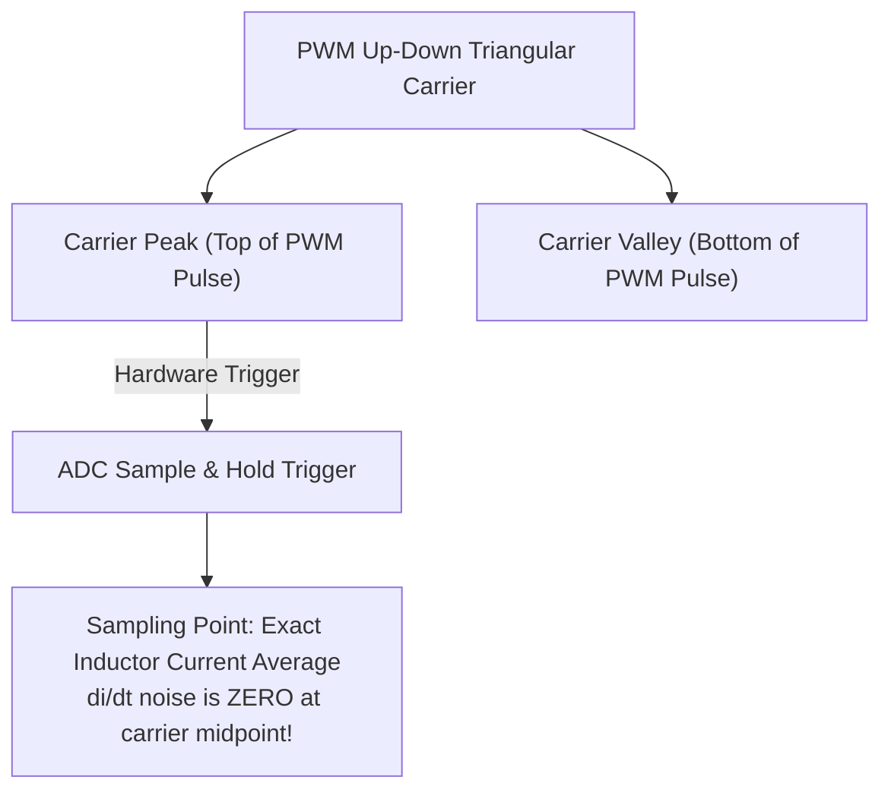

# MPECL Voltage, Current & Temperature Sensing Architecture

**Document ID:** MPECL-DOC-MSC-002  
**Revision:** v1.0  
**Status:** APPROVED FOR DESIGN  
**Target Organization:** Mendex Electronics LLP  

---

## 1. Sensing Principles & Bandwidth Requirements

Accurate, low-noise sensing is the prerequisite for stable closed-loop digital control and reliable hardware protection. Sensing paths in MPECL must satisfy two contradictory requirements:
1. **High Bandwidth for Fast Hardware Trips:** Trip circuits require latency $< 500\text{ ns}$ (small RC filter delay).
2. **High Noise Immunity for ADC Control:** Switching edges ($dv/dt > 50\text{ V/ns}$) inject severe common-mode displacement currents ($i = C_{stray} \cdot \frac{dv}{dt}$) into sensing lines. Precision anti-aliasing filters and synchronized sampling are mandatory.

---

## 2. Voltage Sensing Architecture

```mermaid
graph TD
    subgraph LV_Sense ["Low-Voltage Domain (Tier 1: <= 75V)"]
        V_IN_LV["DC Bus (0 - 75V)"] --> DIVIDER["Precision Resistor Divider<br/>(0.1% Metal Film, 25 ppm/°C)"]
        DIVIDER --> OPAMP_BUF["Op-Amp Voltage Follower / Sallen-Key LPF<br/>(Cutoff fc = 25 kHz)"]
        OPAMP_BUF --> ADC_LV["MDC-100 ADC Input (0 - 3.0V)"]
    end

    subgraph HV_Sense ["High-Voltage Domain (Tiers 2 & 3: 200V - 800V)"]
        V_IN_HV["HV DC Bus (0 - 800V)"] --> HV_CHAIN["High-Voltage Resistor Chain<br/>(4x 1206 in series for voltage rating)"]
        HV_CHAIN --> ISO_AMP["Isolated Sigma-Delta Modulator / Amp<br/>(TI AMC1311 / Silicon Labs Si8920)"]
        ISO_AMP -->|Galvanic Barrier (5 kVrms)| DIFF_RCV["Differential-to-Single-Ended Receiver"]
        DIFF_RCV --> ADC_HV["MDC-100 ADC Input (0 - 3.0V)"]
    end
```

### Critical High-Voltage Resistor Sizing Rule:
* Standard SMD resistors (0805 / 1206) have maximum continuous working voltage limits of $150\text{ V}$ to $200\text{ V}$ to prevent dielectric surface breakdown.
* **MPECL Mandate:** High-voltage dividers must split the top resistance across at least **four identical SMD 1206 or 2010 resistors in series**, guaranteeing $< 100\text{ V}$ per component across an $800\text{ V}$ bus and providing single-point open-circuit safety redundancy.

---

## 3. Current Sensing Architecture

MPECL supports three standardized current sensing methodologies:

| Method | Component Example | Voltage Domain | Current Range | Bandwidth | Galvanic Isolation | Insertion Loss | Application |
|---|---|---|---|---|---|---|---|
| **Resistive Shunt + Diff-Amp** | 4-terminal Manganin shunt + TI INA240 / INA290 | Tier 1 (Low Voltage) | $1\text{ A} - 40\text{ A}$ | $400\text{ kHz} - 1\text{ MHz}$ | None (Referenced to PGND) | $P_{loss} = I^2 R_{shunt}$ (Keep $< 1.5\text{ W}$) | Synchronous Buck / Boost inner inductor current |
| **Hall-Effect Transducer** | Allegro ACS772 / LEM HO-P series | Tiers 2 & 3 | $20\text{ A} - 200\text{ A}$ | $200\text{ kHz} - 300\text{ kHz}$ | Reinforced ($> 4.8\text{ kV}_{RMS}$) | Virtually zero ($< 100\,\mu\Omega$ internal conductor) | Resonant converter primary/secondary, EV fast charging |
| **Current Transformer (CT)** | Pulse / VAC 1:50 or 1:100 HF Toroid | Tiers 2 & 3 | $5\text{ A} - 100\text{ A}_{pk}$ | $10\text{ kHz} - 1\text{ MHz}$ | Basic / Reinforced | Ultra-low loss | Cycle-by-cycle peak switch current in PSFB / Full-Bridge |

```mermaid
circuit
    %% Shunt Kelvin Connection Rule
    graph LR
        SW_NODE["Switching Node"] --> SHUNT["4-Terminal Precision Shunt (R_sense = 2 mOhm)"]
        SHUNT --> PGND["Power Ground"]
        SHUNT == Kelvin Pair (Tightly Coupled) ==> DIFF_AMP["High-CMRR Difference Amp (INA240)<br/>PWM Rejection > 80 dB @ 100 kHz"]
        DIFF_AMP --> ADC_IN["ADC Current Channel"]
        DIFF_AMP --> COMP_IN["Hardware Comparator (MSP-100)"]
```

---

## 4. Temperature Sensing & Multi-Zone Thermal Monitoring

1. **Power Semiconductor Temperature:**
   - 10 kΩ NTC thermistors (B25/85 = 3977 K, 1% tolerance) embedded in heatsink wells directly beneath the power MOSFETs / SiC modules.
   - Linearized in firmware using the Steinhart-Hart equation or a 32-point lookup table.
2. **Magnetic Component Temperature:**
   - Thermistors mounted directly against the outer surface of the high-frequency transformer core and resonant inductor windings.
3. **Ambient & Intake Temperature:**
   - On-board digital I2C temperature sensors (e.g., TI TMP100 / Microchip MCP9808) placed near the cooling fan inlet to detect environmental thermal stress ($> 50^\circ\text{C}$ Indian industrial ambient).

---

## 5. Synchronized ADC Sampling Strategy

Switching power converters generate severe voltage and current spikes at the exact moment switches turn ON or OFF due to parasitic capacitances discharging and diode reverse recovery.



* **MPECL Mandate:** Microcontroller ADCs must **never be sampled asynchronously or in free-running mode**.
* All conversions must be triggered by the PWM timer counter reaching its peak or valley (the exact temporal center of the conduction interval), where switching transients have decayed to zero and the measured current represents the true mathematical average inductor current.
