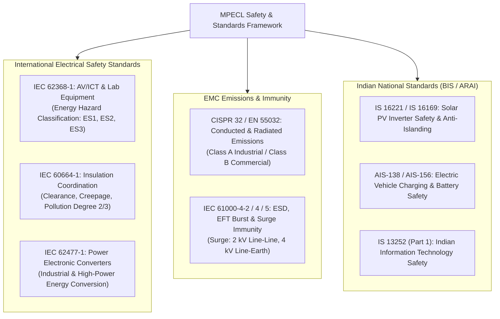

# MPECL Safety & EMC Standards Compliance Framework

**Document ID:** MPECL-DOC-MSC-004  
**Revision:** v1.0  
**Status:** APPROVED FOR DESIGN  
**Target Organization:** Mendex Electronics LLP  

---

## 1. Compliance Philosophy & Verification Boundary

In strict accordance with Mendex Electronics engineering rules:
> [!CAUTION]
> **A design is never declared compliant based solely on simulation models, analytical calculations, or PCB DRC checks.** Compliance status remains formally marked as `NOT_EVALUATED` until physical prototype test reports from an accredited test facility (NABL in India / ILAC internationally) are bound to the product revision in Mendex Studio.

---

## 2. Applicable Safety Standards by Product Domain

---

## 3. Insulation Coordination Matrix (IEC 60664-1 & IEC 62368-1)

Insulation distances must be engineered assuming **Pollution Degree 2 (industrial indoor with non-conductive condensation)** and **Material Group IIIa ($175 \le \text{CTI} < 400$, standard FR4)**:

| Operating Voltage ($V_{RMS} / V_{DC}$) | Insulation Classification | Minimum Clearance (Air) | Minimum Creepage (FR4 Surface) | Physical Implementation in Layout |
|---|---|---|---|---|
| **$\le 50\text{ V DC}$ (Tier 1 SELV)** | Functional / Basic | $0.8\text{ mm}$ | $1.2\text{ mm}$ | Standard PCB trace spacing |
| **$230\text{ VAC} / 400\text{ V DC}$ (Tier 2)** | Basic Insulation | $1.5\text{ mm}$ | $3.0\text{ mm}$ | Dedicated isolation moat |
| **$230\text{ VAC} / 400\text{ V DC}$ (Tier 2)** | **Reinforced Insulation** | **$\ge 3.0\text{ mm}$** | **$\ge 6.3\text{ mm}$** | **Milled physical isolation slot ($\ge 1.5\text{ mm}$ width) under optocouplers/transformers** |
| **$400\text{ VAC} / 800\text{ V DC}$ (Tier 3)** | Basic Insulation | $3.0\text{ mm}$ | $5.0\text{ mm}$ | High-voltage trace clearance |
| **$400\text{ VAC} / 800\text{ V DC}$ (Tier 3)** | **Reinforced Insulation** | **$\ge 5.5\text{ mm}$** | **$\ge 8.0\text{ mm}$** | **Deep isolation slots & conformal coating (Class B/F)** |

---

## 4. EMC Immunity Requirements (IEC 61000-4 Series)

To withstand severe electrical transients in Indian industrial substations and distribution grids, all MPECL power products must pass the following qualification levels:

| Phenomenon | Standard | Test Level | Acceptance Criterion | Protective Component IP |
|---|---|---|---|---|
| **Electrostatic Discharge (ESD)** | IEC 61000-4-2 | $\pm 4\text{ kV}$ Contact / $\pm 8\text{ kV}$ Air | Criterion B (No loss of function after test) | TVS Diodes on all external I/O & USB pins |
| **Electrical Fast Transient (EFT)** | IEC 61000-4-4 | $\pm 2\text{ kV}$ on AC/DC power lines (5 kHz) | Criterion B (Autonomous recovery) | Common-mode chokes + X/Y capacitors (MEM-100) |
| **Surge Immunity** | IEC 61000-4-5 | **$2\text{ kV}$ Differential (Line-Line) $4\text{ kV}$ Common-Mode (Line-PE)** | Criterion B | High-energy MOVs (20 mm) + Gas Discharge Tubes |
| **Conducted RF Immunity** | IEC 61000-4-6 | $10\text{ V}_{RMS}$ ($150\text{ kHz} - 80\text{ MHz}$) | Criterion A (Uncompromised control regulation) | Shielded twisted pairs + RC low-pass filters |

---

## 5. Indian Grid Anomaly Resilience & National Standards

Indian industrial environments exhibit specific electrical stress profiles that must be addressed during baseline architecture:

1. **Phase-to-Neutral Float (440 VAC Overvoltage Condition):**
   - In 3-phase 4-wire systems, a broken or floating neutral wire can cause the single-phase line-to-neutral voltage to rise from nominal $230\text{ VAC}$ up to the full line-to-line voltage of **$415\text{ VAC} - 440\text{ VAC}$**.
   - Standard 275V varistors will overheat and explode under this condition.
   - **MPECL Mandate:** All auxiliary power supplies (MAP-100) and line sense inputs connected to the AC grid must incorporate high-voltage series disconnection circuits or utilize **$550\text{ V}$ rated MOVs** capable of withstanding sustained $440\text{ VAC}$ without catastrophic breakdown.
2. **Solar PV Grid Code Compliance (IS 16221 & IS 16169):**
   - Requires certified anti-islanding protection (disconnection within $< 2.0\text{ seconds}$ upon loss of grid), low-voltage ride-through (LVRT), and total harmonic current distortion $THD_i < 5\%$ at rated output.
3. **Electric Vehicle Charging Stations (AIS-138 Part 1 / AIS-156):**
   - Mandates continuous residual direct current detection (RDC-DD, tripping at $\ge 6\text{ mA DC}$ earth leakage) to prevent blinding upstream Type A residual current circuit breakers (RCCBs).

---

## 6. Unresolved Regulatory Questions (Gap Register)

* **Open Question 1:** BIS (Bureau of Indian Standards) mandatory registration for programmable DC power supplies—confirm whether laboratory test equipment falls under IS 13252 Compulsory Registration Scheme (CRS) Phase 1 or is exempt as specialized industrial machinery.
* **Open Question 2:** CE Mark self-declaration vs. notified body audit for Tier 3 (15 kW) exports to the European Union under Low Voltage Directive (LVD 2014/35/EU) and EMC Directive (2014/30/EU).
