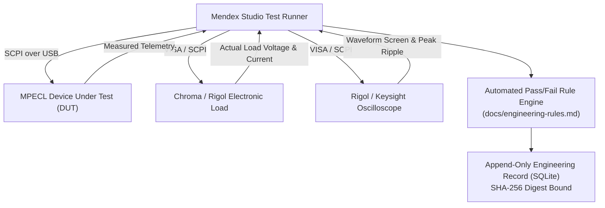

# MPECL Mendex Studio Telemetry & Orchestration Link

**Document ID:** MPECL-DOC-MCN-004  
**Revision:** v1.0  
**Status:** APPROVED FOR DESIGN  
**Target Organization:** Mendex Electronics LLP  

---

## 1. Architectural Scope

Mendex Studio operates as the central engineering orchestration, design verification, and laboratory reporting environment for Mendex Electronics LLP.

The **Mendex Studio Link** establishes a bidirectional communication bridge between physical prototype hardware running MCC firmware and Mendex Studio running on an engineering workstation.

```mermaid
sequenceDiagram
    autonumber
    participant Studio as Mendex Studio (Desktop/CLI)
    participant USB_Bridge as Isolated USB / Ethernet PHY (MCM-100)
    participant Controller as MDC-100 Digital Controller
    participant EEPROM as Non-Volatile Memory (Calibration)

    Studio->>USB_Bridge: Connect / Handshake (*IDN?)
    USB_Bridge->>Controller: Parse SCPI / JSON-RPC
    Controller-->>Studio: IDN Response (UUID, FW Git SHA, Calibration Status)

    rect rgb(240, 248, 255)
        Note over Studio, Controller: Calibration Calibration & Offset Trim
        Studio->>Controller: CALIB:ADC:CH1:GAIN 1.0024
        Controller->>EEPROM: Write Gain & Offset Coefficients
        EEPROM-->>Controller: Commit Verified
        Controller-->>Studio: ACK CALIB OK
    end

    rect rgb(255, 245, 245)
        Note over Studio, Controller: Automated DVP Bench Test Execution
        Studio->>Controller: SOUR:VOLT 24.0; OUTP:STAT ON
        Controller->>Controller: Ramp to 24V (Soft-Start)
        Studio->>Studio: Read Electronic Load & Power Meter
        Studio->>Controller: MEAS:VOLT?; MEAS:CURR?
        Controller-->>Studio: 24.012 V, 10.004 A
        Studio->>Studio: Append to Verified DVP Evidence Record
    end
```

---

## 2. Sensor Calibration Data Protocol

Component tolerances (e.g., $1\%$ sensing resistors, op-amp input offset voltages) produce static gain and offset errors. Rather than using manual potentiometers, MPECL implements software-based two-point digital calibration:

$$V_{calibrated} = Gain_{coeff} \cdot V_{raw\_ADC} + Offset_{coeff}$$

1. **Calibration Command Protocol:**
   - `CAL:PASS <password>`: Unlock protected calibration memory partition.
   - `CAL:POINT:LOW <channel>, <actual_measured_si_value>`: Instructs MCU to sample raw ADC at minimum calibration point (e.g., $10\text{ V}$).
   - `CAL:POINT:HIGH <channel>, <actual_measured_si_value>`: Instructs MCU to sample raw ADC at maximum calibration point (e.g., $48\text{ V}$).
   - `CAL:SAVE`: MCU calculates slope ($m$) and intercept ($c$) via floating-point arithmetic, saves to EEPROM with CRC-16 checksum, and locks memory.
2. **Traceability in Mendex Studio:**
   - Mendex Studio queries `CAL:STATUS?` to record the calibration date, operator ID, and digital checksum into the product's immutable engineering record.

---

## 3. Automated DVP Test Scripting Integration

Mendex Studio orchestrates automated testing by combining SCPI commands to the converter under test with control of programmable AC/DC sources and electronic loads:



* **Zero Fabrication Mandate:** If an oscilloscope or power meter is disconnected during an automated run, Mendex Studio records the test parameter as `NOT_EVALUATED` rather than generating synthetic pass values.
