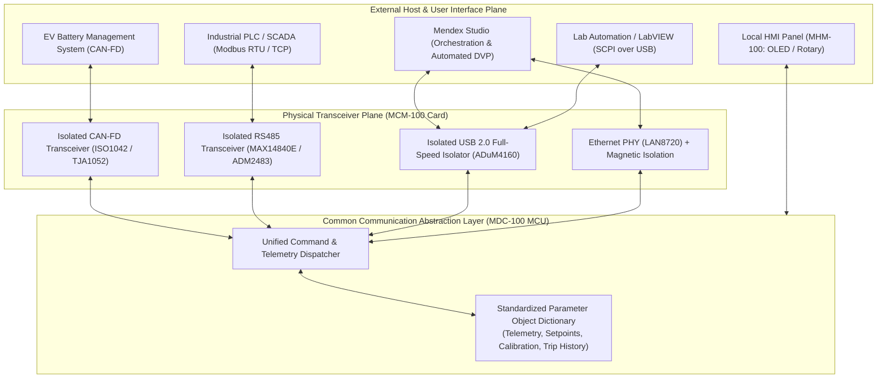

# Mendex Connectivity Core (MCCN) Platform Overview

**Document ID:** MPECL-DOC-MCN-001  
**Revision:** v1.0  
**Status:** APPROVED FOR DESIGN  
**Target Organization:** Mendex Electronics LLP  

---

## 1. Scope & Communication Abstraction Architecture

The **Mendex Connectivity Core (MCCN)** establishes a standardized, galvanically isolated communication and telemetry architecture across all Mendex power conversion platforms.

To eliminate custom protocol implementations in every new power supply or charger, MCCN defines a **Common Communication Abstraction Layer (CCAL)**. The core controller application interacts with a uniform parameter table (Object Dictionary) regardless of whether data is transported over CAN-FD, Modbus RTU, USB-SCPI, or Ethernet.

---

## 2. Galvanic Isolation Mandate for External Interfaces

In industrial environments and high-power DC systems ($> 60\text{ V}$), ground potential differences between the power converter chassis and external PLCs, computers, or vehicle battery packs can reach hundreds of volts, especially during ground faults or lightning surges.

> [!IMPORTANT]
> **Mandatory Isolation Rule:** All communication ports routed outside the converter chassis (CAN-FD, RS485, USB, Ethernet) **must be galvanically isolated** with a minimum isolation rating of **$\ge 2.5\text{ kV}_{RMS}$ (1 minute)** and common-mode transient immunity (CMTI) of **$\ge 50\text{ kV/}\mu\text{s}$**. Direct unisolated connection of host USB or RS485 ground to power ground (PGND) is strictly prohibited.
