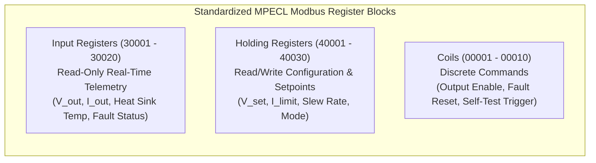

# MPECL Communication Protocols & Fieldbus Standards

**Document ID:** MPECL-DOC-MCN-002  
**Revision:** v1.0  
**Status:** APPROVED FOR DESIGN  
**Target Organization:** Mendex Electronics LLP  

---

## 1. Protocol Applicability by Product Category

| Protocol / Physical Layer | Telecom / DC-DC (Tier 1: 100W–500W) | Industrial Charger / Solar (Tier 2: 1kW–3kW) | EV Fast Charger / High Power (Tier 3: 5kW–15kW) | Lab / Programmable DC Supply |
|---|---|---|---|---|
| **UART (Diagnostic CLI)** | **Mandatory** (Internal) | **Mandatory** (Internal) | **Mandatory** (Internal) | **Mandatory** (Internal) |
| **Isolated RS485 (Modbus RTU)** | Optional | **Mandatory** (PLC link) | **Mandatory** (Industrial) | Optional |
| **Isolated CAN-FD** | Optional | Optional | **Mandatory** (BMS link) | Optional |
| **USB-CDC (SCPI)** | Optional | Optional | Optional | **Mandatory** (Lab PC link) |
| **Ethernet (Modbus TCP / SCPI)** | Not Applicable | Optional | **Mandatory** (SCADA / Cloud) | **Mandatory** (LXI standard) |

---

## 2. Standardized SCPI Command Set (IEEE 488.2 Compliant)

For programmable DC power supplies and laboratory equipment communicating via USB or Ethernet, MPECL implements a standardized SCPI parser:

| SCPI Command | Parameter | Response | Description |
|---|---|---|---|
| `*IDN?` | None | `Mendex Electronics LLP,MPECL-MDC100,SN102938,v1.0.4` | Query manufacturer, model, serial number, and firmware version |
| `*RST` | None | None | Reset instrument to safe factory default state (Output OFF, 0V setpoint) |
| `MEAS:VOLT?` | None | `<float> (e.g., 24.015)` | Measure real-time output voltage (calibrated SI Volts) |
| `MEAS:CURR?` | None | `<float> (e.g., 10.421)` | Measure real-time load current (calibrated SI Amperes) |
| `MEAS:POW?` | None | `<float> (e.g., 250.27)` | Measure calculated output power (SI Watts) |
| `SOUR:VOLT` | `<float>` | None | Set output target voltage setpoint in Volts (e.g., `SOUR:VOLT 24.0`) |
| `SOUR:CURR` | `<float>` | None | Set maximum output current limit in Amperes (e.g., `SOUR:CURR 15.0`) |
| `OUTP:STAT` | `ON \| OFF` | None | Enable or disable power stage gate switching |
| `SYST:ERR?` | None | `<int>, "<string>"` | Retrieve oldest error from FIFO error queue (e.g., `0, "No error"`) |
| `DIAG:DUMP:BLACKBOX?` | None | `<base64 string>` | Extract 64-sample pre-fault ring buffer snapshot for Mendex Studio analysis |

---

## 3. Industrial Modbus RTU Register Mapping (RS485)

Modbus RTU runs at $115200\text{ bps}$, 8 data bits, Even parity, 1 stop bit (8E1) with a 2-wire half-duplex isolated interface:

### Primary Register Allocation Table:
* **Register `30001` (Input):** Output Voltage (Scaled integer: $V \times 100$, e.g., $2400 = 24.00\text{ V}$).
* **Register `30002` (Input):** Output Current (Scaled integer: $A \times 100$, e.g., $1050 = 10.50\text{ A}$).
* **Register `30003` (Input):** Primary Heatsink Temperature (Scaled integer: $^\circ\text{C} \times 10$).
* **Register `30004` (Input):** Fault Status Bitmask:
  - Bit 0: Hardware Short Circuit Tripped
  - Bit 1: Overvoltage Tripped
  - Bit 2: Overtemperature Tripped
  - Bit 3: Input Undervoltage Active
* **Register `40001` (Holding):** Voltage Setpoint ($V \times 100$).
* **Register `40002` (Holding):** Current Limit Setpoint ($A \times 100$).
* **Coil `00001`:** Power Output Enable (`1 = Enable`, `0 = Mute/Disable`).
* **Coil `00002`:** Latch Reset Command (`Write 1 to clear latched faults`).

---

## 4. Isolated CAN-FD Protocol Specification (Vehicle / Battery Interface)

For electric vehicle battery chargers and BESS installations, MPECL implements CAN-FD (Flexible Data-rate):
* **Arbitration Phase Bitrate:** $500\text{ kbps}$ (Standard 11-bit / 29-bit extended identifier).
* **Data Phase Bitrate:** $2.0\text{ Mbps}$ (Payload up to 64 bytes).
* **Cyclic Telemetry Frame (0x18FF50E5, 50 Hz broadcast):**
  - Bytes 0–1: Instantaneous Output Voltage (mV, uint16)
  - Bytes 2–3: Instantaneous Output Current (10 mA, int16)
  - Byte 4: Maximum Operating Temperature (°C, int8)
  - Byte 5: Operational State (0=Standby, 1=SoftStart, 2=Run, 3=Fault)
  - Bytes 6–7: CRC-16 Checksum and Rolling Alive Counter (0–15)
