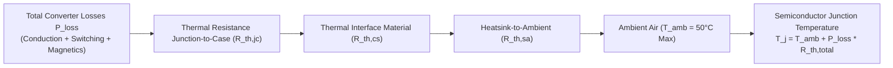

# MPECL Component Derating & Thermal Management

**Document ID:** MPECL-DOC-MVC-004  
**Revision:** v1.0  
**Status:** APPROVED FOR DESIGN  
**Target Organization:** Mendex Electronics LLP  

---

## 1. Electrical Component Derating Guidelines

To ensure field reliability and a mean time between failures (MTBF) exceeding $100,000\text{ hours}$ under industrial operating conditions, MPECL enforces strict component derating limits:

| Component Category | Stress Parameter | Maximum Continuous Derating Factor | Absolute Worst-Case Transient Limit | Basis / Failure Mode Prevented |
|---|---|---|---|---|
| **Power MOSFETs / SiC** | Breakdown Voltage ($V_{DSS}$) | **$\le 80\%$** of rated $V_{(BR)DSS}$ | $\le 90\%$ (transient spike $< 50\text{ ns}$) | Avalanche breakdown, cosmic ray single-event burnout |
| **Power MOSFETs / SiC** | Continuous Drain Current ($I_D$) | **$\le 65\%$** of rated $I_D(T_C=100^\circ\text{C})$ | $\le 80\%$ (short duration peak) | Bond wire electromigration, channel thermal runaway |
| **Power Diodes (SiC/Schottky)** | Reverse Voltage ($V_{RRM}$) | **$\le 75\%$** of rated $V_{RRM}$ | $\le 85\%$ | Zener punch-through, thermal runaway |
| **Ceramic Capacitors (MLCC)** | DC Working Voltage ($V_{DC}$) | **$\le 60\%$** of rated voltage (Class II X7R) | $\le 80\%$ | DC bias capacitance loss (piezoelectric degradation) |
| **Aluminum Electrolytic Caps** | DC Working Voltage ($V_{DC}$) | **$\le 80\%$** of rated voltage | $\le 90\%$ | Dielectric oxide layer breakdown, leakage surge |
| **Aluminum Electrolytic Caps** | AC Ripple Current ($I_{RMS}$) | **$\le 75\%$** of rated ripple current | $\le 85\%$ | Core electrolyte boiling, dry-out, ESR runaway |
| **Film Capacitors (PP/PET)** | DC Working Voltage ($V_{DC}$) | **$\le 70\%$** of rated voltage | $\le 80\%$ | Corona partial discharge, self-healing fatigue |
| **Magnetic Components** | Operating Flux Density ($B_{pk}$) | **$\le 60\%$** of saturation $B_{sat}(100^\circ\text{C})$ | $\le 75\%$ | Sudden magnetic saturation, short-circuit current spike |
| **SMD Resistors (Metal Film)** | Continuous Power ($P_{diss}$) | **$\le 50\%$** of rated wattage | $\le 70\%$ | Thermal drift, localized hot spots, solder fatigue |

---

## 2. Thermal Management for Indian Industrial Climates

Power converters in India operate in environments where ambient air temperatures frequently reach **$45^\circ\text{C} - 50^\circ\text{C}$** inside industrial enclosures, solar inverter canopies, and EV charging kiosks.

### Maximum Allowable Operating Temperatures:
* **Silicon MOSFETs & ICs:** Maximum allowable junction temperature:
  $$T_{j,op} \le 110^\circ\text{C} \quad (\text{against rated } 150^\circ\text{C} \implies 40^\circ\text{C} \text{ safety margin})$$
* **Silicon Carbide (SiC) MOSFETs:** Maximum allowable junction temperature:
  $$T_{j,op} \le 135^\circ\text{C} \quad (\text{against rated } 175^\circ\text{C} \implies 40^\circ\text{C} \text{ safety margin})$$
* **Transformers & Inductor Windings:** Maximum continuous surface temperature:
  $$T_{mag,surface} \le 95^\circ\text{C} \quad (\text{Class B } 130^\circ\text{C} \text{ or Class F } 155^\circ\text{C} \text{ insulation system})$$
* **Electrolytic Capacitors:** Maximum can temperature:
  $$T_{cap,can} \le 85^\circ\text{C} \quad (\text{utilizing strictly } 105^\circ\text{C} \text{ or } 125^\circ\text{C} \text{ rated caps})$$

---

## 3. Electrolytic Capacitor Lifetime Modeling

Electrolytic capacitor wear-out is the primary life-limiting mechanism in power supplies. Life expectancy obeys the **Arrhenius Ten-Degree Rule**:

$$L = L_0 \cdot 2^{\frac{T_{max} - T_{case}}{10}} \cdot \left(\frac{V_{rated}}{V_{applied}}\right)^n$$

Where:
* $L_0$ is the rated lifetime at maximum temperature (e.g., $5,000\text{ hours}$ at $105^\circ\text{C}$).
* $T_{case}$ is the actual capacitor case operating temperature.

### Quantitative Life Comparison:
1. **Un-derated Design ($T_{case} = 95^\circ\text{C}$):**
   $$L = 5000 \cdot 2^{\frac{105 - 95}{10}} = 5000 \cdot 2^1 = 10,000\text{ hours} \approx \mathbf{1.14\text{ years continuous}}$$
2. **MPECL Derated Standard ($T_{case} \le 65^\circ\text{C}$ via airflow and spacing):**
   $$L = 5000 \cdot 2^{\frac{105 - 65}{10}} = 5000 \cdot 2^4 = 5000 \cdot 16 = 80,000\text{ hours} \approx \mathbf{9.13\text{ years continuous}}$$

**Mandatory Rule:** In all MPECL power stages, electrolytic capacitors must be positioned on the cold side of the airflow stream, physically isolated from heat-dissipating magnetic cores and power heatsinks.
