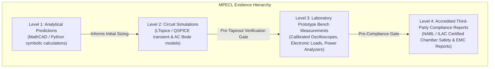
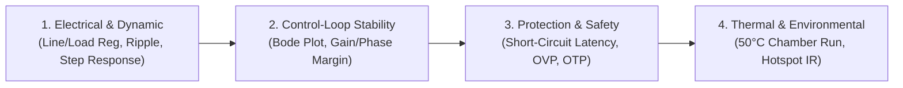

# Mendex Validation Core (MVC) Platform Overview

**Document ID:** MPECL-DOC-MVC-001  
**Revision:** v1.0  
**Status:** APPROVED FOR DESIGN  
**Target Organization:** Mendex Electronics LLP  

---

## 1. Scope & Evidence Hierarchy

The **Mendex Validation Core (MVC)** defines the verification, testing, and qualification framework governing all hardware, firmware, and simulation models produced under MPECL.

In strict alignment with Mendex Electronics core engineering rules, MVC establishes an **unforgiving evidence hierarchy**:

> [!CRITICAL]
> **Core Engineering Rule (Evidence Boundary):**
> 1. Level 1 and Level 2 evidence **can never be cited as proof of compliance or product readiness**.
> 2. In any engineering record, report, or UI view, simulation results must remain explicitly labeled as `SIMULATED`, analytical values as `CALCULATED`, and prototype data as `MEASURED`.
> 3. Any missing measurement or unperformed test **must remain strictly marked as `NOT_EVALUATED`**. No synthetic passing grades or extrapolated compliance claims are permitted.

---

## 2. Validation Phases & Design Verification Plan (DVP)

Every MPECL product must execute a standardized Design Verification Plan (DVP) containing 24 mandatory verification gates organized across four domains:

1. **Gate 1: Pre-Power-On Cold Checks:**
   - Visual inspection under microscope for solder bridging.
   - Low-voltage impedance measurement between all power rails and ground (confirming no short circuits).
   - High-voltage isolation resistance testing ($> 100\text{ M}\Omega$ at $1000\text{ V DC}$ test voltage).
2. **Gate 2: Auxiliary Power & Control Verification:**
   - Power up MAP-100 independently using a current-limited bench supply.
   - Verify $+3.3\text{V}$, $+5\text{V}$, and gate drive auxiliary voltages under minimum and maximum load.
   - Verify MDC-100 clock frequency, reset pin state, and JTAG/SWD communication.
3. **Gate 3: Open-Loop Switching & Gate Drive Integrity:**
   - Drive switches at low input voltage ($10\text{ V}$) in open-loop mode.
   - Measure gate voltage rise time ($t_r$), fall time ($t_f$), peak ringing, and negative bias.
   - Verify dead-time margin ($t_{dead}$) between complementary switches under worst-case temperature.
4. **Gate 4: Closed-Loop Regulation & Dynamic Response:**
   - Engage closed-loop digital control.
   - Sweep line voltage from minimum to maximum.
   - Step load current from $10\%$ to $90\%$ and capture overshoot, undershoot, and settling time.
5. **Gate 5: Fault Protection Stress Testing:**
   - Apply a dead short circuit across output terminals using a fast solid-state contactor.
   - Verify hardware shutdown latency ($< 750\text{ ns}$) and confirm zero semiconductor degradation over 50 consecutive short-circuit events.
6. **Gate 6: Full-Load Thermal Soak:**
   - Run converter at $100\%$ rated continuous power inside a thermal test chamber at $50^\circ\text{C}$ ambient for 4 hours.
   - Record temperature rise across MOSFETs, transformer cores, inductors, and electrolytic capacitors.
