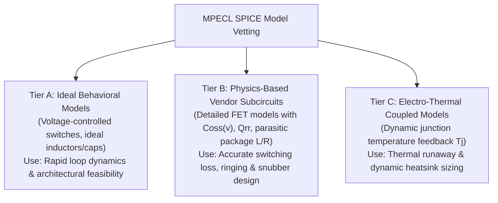

# MPECL LTspice & Simulation Standards

**Document ID:** MPECL-DOC-MVC-002  
**Revision:** v1.0  
**Status:** APPROVED FOR DESIGN  
**Target Organization:** Mendex Electronics LLP  

---

## 1. Simulation Objectives & Scope

Simulation is used in MPECL exclusively to:
1. Validate circuit operating principles prior to schematic freeze.
2. Calculate peak, RMS, and average semiconductor stresses for component derating.
3. Optimize magnetic inductor and transformer turn ratios.
4. Extract open-loop control-to-output transfer functions ($G_{vd}(s)$) to calculate digital compensator coefficients.
5. Perform Monte Carlo tolerance analysis across passive component variations.

---

## 2. SPICE Model Vetting & Classification

To prevent misleading results caused by unvetted manufacturer models, MPECL classifies SPICE models into three tiers:



### Mandatory Rules for SPICE Modeling:
1. **Never use ideal capacitors:** All electrolytic, film, and ceramic capacitors must include realistic Equivalent Series Resistance (ESR) and Equivalent Series Inductance (ESL) based on manufacturer impedance curves.
2. **Never use lossless inductors:** All inductors must specify winding DC resistance ($R_{dc}$) and parallel self-resonant capacitance ($C_p$).
3. **Diode Reverse Recovery ($Q_{rr}$):** In hard-switched converters, diodes and MOSFET body diodes must use models that accurately replicate reverse recovery charge. Failure to model $Q_{rr}$ understates turn-on switching losses by up to $300\%$.

---

## 3. Recommended Simulation Solver Configuration

Switch-mode power simulations frequently suffer from convergence failures, "timestep too small" aborts, or artificial numerical ringing. MPECL standardizes the following LTspice control directives:

```text
* MPECL Standard Simulation Configuration Directives
.options plotwinsize=0           ; Disable lossy waveform compression (preserves full numerical accuracy)
.options numdgt=7                ; Ensure 7-digit floating point precision
.options trtol=1                 ; Tighten transient tolerance to prevent artificial numerical damping
.options cshunt=1e-15            ; Add 1 fF shunt capacitance to ground on all nodes (prevents floating nodes)
.options gmin=1e-12              ; Set minimum conductance across PN junctions
.options method=Gear             ; Use Gear integration instead of Trapezoidal for stiff inductive circuits
```

---

## 4. Loop Stability Extraction via Middlebrook Injection

To extract the loop gain $T(s) = A(s) \cdot \beta(s)$ and determine Gain Margin (GM) and Phase Margin (PM) in switch-mode converters, MPECL implements the **Middlebrook Voltage Injection Technique**:

```mermaid
circuit
    %% Middlebrook injection schematic
    graph LR
        COMP_OUT["Compensator Output"] --> V_INJECT["AC Injection Source (V_inj = 10 mV AC)"]
        V_INJECT --> PWM_IN["PWM Modulator Input"]
        V_INJECT -.->|Node B| PROBE_B["Probe B (V_b)"]
        V_INJECT -.->|Node A| PROBE_A["Probe A (V_a)"]
        PROBE_A --> ANALYZER["Loop Gain T(f) = - V_b / V_a"]
        PROBE_B --> ANALYZER
```

* An AC perturbation source ($V_{inj}$) is inserted into the closed feedback loop at a high-impedance point.
* The loop gain is computed directly as:
  $$T(j\omega) = -\frac{V_b(j\omega)}{V_a(j\omega)}$$
* **MPECL Stability Criteria:**
  - **Phase Margin (PM):** $\ge 45^\circ$ (Target: $60^\circ$) at unity gain crossover ($0\text{ dB}$).
  - **Gain Margin (GM):** $\ge 10\text{ dB}$ (Target: $12\text{ dB}$) at $-180^\circ$ phase crossing.
  - Crossover frequency ($f_c$) targeted between $\frac{f_{sw}}{10}$ and $\frac{f_{sw}}{5}$.

---

## 5. Monte Carlo Worst-Case Tolerance Analysis

Component values vary due to manufacturing tolerances and temperature drift. MPECL testbenches execute automated 200-run Monte Carlo simulations:

```text
* Example Monte Carlo Tolerance Directives
.param R_div1 = mc(100k, 0.01)    ; 100k with 1% tolerance
.param R_div2 = mc(10k, 0.01)     ; 10k with 1% tolerance
.param C_out  = mc(470u, 0.20)    ; 470uF electrolytic with 20% tolerance
.param ESR    = mc(25m, 0.30)     ; ESR with 30% tolerance
.step param run 1 200 1
```

The resulting distribution of phase margin, output ripple, and peak inductor currents defines the production yield confidence interval prior to hardware fabrication.
