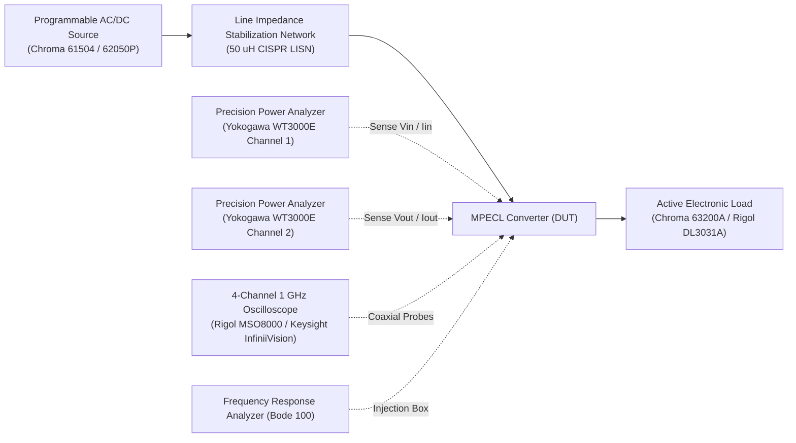

# MPECL Hardware Verification & Bench Test Procedures

**Document ID:** MPECL-DOC-MVC-003  
**Revision:** v1.0  
**Status:** APPROVED FOR DESIGN  
**Target Organization:** Mendex Electronics LLP  

---

## 1. Scope & Test Rig Standard

This document defines standardized laboratory test procedures for measuring electrical efficiency, regulation accuracy, dynamic step response, output ripple, and control loop stability.



---

## 2. Standardized Test Procedures

### Test Procedure 1: Static Load & Line Regulation
1. **Objective:** Quantify steady-state voltage stability across the full operating envelope.
2. **Measurement Grid:**
   - Input Voltage ($V_{in}$): $V_{in,min}, V_{in,nom}, V_{in,max}$.
   - Load Current ($I_{out}$): $0\%, 10\%, 25\%, 50\%, 75\%, 100\%$ rated load.
3. **Calculation Formulas:**
   - **Line Regulation (%):**
     $$\text{Line Reg} = \frac{V_{out}(V_{in,max}) - V_{out}(V_{in,min})}{V_{out}(V_{in,nom})} \times 100\% \quad (\text{Target: } \le \pm 0.5\%)$$
   - **Load Regulation (%):**
     $$\text{Load Reg} = \frac{V_{out}(I_{out,min}) - V_{out}(I_{out,max})}{V_{out}(I_{out,nom})} \times 100\% \quad (\text{Target: } \le \pm 1.0\%)$$

### Test Procedure 2: Electrical Efficiency Mapping
1. **Objective:** Generate a 2D efficiency contour map $\eta(V_{in}, I_{out})$.
2. **Execution:**
   - Utilize a four-wire Kelvin connection directly at the input and output terminals of the DUT.
   - Power Analyzer configured in continuous integration mode ($t_{int} \ge 2.0\text{ seconds}$) to eliminate high-frequency ripple aliasing.
   - Efficiency formula:
     $$\eta = \frac{P_{out,DC}}{P_{in,DC}} = \frac{V_{out,DC} \cdot I_{out,DC}}{V_{in,DC} \cdot I_{in,DC}}$$
   - Measurements logged into Mendex Studio via automated Python/SCPI script.

### Test Procedure 3: Output Ripple & High-Frequency Noise Measurement
> [!WARNING]
> Standard $10\text{x}$ oscilloscope passive probes with long ground lead alligator clips act as RF antennas, picking up stray magnetic flux from inductors ($di/dt$) and displaying false millivolt noise spikes.

```mermaid
circuit
    %% Coaxial tip and barrel probe
    graph LR
        VOUT_TERM["V_out Terminal Pad"] --> PROBE_TIP["Direct Coaxial Tip (1x 50-Ohm Cable)"]
        GND_PAD["Adjacent Low-Inductance Ground Ring"] --> PROBE_SHIELD["Ground Barrel (Zero Ground Lead)"]
        PROBE_TIP --> DC_BLOCK["0.1 uF Film Cap (DC Block)"]
        DC_BLOCK --> TERM_50["50-Ohm Scope Termination"]
        TERM_50 --> SCOPE_CH["Oscilloscope Channel (20 MHz BW Limit Active)"]
```

1. **Setup Rules:**
   - **Bandwidth Limit:** Activate internal $20\text{ MHz}$ analog low-pass filter on the oscilloscope channel.
   - **Probe Connection:** Use a **Tip-and-Barrel** ground spring or direct coaxial SMA adapter soldered across the output capacitor terminals. Ground lead length must be $< 5\text{ mm}$.
   - **Target Acceptance:**
     - Low-Frequency Switching Ripple ($f_{sw}$): $\le 1.0\%$ of $V_{out,nom}$ peak-to-peak.
     - High-Frequency Noise Spikes ($> 5\text{ MHz}$): $\le 2.0\%$ of $V_{out,nom}$ peak-to-peak.

### Test Procedure 4: Dynamic Transient Load Step Response
1. **Objective:** Verify loop stability and transient voltage deviation under sudden load changes.
2. **Parameters:**
   - Step Current: $10\% \to 90\% \to 10\%$ of rated load.
   - Current Slew Rate: **$\ge 2.5\text{ A/}\mu\text{s}$** (utilizing fast MOSFET active load).
   - Dwell Time: $50\text{ ms}$ high, $50\text{ ms}$ low ($10\text{ Hz}$ repetition rate).
3. **Acceptance Criteria:**
   - Maximum Voltage Undershoot / Overshoot: **$\le \pm 5.0\%$** of nominal output voltage.
   - Settling Time ($t_s$): Output returns to within $\pm 1\%$ of nominal within **$\le 500\,\mu\text{s}$**.
   - Ringing: Response must be well-damped ($< 2$ visible oscillation cycles).

### Test Procedure 5: Control-Loop Frequency Response (Bode Plot)
1. **Objective:** Measure real-world Phase Margin (PM) and Gain Margin (GM) on operational hardware.
2. **Instrument:** Vector Network Analyzer (Omicron Lab Bode 100 or Ridley AP300).
3. **Procedure:**
   - Insert a $20\,\Omega$ non-inductive surface-mount injection resistor into the feedback divider network.
   - Connect injection transformer (B-WIT 100) across the resistor.
   - Sweep frequency from $10\text{ Hz}$ to $500\text{ kHz}$ with logarithmic frequency steps and amplitude profiling ($10\text{ mV}$ injection at high frequencies, ramping to $50\text{ mV}$ at low frequencies to overcome noise).
   - Record Phase Margin at $0\text{ dB}$ crossover and Gain Margin at $-180^\circ$ phase crossing.
