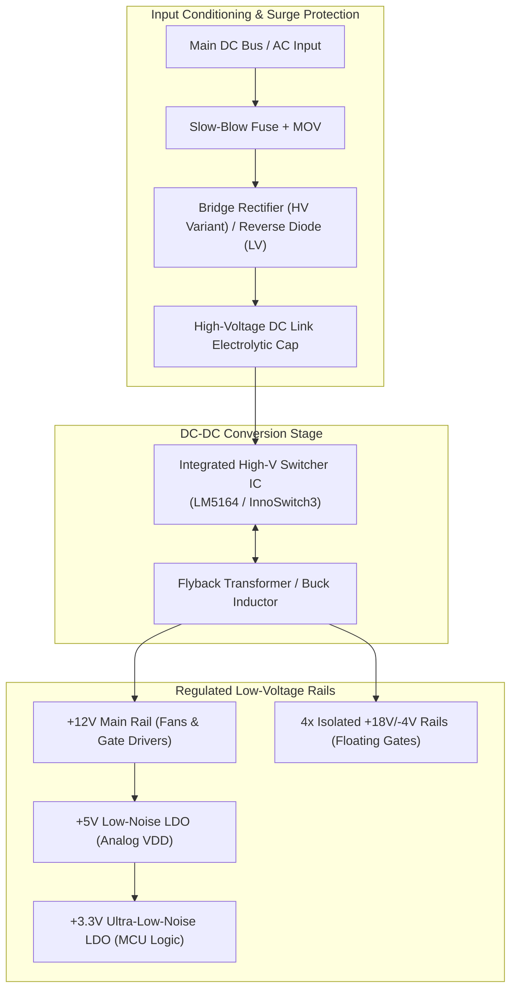

# Module Specification: MAP-100 Auxiliary Power Supply

**Document ID:** MPECL-MOD-MAP-100-001  
**Revision:** v1.0-DRAFT  
**Status:** APPROVED FOR DESIGN  
**Target Organization:** Mendex Electronics LLP  
**Hardware Lead:** Auxiliary Power Systems Lead  

---

## 1. Purpose and Intended Applications
The **MAP-100 Auxiliary Power Supply Module** provides stable, regulated, low-noise DC power rails ($+3.3\text{ V}, +5\text{ V}, +12\text{ V}/+15\text{ V}$, and isolated gate bias rails) required to energize the MDC-100 controller, gate drivers, sensing circuitry, and communication interfaces directly from the main DC input bus or AC mains.

**Intended Applications:**
- Tier 1: Internal bias for 48 V telecom and battery-powered DC-DC converters.
- Tiers 2 & 3: High-voltage auxiliary bias for isolated industrial converters, EV fast chargers, and grid-tied systems.

---

## 2. Functional Requirements
1. **Wide Operating Input Range:**
   - **Variant LV (MAP-100-LV):** $18\text{ V}$ to $75\text{ V DC}$ continuous (withstand $100\text{ V}$ surge for $100\text{ ms}$).
   - **Variant HV (MAP-100-HV):** $85\text{ V}$ to $450\text{ V DC}$ (or $85\text{ VAC} - 305\text{ VAC}$ mains), withstanding sustained $440\text{ VAC}$ neutral float.
2. **Regulated Output Rails:**
   - Rail 1: $+3.3\text{ V DC} \pm 2\%$ @ $1.0\text{ A}$ (MCU core, logic, digital communications).
   - Rail 2: $+5.0\text{ V DC} \pm 3\%$ @ $1.5\text{ A}$ (Analog sensing, gate driver primary side, HMI display).
   - Rail 3: $+12.0\text{ V DC} \pm 5\%$ @ $1.5\text{ A}$ (Cooling fans, relay coils, gate driver power).
   - Isolated Rails (HV Variant): $4\text{x}$ Galvanically isolated $+18\text{ V} / -4\text{ V}$ rails ($0.2\text{ A}$ each) for floating high-side gate drivers.
3. **Autonomous Self-Startup:** Starts up reliably from zero bus voltage with startup delay $\le 100\text{ ms}$.
4. **Short-Circuit & Overload Protection:** Continuous hiccup mode or foldback current limiting under dead short on any output rail.

---

## 3. Non-Functional Requirements
1. **Efficiency:** $\ge 82\%$ (LV Buck variant) and $\ge 78\%$ (HV Flyback variant) at full rated load.
2. **Output Ripple & Noise:** $\le 30\text{ mV}$ peak-to-peak on $3.3\text{ V}$ logic rail ($20\text{ MHz}$ bandwidth).
3. **Galvanic Isolation (HV Variant):** $4.0\text{ kV}_{RMS}$ primary-to-secondary reinforced isolation.
4. **Operating Temperature:** $-40^\circ\text{C}$ to $+85^\circ\text{C}$ ambient.

---

## 4. Proposed Architecture
- **MAP-100-LV:** High-voltage synchronous buck regulator (e.g., TI LM5164 or MPS MP4575) stepping down $18\text{ V}-75\text{ V}$ directly to $+12\text{ V}$, followed by high-efficiency point-of-load linear LDOs for $+5\text{ V}$ and $+3.3\text{ V}$.
- **MAP-100-HV:** Multi-output isolated flyback converter utilizing an integrated primary switcher with $800\text{ V}$ internal MOSFET (e.g., Power Integrations InnoSwitch3 or ST VIPer318), coupled to a custom planar or EFD20 ferrite transformer with triple-insulated wire (TIW).

---

## 5. Functional Block Diagram

---

## 6. Electrical Interface Requirements
- Input connector: 2-pin polarized terminal or solder pins.
- Output interface: Multi-pin header delivering regulated rails and `POWER_GOOD` flag to the motherboard.
- `POWER_GOOD` Signal: Active-high open-drain flag asserted when all outputs reach $\ge 90\%$ of nominal voltage.

---

## 7. Mechanical Interface Considerations
- **Physical Format:** Standardized vertical daughterboard (Single-In-Line Package - SIP or 10-pin vertical header, $50\text{ mm} \times 35\text{ mm} \times 18\text{ mm}$).
- Vertical orientation minimizes valuable power motherboard footprint.

---

## 8. Hardware Component Options
- **LV Switcher IC:** Texas Instruments LM5164-Q1 (100 V, 1 A synchronous buck) or Monolithic Power Systems MP4575.
- **HV Switcher IC:** Power Integrations INN3168C (InnoSwitch3-CE with integrated 650V/725V switch and secondary synchronous rectification) or STMicroelectronics VIPER318HDTR.
- **Transformers:** Standard EFD20 or EE16 core with DMEGC DMR44 ferrite; custom automated winding specification.
- **Output LDOs:** Texas Instruments TPS7A4700 (Ultra-low noise $4\,\mu\text{V}_{RMS}$, 1 A LDO) or Microchip MIC5209.

---

## 9. Firmware Dependencies
- Purely analog hardware converter. Zero firmware dependency for startup or continuous operation.
- MDC-100 monitors the `POWER_GOOD` digital input line prior to initiating soft-start.

---

## 10. Communication Interfaces
- Hardware discrete line: `POWER_GOOD` (Output to MCU).

---

## 11. Safety Requirements
- **Overvoltage Protection:** Optocoupler / primary-sense overvoltage latch prevents runaway output voltages if feedback loop fails.
- **Indian 440V Grid Resilience:** HV variant incorporates a $550\text{ V}$ varistor and $500\text{ V}$ rated input bulk capacitor to prevent explosion during sustained neutral-float events.

---

## 12. Supported Power and Voltage Classes
- Total output power capacity: $25\text{ W}$ continuous, $35\text{ W}$ peak ($500\text{ ms}$).

---

## 13. Design Limitations
- Efficiency drops at minimum load ($< 1\text{ W}$); requires burst mode operation to meet standby power targets ($< 300\text{ mW}$).
- Transformer primary leakage inductance requires careful snubber tuning to prevent exceeding primary FET breakdown voltage.

---

## 14. Reusability Assessment
- **Reuse Rating:** **REUSABLE WITH HARDWARE VARIANT (HV)**.
- MAP-100-LV reused across all Tier 1 products. MAP-100-HV reused across all Tiers 2 & 3 products.

---

## 15. Simulation Approach
- Startup transient, transformer magnetizing flux ramp, and multi-rail cross-regulation simulated in LTspice using coupled inductor models (`K L1 L2 0.98`).

---

## 16. Verification and Acceptance Criteria
1. Full-load cold startup verified at minimum rated input voltage ($18\text{ V}$ for LV, $85\text{ V}$ for HV).
2. Continuous dead short applied to $+3.3\text{ V}$ rail for 1 hour; module recovers autonomously within $50\text{ ms}$ upon short removal.
3. Reinforced isolation withstand verified at $4.0\text{ kV}_{RMS}$ for $60\text{ seconds}$ with leakage current $< 1.0\text{ mA}$.

---

## 17. Estimated Development Complexity
- **Complexity:** Medium.
- **Key Challenge:** Custom transformer winding optimization to achieve tight cross-regulation across 4 isolated outputs without requiring secondary post-regulators.

---

## 18. Preliminary BOM Considerations
- MAP-100-LV BOM cost: **~\$2.20 - \$3.50 USD**.
- MAP-100-HV BOM cost: **~\$4.80 - \$7.20 USD** (including custom EFD20 transformer).

---

## 19. Risks and Dependencies
- **Risk:** Custom flyback transformer procurement lead times from local Indian magnetics vendors.  
  *Mitigation:* Standardize on widely available EFD20/EE16 bobbins with standard pinouts dual-sourced through local winders (e.g., CTR, Cosmo Ferrites).

---

## 20. Future Scalability
- Future roadmap (MAP-200) targets ultra-wide input ($50\text{ V}$ to $1000\text{ V DC}$) for 800V EV traction charging applications using integrated 1700V SiC flyback switchers.
