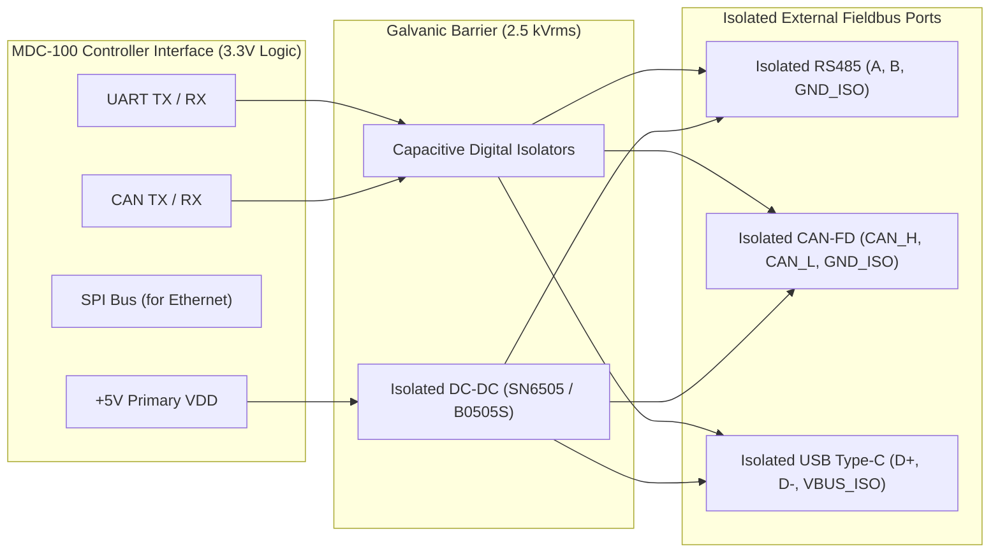

# Module Specification: MCM-100 Communication Interface Module

**Document ID:** MPECL-MOD-MCM-100-001  
**Revision:** v1.0-DRAFT  
**Status:** APPROVED FOR DESIGN  
**Target Organization:** Mendex Electronics LLP  
**Hardware Lead:** Communications & Embedded Systems Lead  

---

## 1. Purpose and Intended Applications
The **MCM-100 Communication Interface Module** is a standardized, galvanically isolated plug-in card that provides industrial fieldbus connectivity, laboratory automation interfaces, and telemetry links between Mendex power conversion products and external supervisory systems (PLCs, EV BMS, Mendex Studio).

**Intended Applications:**
- Industrial automation: Modbus RTU over isolated RS485 for PLC and SCADA integration.
- E-Mobility: Isolated CAN-FD interface for vehicle Battery Management Systems (BMS).
- Laboratory automation: Isolated USB-CDC and Ethernet for automated test benches and SCPI control.

---

## 2. Functional Requirements
1. **Isolated CAN-FD Transceiver:** Supporting up to $5.0\text{ Mbps}$ flexible data rate, compatible with ISO 11898-2:2016.
2. **Isolated RS485 Transceiver:** Half-duplex differential communication up to $500\text{ kbps}$ with fail-safe receiver biasing and 1/8-unit load (up to 256 nodes on bus).
3. **Isolated USB 2.0 Full-Speed Interface:** Hardware isolation allowing direct, safe connection to host PC/laptops without ground loops.
4. **Hardware Bus Termination:** On-board switchable $120\,\Omega$ termination resistors for CAN and RS485 lines via DIP switch or software control.
5. **Galvanic Isolation Barrier:** Withstand $\ge 2.5\text{ kV}_{RMS}$ (1 minute) with CMTI $\ge 50\text{ kV/}\mu\text{s}$.

---

## 3. Non-Functional Requirements
1. **ESD & Surge Protection:** $\pm 15\text{ kV}$ Air discharge, $\pm 8\text{ kV}$ Contact discharge on all external fieldbus terminals (IEC 61000-4-2).
2. **Operating Temperature:** $-40^\circ\text{C}$ to $+85^\circ\text{C}$ industrial ambient.
3. **Power Draw:** Total 5V supply consumption $\le 600\text{ mW}$ with all transceivers active.
4. **Form Factor:** Compact daughterboard ($50\text{ mm} \times 35\text{ mm}$) with polarized shrouded terminal blocks.

---

## 4. Proposed Architecture
MCM-100 contains dedicated isolated transceivers powered by an integrated isolated DC-DC converter (e.g., TI SN6505 driving a miniature toroidal transformer or all-in-one isolated transceiver ICs with integrated power). Digital logic lines connect directly to MDC-100 via a standardized 40-pin header.

---

## 5. Functional Block Diagram

---

## 6. Electrical Interface Requirements
- Logic supply: $+3.3\text{ V DC} \pm 5\%$ for logic side.
- Field power: Self-powered via on-board isolated DC-DC converter (no external field supply required).
- Terminal blocks: 3.81 mm pitch industrial screw or spring-cage terminal blocks (Phoenix Contact / Dinkle).

---

## 7. Mechanical Interface Considerations
- Plugs into motherboard via standard dual-row 0.1" (2.54 mm) header or right-angle board-to-board connector.
- Connectors accessible directly through the rear panel of the converter enclosure.

---

## 8. Hardware Component Options
- **Isolated CAN-FD Transceiver:** Texas Instruments ISO1042BDWR (5 kVrms isolation, 5 Mbps) or NXP TJA1052i.
- **Isolated RS485 Transceiver:** Analog Devices ADM2483BRWZ or Maxim/ADI MAX14840E.
- **USB Isolator:** Analog Devices ADuM4160 or TI ISOUSB211.
- **Isolated DC-DC:** Mornsun B0505S-1WR3 or discrete TI SN6505B + Wurth 760390015 transformer.

---

## 9. Firmware Dependencies
- Drivers integrated in MCC: `mpecl_comms_modbus.c` and `mpecl_comms_can.c`.
- Autonomous DMA circular buffers for UART and CAN-FD to avoid CPU loading.

---

## 10. Communication Interfaces
- Internal: 3.3V LVCMOS UART, CAN-FD controller signals.
- External: CAN-FD, RS485 (Modbus RTU), USB 2.0 Full Speed.

---

## 11. Safety Requirements
- Isolation barrier conforms to IEC 62368-1 reinforced insulation ($> 4.0\text{ mm}$ clearance on PCB).
- TVS arrays (e.g., Semtech SM712) protect RS485 lines from asymmetrical ground potential shifts ($-7\text{ V}$ to $+12\text{ V}$).

---

## 12. Supported Power and Voltage Classes
- Universal: Compatible with all MPECL power ratings ($100\text{ W}$ to $15\text{ kW}$).

---

## 13. Design Limitations
- USB 2.0 interface limited to Full Speed ($12\text{ Mbps}$); High-Speed ($480\text{ Mbps}$) requires specialized active isolators.
- Ethernet requires an optional secondary daughtercard variant (MCM-100-ETH) due to physical magnetic jack volume.

---

## 14. Reusability Assessment
- **Reuse Rating:** **100% DIRECTLY REUSABLE** across all converter products.

---

## 15. Simulation Approach
- Transmission line termination reflections, differential signal eye diagrams, and ESD clamp clamp-voltage simulated in SPICE / IBIS models.

---

## 16. Verification and Acceptance Criteria
1. CAN-FD communication error-free at $2.0\text{ Mbps}$ across a $40\text{ meter}$ terminated twisted pair.
2. RS485 communication verified across 32 nodes on a $1200\text{ meter}$ bus at $115.2\text{ kbps}$.
3. High-voltage isolation withstand verified at $2.5\text{ kV}_{RMS}$ for $60\text{ seconds}$.

---

## 17. Estimated Development Complexity
- **Complexity:** Low-Medium.
- **Key Challenge:** Layout isolation moats and ensuring zero copper plane crossover beneath the digital isolators.

---

## 18. Preliminary BOM Considerations
- Estimated BOM cost: **~\$4.50 - \$6.80 USD** (Fully populated with CAN-FD, RS485, and isolated DC-DC).

---

## 19. Risks and Dependencies
- **Risk:** Sourcing bottlenecks on integrated isolated transceivers (ISO1042 / ADM2483).  
  *Mitigation:* Layout supports discrete multi-channel digital isolator + standard non-isolated transceiver as second source.

---

## 20. Future Scalability
- Future roadmap (MCM-200) evaluates integrating Wi-Fi/Bluetooth (ESP32-C3 co-processor) and isolated Modbus TCP / EtherCAT for smart factory Industry 4.0 deployments.
