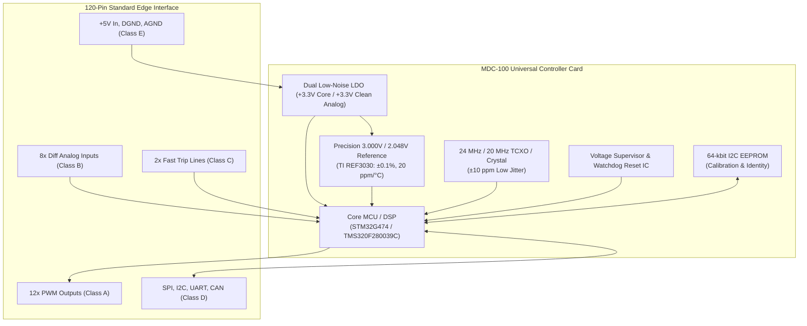

# Module Specification: MDC-100 Universal Digital Controller

**Document ID:** MPECL-MOD-MDC-100-001  
**Revision:** v1.0-DRAFT  
**Status:** APPROVED FOR DESIGN  
**Target Organization:** Mendex Electronics LLP  
**Hardware Lead:** Embedded Power Architect  

---

## 1. Purpose and Intended Applications
The **MDC-100 Universal Digital Controller** is a standardized plug-in control daughtercard designed to provide high-speed digital control loop execution, high-resolution PWM generation, multi-channel synchronized ADC sampling, and system supervisory management across all MPECL power conversion products.

**Intended Applications:**
- Tier 1: 100 W – 500 W Synchronous Buck and Boost Converters.
- Tier 2: 1 kW – 3 kW LLC Resonant and Phase-Shifted Full-Bridge Converters.
- Tier 3: 5 kW – 15 kW Dual Active Bridge and Bidirectional Battery Chargers.
- Programmable laboratory DC power supplies and solar MPPT string controllers.

---

## 2. Functional Requirements
1. **High-Resolution PWM Generation:** Minimum 6 complementary PWM pairs (12 outputs) with programmable dead-band insertion ($0\text{ to }2\,\mu\text{s}$ in $< 1\text{ ns}$ steps).
2. **Synchronized Multi-Channel ADC Sampling:** Minimum 8 simultaneous or high-speed sequential analog sampling channels synchronized to the PWM carrier midpoint with $\le 500\text{ ns}$ total conversion latency.
3. **Hardware Trip Zone (Fault Latch):** Asynchronous hardware trip input capable of forcing all PWM outputs to a safe passive state in $< 50\text{ ns}$ from silicon trip pin assertion.
4. **Digital Compensator Execution:** Capable of executing a dual-loop cascaded 2P2Z/3P3Z difference equation within $\le 2.5\,\mu\text{s}$ per switching period.
5. **Non-Volatile Calibration & Parameter Storage:** Integrated I2C/SPI EEPROM (minimum 64 kbit) for storing factory calibration coefficients, board serial number, and fault logs.

---

## 3. Non-Functional Requirements
1. **Clock Jitter:** System clock phase jitter $< 50\text{ ps}$ RMS to ensure stability of high-resolution delay lines.
2. **Operating Temperature:** Industrial $-40^\circ\text{C}$ to $+85^\circ\text{C}$ ambient.
3. **Form Factor:** Compact daughterboard ($\le 65\text{ mm} \times 40\text{ mm}$) with standardized card-edge or dual-row header.
4. **Power Consumption:** Total 3.3V logic supply consumption $\le 450\text{ mW}$ at maximum clock frequency.
5. **ESD Immunity:** Minimum $\pm 4\text{ kV}$ contact discharge on all exposed connector pins (IEC 61000-4-2).

---

## 4. Proposed Architecture
MDC-100 employs a dual-variant pin-compatible architecture:
- **Variant A (MDC-100-ST):** STMicroelectronics STM32G474RET6 (ARM Cortex-M4F @ 170 MHz, 184 ps HRTIM, 4x 4 MSPS ADCs).
- **Variant B (MDC-100-TI):** Texas Instruments TMS320F280039CPN (C28x 32-bit DSP @ 120 MHz + CLA, 150 ps HRPWM, 3x 3.45 MSPS ADCs).
Both variants map to the identical standardized 120-pin MCMIS edge connector pinout.

---

## 5. Functional Block Diagram

---

## 6. Electrical Interface Requirements
- **Primary Power Input:** $+5.0\text{ V DC} \pm 5\%$ supplied from motherboard (MAP-100).
- **Internal Regulated Voltages:** $+3.3\text{ V DC}$ (Digital Core) and $+3.3\text{ V DC}$ (Analog VDD filtered).
- **PWM Outputs:** 3.3 V LVCMOS with $22\,\Omega$ series termination resistors on-card to suppress transmission line ringing.
- **ADC Feedback Inputs:** $0\text{ to }3.000\text{ V}$ full-scale range; differential input impedance $\ge 100\text{ k}\Omega$; on-card anti-aliasing RC filter ($R = 100\,\Omega, C = 1\text{ nF}, f_c \approx 1.6\text{ MHz}$).
- **Trip Zone Inputs:** Active-low, internally pulled up to 3.3 V via $2.2\text{ k}\Omega$; compatible with open-drain comparator outputs.

---

## 7. Mechanical Interface Considerations
- **Dimensions:** $65.0\text{ mm} \times 40.0\text{ mm} \times 1.6\text{ mm}$ (4-layer FR4, $1\text{ oz}$ copper).
- **Connector Type:** 120-pin $0.8\text{ mm}$ pitch edge connector (compatible with standard PCIe or Samtec MEC8 series).
- **Retention:** Dual M2.5 nylon/brass mounting standoffs on opposite corners to prevent fretting corrosion under industrial vibration.

---

## 8. Hardware Component Options
- **MCU Option 1 (Target A):** STM32G474RET6 (64-pin LQFP, readily stocked across Indian distributors).
- **MCU Option 2 (Target B):** TMS320F280039CPN (64-pin LQFP, industrial grade).
- **Voltage Reference:** TI REF3030AIDBZR or Microchip MCP1501-30E.
- **EEPROM:** Microchip 24CW640T-I/OT or ST M24C64.
- **Voltage Supervisor:** TI TPS3823-33DBVR (with integrated $200\text{ ms}$ watchdog).

---

## 9. Firmware Dependencies
- **HAL Layer:** Implemented in `mpecl_hal_stm32g4.c` or `mpecl_hal_c2000.c`.
- **Interrupt Vectors:** High-priority ADC ISR mapped to Vector 1; Trip Zone mapped to Vector 0.
- **Math Library:** ARM CMSIS-DSP (for Variant A) or TI IQmath / TMU (for Variant B).

---

## 10. Communication Interfaces
- 1x High-speed SPI ($40\text{ MHz}$) for external isolated high-resolution telemetry.
- 1x I2C ($400\text{ kHz}$) shared with on-board EEPROM and external MHM-100 panel.
- 1x Full-duplex UART ($115.2\text{ kbps} - 921.6\text{ kbps}$) routed to MCM-100.
- 1x CAN-FD controller routed to MCM-100 transceiver.

---

## 11. Safety Requirements
- **Failsafe Tri-State:** In the event of brownout ($V_{DD} < 2.9\text{ V}$) or reset, internal pull-down resistors on all PWM lines ensure that high-side and low-side power switches remain hard OFF.
- **Watchdog Timer:** Independent hardware watchdog must reset MCU within $200\text{ ms}$ if firmware task loop hangs.

---

## 12. Supported Power and Voltage Classes
- Fully decoupled from power voltage. Supports all power levels ($100\text{ W}$ to $15\text{ kW}$) provided the motherboard scales analog feedback to the standard $0 - 3.0\text{ V}$ range.

---

## 13. Design Limitations
- Not suitable for ultra-high-frequency GaN applications operating above $1.5\text{ MHz}$ (due to controller loop execution budget and timer quantization).
- Board-edge connector requires gold flash ($\ge 30\,\mu\text{in}$ Au over Ni) to prevent contact oxidation over 10-year service life.

---

## 14. Reusability Assessment
- **Reuse Rating:** **100% DIRECTLY REUSABLE** across all converter topologies.
- Standardized pinout enables software re-targeting with zero PCB changes.

---

## 15. Simulation Approach
- Behavioral simulation of ADC sampling and discrete 2P2Z compensators performed in Python (NumPy/SciPy) and LTspice behavioral voltage sources ($B\text{-elements}$).
- HRTIM timer jitter and quantization verified using vendor cycle-accurate simulators.

---

## 16. Verification and Acceptance Criteria
1. PWM complementary dead-time verified on 1 GHz oscilloscope with jitter $< 200\text{ ps}$.
2. Trip zone latency measured from trip pin edge to PWM output low: **$< 45\text{ ns}$**.
3. ADC sampling effective number of bits (ENOB) measured $\ge 10.5\text{ bits}$ at $100\text{ kHz}$.
4. Continuous 72-hour thermal soak at $85^\circ\text{C}$ in environmental chamber with zero watchdog resets.

---

## 17. Estimated Development Complexity
- **Complexity:** Medium-High.
- **Key Challenge:** High-speed 4-layer PCB routing to ensure digital switching noise from MCU core does not couple into high-resolution analog ADC and voltage reference ground planes.

---

## 18. Preliminary BOM Considerations
- Estimated BOM cost at 1,000 unit volume in India: **~\$8.50 - \$11.00 USD** (Variant A) / **~\$10.50 - \$13.50 USD** (Variant B).
- All passive components selected in 0603/0805 packages for high-speed automated SMD pick-and-place assembly.

---

## 19. Risks and Dependencies
- **Risk 1:** Semiconductor lead times for TI C2000 family during global supply chain crunches.  
  *Mitigation:* Dual-sourcing strategy with STM32G4 variant as primary high-volume path.
- **Risk 2:** Signal degradation across edge connector pins in dirty/vibrational environments.  
  *Mitigation:* Conformal coating on card surfaces and gold-plated retention connectors.

---

## 20. Future Scalability
- Future revision (MDC-200) roadmap targets dual-core ARM Cortex-M7 / C2000 multi-core DSPs for complex 3-phase grid-tied central inverters ($> 50\text{ kW}$) using an extended pin-compatible connector.
