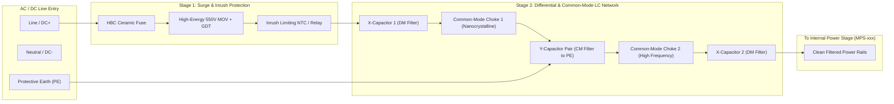

# Module Specification: MEM-100 EMI/EMC Input Filter Subsystem

**Document ID:** MPECL-MOD-MEM-100-001  
**Revision:** v1.0-DRAFT  
**Status:** APPROVED FOR DESIGN  
**Target Organization:** Mendex Electronics LLP  
**Hardware Lead:** EMC & Power Quality Lead  

---

## 1. Purpose and Intended Applications
The **MEM-100 EMI/EMC Filter Subsystem** is a standardized electromagnetic interference suppression design IP block positioned at the AC mains or DC bus entry. It suppresses differential-mode (DM) and common-mode (CM) conducted noise generated by fast semiconductor switching ($dv/dt > 50\text{ V/ns}$), ensuring compliance with **CISPR 32 / EN 55032 Class A (Industrial)** and **Class B (Residential/Commercial)** limits.

**Intended Applications:**
- Front-end power filter for all MPECL power converters ($100\text{ W}$ to $15\text{ kW}$).
- Suppression of grid-borne voltage surges, lightning transients, and burst interference.

---

## 2. Functional Requirements
1. **Conducted Emissions Attenuation:** Minimum $40\text{ dB}$ differential-mode and $50\text{ dB}$ common-mode attenuation across the critical $150\text{ kHz}$ to $30\text{ MHz}$ frequency spectrum.
2. **Surge Withstand (IEC 61000-4-5):** Suppress line-to-line surges up to $\pm 2\text{ kV}$ and line-to-earth surges up to $\pm 4\text{ kV}$.
3. **Earth Leakage Current Limit:** In accordance with IEC 62368-1, continuous touch leakage current drained to protective earth (PE) via Y-capacitors must be **$\le 3.5\text{ mA}$** for industrial equipment ($\le 0.75\text{ mA}$ for portable lab supplies).
4. **Active Discharge Circuit:** Integrated X-capacitor discharge network bleeds line voltage to $< 60\text{ V}$ within $\le 1.0\text{ second}$ of AC plug removal (preventing electric shock to operators).

---

## 3. Non-Functional Requirements
1. **Continuous Current Rating:** Configurable for $10\text{ A}$ (Tier 1), $25\text{ A}$ (Tier 2), or $60\text{ A}$ (Tier 3) continuous with temperature rise $\Delta T \le 30^\circ\text{C}$.
2. **Component Voltage Ratings:** X-capacitors rated $\ge 310\text{ VAC}$; Y-capacitors rated $\ge 400\text{ VAC}$ (Class Y1/Y2).
3. **Operating Temperature:** $-40^\circ\text{C}$ to $+105^\circ\text{C}$.

---

## 4. Proposed Architecture
MEM-100 implements a multi-stage Pi ($\pi$) filter network comprising high-permeability nanocrystalline or MnZn ferrite common-mode chokes, metallized polypropylene film X-capacitors, safety-certified ceramic Y-capacitors, and a high-energy metal-oxide varistor (MOV) + Gas Discharge Tube (GDT) surge stage.

---

## 5. Functional Block Diagram

---

## 6. Electrical Interface Requirements
- Input/Output power terminals: Rated for $\ge 150\%$ continuous rated current.
- Earth terminal: Low-inductance braided copper strap bonded directly to metal chassis.

---

## 7. Mechanical Interface Considerations
- Physical Format: **Design IP Block** located immediately adjacent to the chassis AC/DC power inlet socket.
- **Physical Isolation Rule:** A metal shield partition separates the filter input terminals from the noisy switching power stage to prevent radiated noise from bypassing the filter via capacitive coupling.

---

## 8. Hardware Component Options
- **Common-Mode Chokes:** Wurth WE-CMB series or Vacuumschmelze (VAC) Nanocrystalline toroidal chokes ($L_{cm} = 2.2\text{ mH} - 10\text{ mH}$).
- **X-Capacitors:** Kemet R46 / EPCOS B32922 series ($0.22\,\mu\text{F} - 1.0\,\mu\text{F}, 310\text{ VAC}$, Class X2).
- **Y-Capacitors:** Murata DE2 series or Vishay VY2 Class Y2 ceramic disc capacitors ($1.0\text{ nF} - 4.7\text{ nF}, 250\text{ VAC} / 400\text{ VAC}$).
- **Surge Suppressors:** Epcos / TDK S20K300 / S20K550 (20 mm high-energy varistors) paired with EPCOS 2-electrode GDTs.

---

## 9. Firmware Dependencies
- Purely passive hardware filter. Zero firmware dependency.

---

## 10. Communication Interfaces
- None (Passive power filter).

---

## 11. Safety Requirements
- **Safety Agency Certification:** All X and Y capacitors must carry certified UL/ENEC/VDE markings.
- **Discharge Resistor Redundancy:** Bleeder resistors must comprise at least two resistors in series (e.g., 2x $470\text{ k}\Omega$ in series) to maintain safety in the event of a single-component short circuit.

---

## 12. Supported Power and Voltage Classes
- Compatible with all voltage classes ($18\text{ V DC}$ up to $440\text{ VAC} / 800\text{ V DC}$).

---

## 13. Design Limitations
- Common-mode chokes suffer from saturation if differential-mode load current is excessive; chokes with controlled stray leakage inductance ($L_{leak} \approx 1\% - 2\%$ of $L_{cm}$) are selected to double as differential-mode chokes.

---

## 14. Reusability Assessment
- **Reuse Rating:** **REUSABLE WITH HARDWARE VARIANT (HV)** based on input voltage and current rating.

---

## 15. Simulation Approach
- Differential and common-mode insertion loss curves ($S_{21}$) simulated in LTspice across a $50\,\Omega$ LISN source and load model.

---

## 16. Verification and Acceptance Criteria
1. Conducted emissions measured below CISPR 32 Class A limit lines with minimum **$6\text{ dB}$ margin** across $150\text{ kHz} - 30\text{ MHz}$ in certified EMC chamber.
2. Earth leakage current measured $< 2.0\text{ mA}$ at $250\text{ VAC} / 50\text{ Hz}$.
3. Zero damage or component degradation after $10\text{ consecutive}$ surge pulses at $\pm 2\text{ kV}$ line-line and $\pm 4\text{ kV}$ line-earth.

---

## 17. Estimated Development Complexity
- **Complexity:** Medium.
- **Key Challenge:** Preventing magnetic core saturation under high line currents while fitting within chassis volumetric constraints.

---

## 18. Preliminary BOM Considerations
- Estimated BOM cost: **~\$3.80 - \$6.50 USD** (Tier 1/2) / **~\$12.00 - \$18.00 USD** (Tier 3 high-power nanocrystalline).

---

## 19. Risks and Dependencies
- **Risk:** High-frequency parasitic inter-winding capacitance across common-mode chokes reducing attenuation above $10\text{ MHz}$.  
  *Mitigation:* Utilize single-layer sector-wound chokes with physical plastic separators.

---

## 20. Future Scalability
- Future roadmap (MEM-200) evaluates active EMI filtering (AEF) using op-amp phase-inversion circuits to reduce passive choke volume by up to $50\%$.
