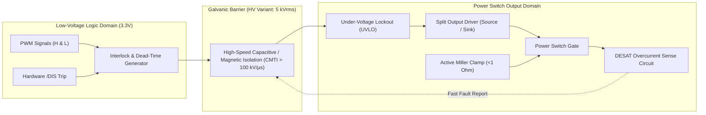

# Module Specification: MGD-100 MOSFET & SiC Gate Driver Subsystem

**Document ID:** MPECL-MOD-MGD-100-001  
**Revision:** v1.0-DRAFT  
**Status:** APPROVED FOR DESIGN  
**Target Organization:** Mendex Electronics LLP  
**Hardware Lead:** Power Semiconductor Lead  

---

## 1. Purpose and Intended Applications
The **MGD-100 Gate Driver Subsystem** is a standardized, high-performance gate driver design IP block that provides fast, low-impedance gate switching, robust dead-time control, and shoot-through protection for power MOSFETs, SiC MOSFETs, and GaN devices.

**Intended Applications:**
- High-side and low-side power switches in Synchronous Buck, Boost, and Half-Bridge converters.
- Dual-leg and H-bridge inverters in LLC Resonant, Phase-Shifted Full-Bridge (PSFB), and Dual Active Bridge (DAB) topologies.

---

## 2. Functional Requirements
1. **Peak Output Current:** Capable of delivering $\ge 4.0\text{ A}$ peak source current and $\ge 4.0\text{ A}$ peak sink current to minimize switching transition time ($t_{sw} < 25\text{ ns}$).
2. **Propagation Delay & Matching:** Total propagation delay $\le 50\text{ ns}$ with channel-to-channel matching skew $\le 5\text{ ns}$ to prevent duty-cycle distortion.
3. **Shoot-Through Protection & Hardware Dead-Time:** Cross-conduction prevention logic ensuring high-side and low-side switches cannot turn on simultaneously.
4. **Desaturation (DESAT) Protection (HV Variant):** Continuous monitoring of switch $V_{DS(on)}$ during conduction; triggers hardware shutdown in $< 1.5\,\mu\text{s}$ upon short-circuit fault.
5. **Active Miller Clamp (HV Variant):** Low-impedance sink pin active when gate voltage drops below $2.0\text{ V}$, suppressing parasitic $C_{gd} \cdot \frac{dv}{dt}$ induced false turn-on.

---

## 3. Non-Functional Requirements
1. **Common-Mode Transient Immunity (CMTI):** Minimum $\ge 100\text{ kV/}\mu\text{s}$ (HV Isolated Variant) to withstand high $dv/dt$ in SiC power circuits.
2. **Gate Loop Inductance:** Parasitic layout inductance constrained to $\le 3\text{ nH}$.
3. **Isolation Rating (HV Variant):** Minimum $5.0\text{ kV}_{RMS}$ reinforced galvanic isolation (conforming to IEC 62368-1).
4. **Operating Temperature:** $-40^\circ\text{C}$ to $+125^\circ\text{C}$ junction temperature.

---

## 4. Proposed Architecture
To satisfy cost constraints in Tier 1 while meeting high-voltage isolation requirements in Tiers 2 & 3, MGD-100 is engineered as two standardized schematic IP blocks:
- **MGD-100-LV (Low-Voltage Non-Isolated):** Integrated half-bridge bootstrap driver for systems up to $100\text{ V DC}$.
- **MGD-100-HV (High-Voltage Isolated):** Dual-channel reinforced galvanically isolated driver with split-rail bipolar gate bias ($+18\text{ V} / -4\text{ V}$) for SiC MOSFETs up to $1000\text{ V DC}$.

---

## 5. Functional Block Diagram

---

## 6. Electrical Interface Requirements
- **Logic Input:** 3.3 V LVCMOS compatible ($V_{IH} \ge 2.0\text{ V}, V_{IL} \le 0.8\text{ V}$).
- **Supply Voltage (LV Variant):** $+12.0\text{ V DC} \pm 10\%$ unipolar.
- **Supply Voltage (HV Variant):** $+18.0\text{ V DC}$ positive rail, $-4.0\text{ V DC}$ negative turn-off rail (provided by MAP-100 isolated DC-DC).
- **Bootstrap Diode (LV Variant):** Fast recovery ($t_{rr} < 25\text{ ns}$) or Silicon Carbide Schottky diode rated for $V_{in,max} \times 1.5$.

---

## 7. Mechanical Interface Considerations
- **Physical Format:** **Design IP Block (Hierarchical Schematic & Layout Block).**
- **Physical Placement Rule:** MGD-100 **must never be implemented as a plug-in connectorized daughtercard**. It must be routed directly onto the power motherboard within **$\le 15\text{ mm}$** of the power semiconductor terminals to minimize gate loop inductance.

---

## 8. Hardware Component Options
- **LV Variant IC:** Texas Instruments UCC27282DR (120 V, 3 A, high-speed half-bridge) or Diodes Inc DGD05473.
- **HV Variant IC:** Texas Instruments UCC21520DW / UCC21710DW (5.7 kVrms isolated dual driver with DESAT) or Skyworks Si8239x.
- **Gate Resistors:** High-pulse thick-film MELF or 1206 resistors ($R_{g,on} = 2.2\,\Omega - 10\,\Omega, R_{g,off} = 1.0\,\Omega - 4.7\,\Omega$).
- **Anti-Parallel Diode:** Fast Schottky (e.g., BAS3010) across $R_{g,on}$ to provide independent turn-on and turn-off slew rates.

---

## 9. Firmware Dependencies
- MDC-100 timer dead-band register configuration ($t_{dead}$ calculated based on switch $Q_g$ and driver output resistance).
- Firmware trip zone interrupt linked to MGD-100 fault reporting pin.

---

## 10. Communication Interfaces
- Hardware discrete pins: `PWM_H`, `PWM_L`, `/DIS_TRIP`, `/FAULT_OUT`. Zero software bus latency.

---

## 11. Safety Requirements
- **UVLO (Undervoltage Lockout):** Gate driver must remain clamped low until gate supply voltage exceeds $V_{UVLO,on} \ge 10.5\text{ V}$ (for Si) or $\ge 14.5\text{ V}$ (for SiC), preventing operation in the linear resistive region.
- **Negative Gate Bias:** HV variant applies $-4\text{ V}$ gate bias during the off-state to guarantee noise immunity against induced $C_{gd} \cdot \frac{dv}{dt}$ turn-on.

---

## 12. Supported Power and Voltage Classes
- **MGD-100-LV:** Up to $100\text{ V DC}$ bus, $100\text{ W} - 1\text{ kW}$ power converters.
- **MGD-100-HV:** Up to $1000\text{ V DC}$ bus, $1\text{ kW} - 15\text{ kW}$ power converters.

---

## 13. Design Limitations
- Bootstrap circuit (LV variant) cannot operate at $100\%$ continuous DC duty cycle; requires periodic low-side conduction to recharge the bootstrap capacitor.
- HV variant requires dedicated isolated auxiliary power supplies for each high-side driver node.

---

## 14. Reusability Assessment
- **Reuse Rating:** **REUSABLE WITH HARDWARE VARIANT (HV)**.
- LV products share MGD-100-LV across 100% of designs. HV products share MGD-100-HV.

---

## 15. Simulation Approach
- Driver propagation delays, gate charging curves, and parasitic trace inductance ringing ($L_{gate} \cdot \frac{di}{dt}$) simulated in LTspice using manufacturer unencrypted SPICE subcircuits.

---

## 16. Verification and Acceptance Criteria
1. Gate rise time $t_r \le 25\text{ ns}$ and fall time $t_f \le 20\text{ ns}$ measured at rated switch capacitive load.
2. Zero cross-conduction shoot-through verified under maximum ambient temperature ($85^\circ\text{C}$).
3. DESAT short-circuit trip latency measured $\le 1.2\,\mu\text{s}$ upon hard-switched short-circuit event.

---

## 17. Estimated Development Complexity
- **Complexity:** Medium.
- **Key Challenge:** Controlling parasitic inductive coupling between power switching loop and gate drive return loop (Kelvin source layout).

---

## 18. Preliminary BOM Considerations
- MGD-100-LV BOM cost: **~\$0.75 - \$1.20 USD** per half-bridge channel.
- MGD-100-HV BOM cost: **~\$3.50 - \$5.20 USD** per isolated half-bridge channel (including isolated DC-DC bias).

---

## 19. Risks and Dependencies
- **Risk:** High $dv/dt$ transient coupling across isolation barrier disrupting logic inputs.  
  *Mitigation:* Select driver ICs with verified CMTI $\ge 100\text{ kV/}\mu\text{s}$ and implement common-mode chokes on logic lines.

---

## 20. Future Scalability
- Future roadmap (MGD-200) targets integrated smart gate drivers with real-time temperature reporting, slew-rate adjustability via SPI, and on-chip state-of-health monitoring.
